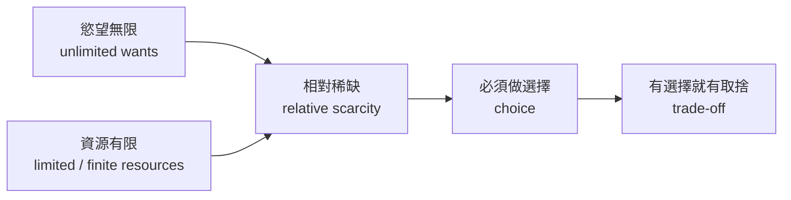

# 01 經濟學是什麼？(What is Economics?)

> **本課資料來源**：`Why_Study_Economics.pptx`、`Lesson_1_Introduction_to_Economics.pptx`（第 1–10 頁）、`Chapter_1.1-1.2.docx`（1.1 節）、`Introduction_to_Economics_eBook.epub`
> **建議時間**：70–90 分鐘

## 本課學完，你要會：

- [ ] 說出 3 個「為什麼要學經濟學」的理由
- [ ] 用英文寫出 **Economics** 和 **Relative scarcity** 的定義
- [ ] 分辨 **需要 (needs)** 和 **想要 (wants)**、**商品 (goods)** 和 **服務 (services)**
- [ ] 說出 **三個基本經濟問題 (What, How, For whom)**
- [ ] 判斷一個問題屬於 **個體經濟學 (microeconomics)** 還是 **總體經濟學 (macroeconomics)**

---

## 1. 為什麼要學經濟學？(Why study Economics?)

### 白話解釋
經濟學不是「教你怎麼賺錢」的學問，而是「教你**看懂**世界怎麼運作、**做出更好選擇**」的學問。

### 課程投影片的四個理由（`Why_Study_Economics.pptx` 第 2 頁）

| 英文原文 | 中文意思 |
|---|---|
| You will be able to make better decisions as a consumer, worker, investor and citizen of your country and the world. | 你能以消費者、工作者、投資者、公民的身分做更好的決定 |
| Economic literacy also gives people the tools for understanding the world around them; and how to interpret events that will either directly or indirectly affect them. | 經濟知識讓你看懂身邊的世界，理解那些直接或間接影響你的事件 |
| Nations benefit from having an economically educated population … Educated populations can make better decisions (when voting) about who should form the Government. | 國民懂經濟，國家也受益：大家更能理解重要議題，投票時做更好的決定 |
| Research shows that Economics graduates have excellent career prospects … | 經濟學畢業生的就業前景很好 |

### 經濟學能回答哪些問題？（`Why_Study_Economics.pptx` 第 3–10 頁、`Lesson_1` 第 3 頁）

下面這些問題，課程都拿來當例子。你**現在不需要會答**，先知道「原來這些都是經濟學問題」，之後的課會一個一個學到：

| 問題 | 之後會用到的經濟學工具（預告） |
|---|---|
| Why do sports players get paid more than nurses?（為什麼運動員賺得比護士多？） | 工資也是一種「價格」，由勞動的**需求和供給**決定，不是由「這份工作有多重要」決定（`07` 課的需求與供給） |
| What makes prices of petrol go up and down?（油價為什麼會漲跌？） | 石油的需求和供給改變（`07` 課） |
| What are the causes and effects of changing currency exchange rates?（匯率為什麼會變？） | Unit 2 總體經濟學 |
| Why do people protest about governments?（人們為什麼抗議政府？） | 政府政策會影響每個人的生活（Unit 1 的政府介入、Unit 2 的政策） |
| Why are some countries rich and some countries poor?（為什麼有的國家富、有的國家窮？） | 資源、生產力、經濟成長（`06` 課的 PPF 外移、Unit 2） |
| What causes recessions?（經濟衰退的原因是什麼？） | Unit 2 總體經濟學 |
| Climate change, poverty, the spread of disease, air pollution（氣候變遷、貧窮、疾病傳播、空氣污染） | 這些是經濟學能幫忙**解決**的問題，之後會學到「市場失靈 (market failure)」和政府介入 |

> 💡 投影片最後一頁說：*"This presentation provides only a brief introduction to the types of issues and dilemmas that Economics can help with."* 意思是：這些只是開胃菜，經濟學能處理的問題非常多。

---

## 2. 經濟學的定義 (Definition of Economics)

### 白話解釋
**經濟學 = 研究「東西不夠用的時候，人們怎麼做選擇」的學問。**

### 生活例子
你這個月的生活費只有 ¥2,000。你想喝奶茶、想買新耳機、想週末和朋友吃火鍋、還要買課本……錢不夠全部都買。
你怎麼決定錢要花在哪裡？——**這個「做決定」的過程，就是經濟學研究的東西。**
時間也一樣：一天只有 24 小時，要讀書、睡覺、打遊戲、運動，你怎麼分配？

### 課程的英文定義（請背下來）
> **Economics** is the study of how individuals and societies make decisions to maximise the use of scarce resources.

> Economics is the study of human behaviour. Since it uses scientific methods, it is called a **social science**. We study human behaviour to better understand and improve our world.

### 拆解定義裡的關鍵字

| 關鍵字 | 意思 |
|---|---|
| individuals and societies | 個人和整個社會（國家）都要做決定 |
| make decisions | 經濟學的核心是「選擇」 |
| maximise the use of | 把有限的東西用到最好、得到最大好處 |
| scarce resources | **稀缺的資源**：不夠滿足所有慾望的資源 |
| **社會科學 (social science)** | 研究「人的行為」的科學。它用科學方法（觀察、資料、模型），但研究對象是人，所以叫社會科學（物理、化學則是自然科學） |

---

## 3. 基本經濟問題：相對稀缺 (The basic economic problem: Relative scarcity)

### 白話解釋
人想要的東西**永遠比**能拿來滿足它們的資源**多**。這就是所有經濟問題的根源。
「**相對**」兩個字很重要：意思是資源是**和人的慾望相比**才顯得不夠，不是說資源本身很少。

### 生活例子
- 一個學生有 ¥2,000 生活費，想要的東西值 ¥5,000 → 稀缺。
- 一個億萬富翁錢很多，但**一天也只有 24 小時**，他想做的事情做不完 → **時間**對他來說也是稀缺的。
- 所以：**每個人、每間公司、每個國家都面對稀缺**，富人和富國也不例外。

### 課程的英文定義（請背下來）
> The study of Economics seeks to solve (or minimise) the basic economic problem: **Relative scarcity**.
>
> **Relative scarcity** can be defined as *'the condition in which human **needs** and **wants** are forever greater than the **resources** available to satisfy them'*.

課堂投影片（`Lesson_1` 第 5 頁）的說法：
> The economic problem is **Scarce Resources** in relation to **Unlimited Wants**.

### 3.1 資源有限 (Limited resources)（`Lesson_1` 第 6 頁）
- 地球上的工人、機器、土地、石油和其他天然資源都是**有限的 (finite)**。
- 因為資源有限，我們**不可能生產無限多**的商品和服務。
- 人口不斷增加、生產越來越多，可能**破壞地球的天然資源 (natural resources)**。
- 這關係到**長期永續性 (long-term sustainability)**，也會影響未來的生活水準 (living standards) 和生活品質。

### 3.2 慾望無限 (Unlimited wants)（`Lesson_1` 第 7 頁）
- 人總是想要更好的食物、房子、交通、教育、醫療、最新的科技產品、更多外食、更多出國旅遊、更多休閒時間……
- *"Economic resources are limited, but human needs and wants are infinite."*
- 社會的發展，可以說就是**不斷發現新的需要和想要**的過程（例如 20 年前沒人「需要」手機充電寶，現在很多人覺得少不了）。



---

## 4. 需要 (needs) vs 想要 (wants)

### 白話解釋
- **需要 (needs)**：沒有它就**活不下去**的東西。
- **想要 (wants)**：沒有也能活，但有了會讓生活**更舒服、更快樂**的東西。

### 課程的英文定義
> **'Wants'** (desires) are distinguished from **'needs'** in that needs relate to things necessary for survival, and wants merely improve our standards of living, comfort or happiness.
>
> For example, consumers have a **need** for products such as food and water, but they also might **want** mobile phones and holidays, which are not necessary for survival.

### 例子對照表

| 需要 (needs) — 生存必需 | 想要 (wants) — 提升生活 |
|---|---|
| 飲用水 | 進口瓶裝氣泡水 |
| 基本的食物（米飯、蔬菜） | 奶茶、火鍋、蛋糕 |
| 住的地方（宿舍） | 有海景的大房間 |
| 保暖的衣服 | 名牌外套 |
| 基本醫療 | 美容療程 |
| — | 手機、遊戲機、出國旅行 |

> ⚠️ **注意**：同一類東西可以有「需要」的部分和「想要」的部分。「吃飯」是需要，但「吃 ¥300 的牛排」中，多出來的享受是想要。**作業或測驗舉例時，選最明確的例子**（水、食物 vs 手機、旅行），不要選有爭議的。

---

## 5. 產品、商品與服務 (Products, goods and services)

### 白話解釋
- **產品 (product)**：任何能滿足人們需要或想要的東西。分成兩種：
  - **商品 (goods)**：看得到、**摸得到**的實體東西。
  - **服務 (services)**：別人**幫你做的事**，摸不到。

### 課程的英文定義
> A **product** is anything that can be offered to consumers (people) to satisfy their desires or needs. Products provide benefits, and people are usually willing to pay for them. A product can be classified as either a good or a service.
>
> **Goods** are physical objects that provide benefits to consumers. We usually buy goods from businesses that produce them — examples: laptop computers, cars, and bread.
>
> **Services** are actions that benefit consumers, such as helping, repairing, creating, or performing any other useful tasks. We usually pay a business to perform a service for us — examples include legal advice, bicycle repair, and manicures.

### 快速判斷法：「我摸得到它嗎？」

| 東西 | 商品還是服務？ | 為什麼 |
|---|---|---|
| 一杯奶茶 | 商品 (good) | 實體的，可以拿在手上 |
| 外賣員幫你送奶茶 | 服務 (service) | 「送」是一個動作 |
| 課本 | 商品 | 實體的 |
| 老師上課教你 | 服務 | 「教」是一個動作 |
| 理髮 | 服務 | 課本的例子 haircut / manicure |
| 腳踏車 | 商品 | 實體的 |
| 修腳踏車 | 服務 | 課本例子 bicycle repair |

---

## 6. 稀缺 → 選擇 → 取捨 (Scarcity, choice and trade-off)

### 白話解釋
因為東西不夠，所以**一定要選**；選了 A，就**得放棄**一些 B。這個「放棄」叫做**取捨 (trade-off)**。

### 課程投影片（`Lesson_1` 第 8 頁）
> Because of scarcity, **choices** have to be made on a daily basis by all consumers, firms and governments.
>
> Making a choice normally involves a **trade-off** — in simple terms, choosing more of one thing means giving up something else in exchange. Because wants are unlimited but resources are finite, choice is an unavoidable issue in economics.

### 三種「做選擇的人」

| 誰 | 稀缺的是什麼 | 要做的選擇（例子） |
|---|---|---|
| 消費者 (consumers) | 錢、時間 | 這 ¥50 買奶茶還是買文具？ |
| 公司 (firms) | 工人、機器、資金、土地 | 工廠今年多做桌子還是多做椅子？ |
| 政府 (governments) | 稅收、土地、人力 | 預算多給醫院還是多給學校？ |

👉 「放棄掉的那個最好的選擇」有一個專有名詞——**機會成本 (opportunity cost)**，`03` 課會詳細教。

---

## 7. 三個基本經濟問題 (The three basic economic questions)

### 白話解釋
資源有限，所以每個社會都必須回答三個問題。回答這三個問題，就是在做**資源分配 (resource allocation)**——決定有限的資源要用在哪裡、怎麼用、給誰。

### 課程投影片（`Lesson_1` 第 9 頁）

| 問題 | 英文原文 | 白話 |
|---|---|---|
| **生產什麼？** (What to produce) | What goods and services should an economy produce? What quantities? – should the emphasis be on agriculture, manufacturing or services, should it be on sport and leisure or housing? | 要做哪些東西？各做多少？ |
| **如何生產？** (How to produce) | How should goods and services be produced? – labour intensive, land intensive, capital intensive? Efficiency? | 用很多人手做（勞動密集 labour intensive）？還是用很多機器做（資本密集 capital intensive）？怎樣最有效率？ |
| **為誰生產？** (For whom to produce) | Who should get the goods and services produced? – even distribution? more for the rich? for those who work hard? | 做出來的東西分給誰？平均分？有錢人多拿？努力的人多拿？ |

### 生活例子：學校餐廳
- **生產什麼**：今天賣麵還是賣飯？各準備幾份？
- **如何生產**：請 5 個廚師手工做（勞動密集），還是買一台自動炒菜機只請 1 個人（資本密集）？
- **為誰生產**：先到先得？老師優先？用飯卡補貼經濟困難的同學？

### 生產過程 (Production process)（`Lesson_1` 第 10 頁）

```
  +----------------------------+          +--------------------------+
  |  Resources (inputs)        |   ===>   |  Outputs                 |
  |  land, people, machines    |          |  goods and services      |
  |  and ideas                 |          |                          |
  +----------------------------+          +--------------------------+
```

資源（土地、人、機器、點子）**投入 (input)** → 生產出 **產出 (output)**：商品和服務。資源的四大類叫**生產要素 (factors of production)**，`02` 課詳細教。

---

## 8. 個體經濟學 vs 總體經濟學 (Microeconomics vs Macroeconomics)

### 白話解釋
- **個體經濟學**：看「**樹**」——一個人、一個家庭、一間公司、一個市場怎麼做決定。
- **總體經濟學**：看「**森林**」——整個國家的經濟表現好不好。

（大陸常把它們叫做「**微觀**經濟學」和「**宏觀**經濟學」，是同一個意思。）

### 課程的英文定義（請背下來）
> **Microeconomics** is the branch of economics that studies decision making by individuals, households and firms in a specific industry sector or market.
>
> **Macroeconomics** is the branch of economics that studies decision making for the economy as a whole. It is concerned with the influences on national spending, output, income, employment and overall living standards.

課堂投影片（`Lesson_1` 第 4 頁）的簡短版：
> Microeconomics: The study of individual decision-making units within an economy. (Market theory, Individual demand, Firms and supply)
> Macroeconomics: The study of the economy as a whole. (Inflation, Unemployment, The growth rate of the economy, International trade)

### 課本的總結句（課本小組討論第 6 題就是要你找這句）
> Macroeconomics is the study of the 'big picture' of what is happening in an economy (usually a whole country's performance is studied), whereas Microeconomics studies the small parts (people, firms, markets) that make up a larger economy.

### 個體經濟學研究什麼？
1. **個人和家庭的選擇**：錢怎麼花、時間怎麼用、在哪裡工作、要不要投資……
2. **公司的選擇**：生產什麼、怎麼生產（用哪些資源、怎麼組合）、怎麼賣、定什麼價格。
   - 課本例子：一家**披薩店 (pizza parlour)** 需要：披薩原料（來自土地/天然資源）、店面（土地）、披薩烤爐（資本）、廚師和店員（勞動）。付給這些資源的錢變成提供者的收入；如果賣披薩的收入大於成本，老闆就有**利潤 (profit)**。
3. **市場怎麼運作**（`07` 課的需求、供給、均衡）。
4. **政府介入**如何影響個人和公司，進而影響價格、產量、工資等（例如對香菸課稅）。

### 總體經濟學研究什麼？
一個國家的：失業率 (unemployment rate)、物價上漲／通貨膨脹 (inflation)、政府支出 (government spending)、經濟成長率 (growth rate)、國際貿易 (international trade)、匯率 (exchange rate) 波動對經濟的影響。

### 對照表

| | 個體經濟學 Microeconomics | 總體經濟學 Macroeconomics |
|---|---|---|
| 看什麼 | 樹：個人、家庭、公司、單一市場 | 森林：整個經濟（通常是一個國家） |
| 典型問題 | 奶茶店該定價多少？豬肉價格為什麼上漲？ | 中國今年經濟成長多少？為什麼失業率上升？ |
| 課程單元 | Unit 1 (MUF0061) | Unit 2 (MUF0062) |

---

## 常見錯誤

1. ❌ 把「稀缺 (scarcity)」理解成「稀有」或「貧窮」。
   ✅ 稀缺是指**資源和慾望相比不夠**。有錢人、有錢國家也面對稀缺（例如時間）。
2. ❌ 寫定義時漏掉 **relative** 或 **forever greater**。
   ✅ 完整寫：*the condition in which human needs and wants are forever greater than the resources available to satisfy them.*
3. ❌ 以為「只要跟政府有關就是總體經濟學」。
   ✅ 政府對**某一個市場**的介入（例如對香菸課稅、對某種農產品補貼）屬於**個體**經濟學；課本明說 *"Microeconomics also considers how government interventions can influence people and firms"*。政府的**整體**財政預算、全國利率才是總體。
4. ❌ 以為「大公司」就是總體經濟學。
   ✅ 再大的公司（例如 Apple）也只是**一間公司**，研究它的決定是**個體**經濟學。
5. ❌ needs 和 wants 舉有爭議的例子（例如「手機是需要」）。
   ✅ 作業和測驗裡選最明確的例子：needs = food, water, shelter；wants = mobile phones, holidays。

---

## 自我檢查

**Q1.** 用英文寫出 *relative scarcity* 的定義，並用一句中文說明「relative（相對）」是什麼意思。

**Q2.** 下面哪些是商品 (good)，哪些是服務 (service)？
(a) 一本經濟學課本 (b) 牙醫幫你補牙 (c) 一台筆電 (d) 網約車司機載你去學校 (e) 一雙鞋

**Q3.** 判斷下面每一題屬於 microeconomics 還是 macroeconomics：
(a) 一家奶茶店決定要不要漲價
(b) 全國失業率從 5% 升到 6%
(c) 一個學生決定要打工還是讀書
(d) 政府對香菸加稅後，香菸的銷量怎麼變
(e) 全國的物價水準（通膨率）上升
(f) 一個國家的人民幣匯率下跌對出口的影響

**Q4.** 一個國家決定「多用機器人、少用工人」來生產汽車。這是在回答三個基本經濟問題中的哪一個？

**Q5.** 課本小組討論題：(1) What does the word 'scarcity' mean? (2) What types of decisions do individuals need to make? (3) What types of decisions do firms need to make?

<details>
<summary>👉 點我看答案</summary>

**A1.** *Relative scarcity is the condition in which human needs and wants are forever greater than the resources available to satisfy them.*
「相對」的意思是：資源是**和人的需要、想要相比**才不夠，並不是說資源本身絕對很少。

**A2.** 商品：(a)、(c)、(e)；服務：(b)、(d)。判斷法：摸得到的實體物品是商品，別人幫你做的動作是服務。

**A3.** (a) micro（一間公司）(b) macro（全國失業）(c) micro（一個人）(d) micro（政府介入**一個**市場）(e) macro（全國物價）(f) macro（匯率、國際貿易）。

**A4.** **How to produce（如何生產）**——選擇資本密集 (capital intensive) 還是勞動密集 (labour intensive) 的生產方式。

**A5.**
(1) Scarcity means that resources are limited compared with (relative to) human needs and wants, so not all needs and wants can be satisfied. / 稀缺：資源和人的需要、想要相比不夠用，所以不能滿足所有需要和想要。
(2) Individuals and households decide how to spend their money, what to do with their time, where and how to work, whether to invest their money, and many other decisions about how to live life.
(3) Firms decide what to produce, how to produce it (which resources to use and how to combine them), how to sell it, and what price to charge.

</details>

---

⬅️ 上一頁：[README 學習地圖](README.md)　|　下一課 ➡️ [02 生產要素](02_生產要素.md)
