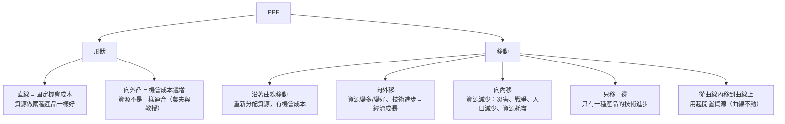

# 06 生產可能性曲線（下）：形狀與移動 (PPF: Shape and Shifts)

> **本課資料來源**：✅ 官方 *MUF0061 Definitions and Index*（allocative efficiency 的官方定義）、`The_Law_of_Increasing_Opportunity_Costs.pptx`（全部 8 頁）、`Lesson_2_Opportunity_cost_and_PPC.pdf`（第 4、5、7、9、12–18 頁）、`Chapter_1.3.docx`（Sophie's Sweets、Shifting the PPF、Microeconomics or Macroeconomics? 小組活動）
> **建議時間**：90–110 分鐘
> **先備知識**：`05` PPF 基礎與計算

## 本課學完，你要會：

- [ ] 說出 **直線 PPF = 固定機會成本**、**向外凸 PPF = 機會成本遞增**
- [ ] 用「農夫與教授」解釋 **機會成本遞增法則 (law of increasing opportunity costs)**
- [ ] 畫出 PPF **向外移、向內移、只有一邊移動** 三種圖，並說出原因
- [ ] 分辨 **沿著曲線移動 (movement along)** 和 **整條曲線移動 (shift)**
- [ ] 解釋為什麼今天多生產 **資本財** 能讓未來的 PPF 往外移
- [ ] 判斷一條 PPF 屬於 **個體** 還是 **總體** 經濟學

---

## 1. PPF 的兩種形狀

> A **straight line** represents **constant** opportunity costs, and a **bowed-out line** represents **increasing** opportunity costs.（`Lesson_2` 第 7 頁）

| 形狀 | 機會成本 | 什麼時候會這樣 |
|---|---|---|
| **直線** (straight line) | **固定** (constant)：每多做 1 單位，放棄的數量都一樣 | 資源做兩種產品**一樣好** |
| **向外凸** (bowed out / concave to the origin) | **遞增** (increasing)：做得越多，每多做 1 單位要放棄的越多 | 資源**不是**做兩種產品都一樣好（真實世界通常如此） |

「concave to the origin」（對原點凹）聽起來像「往內凹」，其實是指從原點看過去，曲線是**往外鼓**的——和 bowed out 是同一個意思。

---

## 2. 直線 PPF：固定機會成本 (Constant opportunity cost)

課堂投影片（`Lesson_2` 第 5 頁）：
> The PPF does not always have to be drawn as a curve. If the opportunity cost for producing two products is **constant**, then we draw the PPF as a **straight line**. The **gradient** (slope) of that line is a way of measuring the opportunity cost between two goods.

### 例題 1：數學練習 vs 經濟題（`Lesson_2` 第 7 頁左圖）
一個學生可以做 5 題數學練習 (maths exercises)，或 5 題經濟題 (economics problems)，或中間的任何組合。

```text
Maths exercises
  ^
    5 |A.
      | ....
      |    ....
    4 |       .o.
      |         ....
      |            ....
    3 |               .C.              D
      |                 ....
      |                    ....
    2 |        E              .o.
      |                         ....
      |                            ....
    1 |                               .o.
      |                                 ....
      |                                    ....
    0 |                                       .B
      +-----------------------------------------> Economics problems
       0       1       2       3       4       5
```

- 每多做 **1 題經濟題**，就少做 **1 題數學**（A → … → B 每一步都一樣）→ **固定機會成本 = 1 題數學**。
- **D 點**（4 題經濟、3 題數學）：4 + 3 = 7 > 5 → 在線**外**，做不到。
- **E 點**（1 題經濟、2 題數學）：在線**內**，有時間沒用好。

### 例題 2：投影片的直線 PPF（`Lesson_2` 第 5 頁）——請以圖上的數字為準

```text
Output of Good A
  ^
  280 |...
      |  ...
  240 |    .....
      |        ...
  200 |          ..A..
      |              ...
  160 |                ..B.
      |                    ...
  120 |                       ...
      |                          ...
   80 |                             ...
      |                                ...
   40 |                                   ...
      |                                      ...
    0 |                                         ..
      +-------------------------------------------> Output of Good B
       0          60    90                      210
```

圖上兩個點：**A 點**（Good B = 60，Good A = 200）、**B 點**（Good B = 90，Good A = 160）。

**一步一步算：**
1. 得到的 Good B：90 − 60 = **30 單位**
2. 放棄的 Good A：200 − 160 = **40 單位**
3. **1 單位 Good B 的機會成本** = 40 ÷ 30 = 4/3 ≈ **1.33 單位 Good A**
4. 反過來，**1 單位 Good A 的機會成本** = 30 ÷ 40 = **0.75 單位 Good B**
5. 檢查：4/3 × 3/4 = 1 ✅（互為倒數）
6. 這條線的**斜率 (gradient)** 大小 = 40 ÷ 30 ≈ 1.33，正好等於「1 單位 B 的機會成本（以 A 計）」——這就是投影片說的「斜率可以衡量機會成本」。

> 📌 **溫和提醒**：這張投影片上方的方框寫著 *"Increasing output of good B from 60 to 90 units implies giving up 90 units of good A"* 和 *"The marginal opportunity cost for each extra unit of good B is 30 units of Good A"*。但**同一張投影片的圖**顯示 Good A 是從 200 減到 160，也就是只放棄了 **40** 單位。方框的文字和它自己的圖對不上，可能是筆誤。本指南依圖計算（1 B ≈ 1.33 A）；建議你上課時向老師確認一下。

**延伸（選讀）**：如果這真的是一條直線，每 1 單位 B 都要放棄 4/3 單位 A：
- 從 A 點往左走到 Good B = 0：Good A = 200 + 60 × 4/3 = **280**（y 軸截距）
- 往右走到 Good A = 0：Good B = 90 + 160 × 3/4 = **210**（x 軸截距）
（投影片的圖是示意圖，沒有按比例畫，所以從圖上看不出這兩個數字。）

### 例題 3：Sophie's Sweets（`Chapter_1.3` 的 *What is a model?* 活動）

```text
Cupcakes
  ^
 1200 |
      |...
 1000 |  .....
      |      .....
  800 |          .....
      |              .....
  600 |                  .....
      |                      .....
  400 |                          .....
      |                              .....
  200 |                                  .....
      |                                      .....
    0 |                                          ...
      +-------------------------------------------------> Pancakes
       0     1000    2000    3000    4000    5000
```

課本的圖是一條直線：最多 **1,100 個杯子蛋糕 (cupcakes)**，或最多大約 **5,500 個鬆餅 (pancakes)**（從原圖的 x 軸讀出來大約是 5.4–5.5 千，是估計值）。
- 1 個杯子蛋糕的機會成本 ≈ 5,500 ÷ 1,100 = **5 個鬆餅**
- 1 個鬆餅的機會成本 ≈ 1,100 ÷ 5,500 = **0.2 個杯子蛋糕**
- 因為是直線，**每一個**杯子蛋糕的機會成本都一樣。

### 延伸例題 4：法國 vs 英國（`Lesson_2` 第 9 頁）
> In which country is the opportunity cost of cloth lower?

| 國家 | 全部做酒 (wine) | 全部做布 (cloth) | 1 單位布的機會成本 | 1 單位酒的機會成本 |
|---|---|---|---|---|
| 法國 FRANCE | 600 | 300 | 600 ÷ 300 = **2 單位酒** | 300 ÷ 600 = **0.5 單位布** |
| 英國 ENGLAND | 200 | 300 | 200 ÷ 300 ≈ **0.67 單位酒** | 300 ÷ 200 = **1.5 單位布** |

**答案：英國**生產布的機會成本比較低（0.67 < 2）；反過來，**法國**生產酒的機會成本比較低（0.5 < 1.5）。
（這個「誰的機會成本比較低，誰就專門生產那樣東西」的想法，叫做比較優勢 (comparative advantage)。它不在你們 MUF0061 的每週主題表上，知道就好。）

---

## 3. 向外凸的 PPF：機會成本遞增法則 (The Law of Increasing Opportunity Costs)

這一節是 Monash 投影片 `The_Law_of_Increasing_Opportunity_Costs.pptx` 的內容：
> *An explanation of why the Production Possibilities Frontier (PPF) is a curve rather than a straight line.*
>
> Why is it that the opportunity cost of producing more of one product is greater as we move closer to producing all of one product and none of the other?

### 白話解釋
**一樣東西做得越多，每多做 1 單位要放棄的另一樣東西就越多。** 因為最適合的人和資源會先被調過去，越到後面，調過去的都是「不適合」的資源。

### 例題 5：經濟體 Z — 農產品 vs 大學學位（投影片第 3–4 頁）

**Production Possibilities for Economy Z**

| 點 | 農產品 (agricultural products) | 大學學位 (university degrees) |
|---|---|---|
| A | 8,000 萬 (80 million) | 0 |
| B | 7,000 萬 (70 million) | 20,000 |
| C | 5,000 萬 (50 million) | 40,000 |
| D | 0 | 60,000 |

```text
Agricultural products (million)
  ^
   80 |A....
      |    .........
      |            ....B..
      |                  .....
   60 |                      .....
      |                          .....
      |                              ..C.
      |                                 ..
   40 |                                  ...
      |                                    ...
      |                                      ..
      |                                       ...
   20 |                                         ..
      |                                          ...
      |                                            ...
      |                                              ..
    0 |                                               .D
      +-------------------------------------------------> University degrees (thousand)
       0              20              40              60
```

**一步一步算：**

| 問題（投影片第 3 頁） | 移動 | 放棄的農產品 | 每 1 個學位的機會成本 |
|---|---|---|---|
| 第一批 20,000 個學位 | A → B | 80 − 70 = **1,000 萬** | 10,000,000 ÷ 20,000 = **500 個農產品** |
| 下一批 20,000 個學位 | B → C | 70 − 50 = **2,000 萬** | 20,000,000 ÷ 20,000 = **1,000 個農產品** |
| 最後 20,000 個學位 | C → D | 50 − 0 = **5,000 萬** | 50,000,000 ÷ 20,000 = **2,500 個農產品** |

投影片第 4 頁的答案：**10 million、20 million、50 million agricultural products** ✅（和上表一致）。
同樣是多 20,000 個學位，要放棄的農產品卻越來越多 → **機會成本遞增**。

> 📌 **溫和提醒**：投影片第 3–4 頁的問題寫 *"the first 20 university degrees"*，但圖上每一段是 **20,000** 個學位（0 → 20,000 → 40,000 → 60,000）。應該是少寫了「,000」；依圖理解成每段 20,000 個學位，答案的 10、20、50 百萬是對的。上課時可以和老師確認。

### 為什麼機會成本會遞增？農夫與教授（投影片第 5–8 頁）

**資源不是做每種產品都一樣好。**
> *Not all resources are equally as good at producing all products.*

**👨‍🌾 農夫**（第 5–6 頁）：他很會生產肉、羊毛、小麥、水果和蔬菜，但不適合在大學工作。如果國家想要「大部分生產學位、幾乎不生產農產品」，他也得被調去大學。
> *This farmer may be able to contribute to university degrees (after some training), but he would not be as productive or efficient as he was as a farmer. As we move from producing agricultural products to university degrees, the amount of agricultural products foregone is much greater than the corresponding gain in university degrees.*
>
> *The closer we get to each extreme of the PPF, the more unsuitable are the resources we are using.*

**👨‍🏫 教授**（第 7 頁）：反過來，如果要從生產學位改成多生產農產品，教授就要去種田——他得先受訓，而且可能還是不太適合務農。

**結論**（第 8 頁，請記住這兩句）：
> As we switch from one product to the other, we will move the **best suited resources first**, then the **worst suited resources last**.
>
> The worst suited resources are the ones which are best at producing the other product. That is why the more we move resources to produce extra of something, the greater the opportunity cost in terms of the other product given up.

課堂投影片（`Lesson_2` 第 4 頁）的一句話版本：
> A PPC (PPF) on a diagram is usually **concave to the origin**, as the extra output resulting from allocating more resources to one particular good may fall.

### 生活例子：小組作業
你們 4 人小組要做海報和寫報告。一開始只寫報告。後來要做海報了：
- 第 1 個被派去畫海報的，是**最會畫畫、最不會寫字**的同學 → 報告幾乎沒少多少，海報卻做得很快。
- 最後 1 個被派去畫的，是**最會寫報告、完全不會畫畫**的同學 → 報告少了一大截，海報只多了一點點。
所以越多做海報，每多 1 張海報的「代價」（少寫的報告）就越大 → 機會成本遞增。

### 例題 6：一個國家：稻米 vs 手機（我設計的數字，方便練習）

| 點 | A | B | C | D | E | F |
|---|---|---|---|---|---|---|
| 手機 Phones（千支） | 0 | 10 | 20 | 30 | 40 | 50 |
| 稻米 Rice（噸） | 100 | 95 | 85 | 70 | 50 | 0 |

```text
Rice (tonnes)
  ^
  100 |A.....
      |     .....B..
      |            .......
      |                  ..C..
      |                      ....
   75 |                         ....
      |                            ..D.
      |                               ....
      |                                  ...
      |                                    ....
   50 |                                       .E
      |                                         .
      |                                          .
      |                                           .
      |                                            .
   25 |                                             .
      |                                              .
      |                                               .
      |                                                .
      |                                                 .
    0 |                                                  F
      +---------------------------------------------------> Phones (thousand)
       0        10        20        30        40        50
```

| 移動 | 多的手機 | 放棄的稻米 | 每 1 千支手機的機會成本 |
|---|---|---|---|
| A → B | 10 | 5 | 0.5 噸 |
| B → C | 10 | 10 | 1 噸 |
| C → D | 10 | 15 | 1.5 噸 |
| D → E | 10 | 20 | 2 噸 |
| E → F | 10 | 50 | 5 噸 |

每一段都比前一段大 → 機會成本遞增 → 曲線向外凸。

### 例題 7：洋蔥 vs 馬鈴薯（`Lesson_2` 第 7 頁右圖，數字從圖上讀，為近似值）

| 點 | 馬鈴薯 Potatoes（噸） | 洋蔥 Onions（噸） |
|---|---|---|
| a | 250 | 250 |
| b | 180 | 300 |
| c | 約 75 | 約 350 |

- a → b：多 50 噸洋蔥，放棄 250 − 180 = **70 噸馬鈴薯** → 每噸洋蔥 ≈ **1.4 噸馬鈴薯**
- b → c：再多約 50 噸洋蔥，放棄約 180 − 75 = **105 噸馬鈴薯** → 每噸洋蔥 ≈ **2.1 噸馬鈴薯**
- 同樣多 50 噸洋蔥，放棄的馬鈴薯越來越多 → 機會成本遞增。

---

## 4. PPF 的移動 (Shifts in the PPF)

### 4.1 先分清楚：沿著曲線移動 vs 整條曲線移動

| | 沿著曲線移動 (movement along the PPF) | 整條曲線移動 (shift of the PPF) |
|---|---|---|
| 發生什麼 | 資源在兩種產品之間**重新分配** | 資源的**數量、品質**或**技術**改變 |
| 曲線本身 | **不動** | **整條移動**（向外或向內） |
| 例子 | 家具工廠從 D 點移到 E 點 | 工廠買了新機器、員工受訓變得更有效率 |
| 機會成本 | 有（多一樣就少一樣） | 向外移時，可以**兩樣都多** |

> 🔑 記住：PPF 的假設是「資源固定、技術不變」。**一旦這兩個假設不成立，PPF 就會移動。**

### 4.2 向外移 (Outward shift)：經濟成長

```text
Capital goods
   ^
   |
   |
   |ooooooooooooooo              outward shift: PPF1 -> PPF2
   |              oooooo
   |                    oooo
   |                        oooo
   |************               ooo
   |           ******            Dooo
   |                ****            oo
   |                   ****          ooo
   |                      A*           oo
   |                       ***          oo
   |                         **          oo
   |                          **          o
   |                           *           o
   |                           **PPF1      oPPF2
   |                            *          o
   +-------------------------------------------------> Consumer goods
    0
```

課堂投影片（`Lesson_2` 第 12 頁）：
> Point D is unattainable at the moment because it lies beyond the PPC. A country would require
> - an **increase in factor resources**,
> - or an **increase in the efficiency (or productivity)** of factor resources
> - or an **improvement in technology**
>
> to reach this combination of Good X and Good Y. If we achieve this then output combination D may become attainable.

`Lesson_2` 第 13 頁：
> It can only produce at points outside the PPF if it finds a way of expanding its resources or improves the productivity of those resources it already has. This will push the PPF further outwards.

**課本小組活動：Shifting the PPF（`Chapter_1.3`）**——有哪些具體的因素能讓澳洲的 PPF 向外移？
課本給的例子：*Australia's government could spend more money on providing education to people so that the labour resources are more skilled and trained, and can produce more in the future.*

參考答案（按生產要素整理）：

| 生產要素 | 讓 PPF 向外移的具體因素 |
|---|---|
| 勞動 Labour | 政府多投資教育和職業訓練；吸引技術移民；人口增加使勞動力變多；更好的醫療讓工人更健康、更有生產力 |
| 資本 Capital | 公司投資新機器和工廠；政府建設道路、港口、網路等基礎建設 |
| 土地 Land | 發現新的礦藏或天然氣田；開發新的可耕地或再生能源 |
| 企業家精神 / 技術 Enterprise / Technology | 研究與開發 (R&D) 帶來新技術；更好的管理方法；鼓勵創業 |

> 📌 **小提醒**：`Lesson_2` 第 14 頁說向外移 *"represents an improvement in economic efficiency"*。比較常見、也比較精確的說法是：PPF 向外移代表**經濟成長 (economic growth)**——經濟**能生產的最大產量（生產能力）增加了**。寫作業時用 *economic growth / an increase in productive capacity* 比較安全，可以和老師確認他們想要的說法。

### 4.3 向內移 (Inward shift)

```text
Agricultural products
   ^
   |
   |
   |***************              inward shift: PPF1 -> PPF2
   |              ******
   |                    ****
   |                        ****
   |oooooooooooo               ***A
   |           oooooo            ****
   |                oooo            **
   |                   ooDo          ***
   |                      oo           **
   |                       ooo          **
   |                         oo          **
   |                          oo          *
   |                           o           *
   |                           ooPPF2      *PPF1
   |                            o          *
   +-------------------------------------------------> Manufactured products
    0
```

課堂投影片（`Lesson_2` 第 17 頁）：
> PPC could also decline when in some way the resources available to the economy have declined:
> a. Some natural resources become exhausted.（天然資源用完了）
> b. Working population is falling.（工作人口減少，例如人口老化）
> c. Technology available to us has changed.（能用的技術改變/減少）
> d. Impact of controls on global emissions …（全球減排管制：例如限制用煤，能用的能源資源變少）

其他常見例子：地震、洪水等**天然災害**摧毀工廠和道路；**戰爭**；嚴重的**疫情**使勞動力減少。

> ⚠️ **超常見的錯誤**：「經濟衰退、失業增加 → PPF 向內移」？**錯！**
> 失業時，工人和機器**還在**，只是沒被使用 → 生產點移到**曲線裡面**，**曲線本身不動**。只有當資源**真的消失或變差**（工人死亡/移出、工廠被毀、資源用光）時，PPF 才會向內移。

### 4.4 只有一邊移動（技術只改善一種產品）

**農產品的技術突破**（`Lesson_2` 第 15 頁）：
> When the ability to produce agricultural products gets improved, for example, a technological breakthrough, the curve may shift **upward**.

```text
Agricultural products
   ^
   |
   |  new max
   |oooooooooo
   |         ooooooo
   |               ooooo
   |  old max          ooo
   |******               oooo
   |     ***********        ooo
   |               ******     oo
   |                    *****  ooo
   |                        ***  oo
   |                          *** oo
   |                            ***o
   |                              *oo
   |                               *o
   |                                o  same max on X-axis
   |                                o
   +-------------------------------------------------> Manufactured products
    0
```

- y 軸（農產品）的最大值**變大**；x 軸（工業品）的最大值**不變**——因為如果全部資源都拿去做工業品，農業技術再好也用不上。

**工業品的技術突破**（`Lesson_2` 第 16 頁）：
> When the ability to produce manufactured products gets improved, for example, a technological breakthrough, the curve may shift **rightward**.

```text
Agricultural products
   ^
   |
   |
   |
   |      same max on Y-axis
   |oooooooooooo
   |       ****ooooooooo
   |            ****   oooooo
   |                ***     ooooo
   |                  ***       oooo
   |                    **         ooo
   |                     **          ooo
   |                      **           oo
   |                       **           oo
   |                        **           oo
   |                         *            oo
   |                         *             o
   |                       old           new
   +-------------------------------------------------> Manufactured products
    0
```

- x 軸（工業品）的最大值變大；y 軸（農產品）的最大值不變。

### 4.5 課堂測驗（`Lesson_2` 第 18 頁）
> The diagram shows two production possibility curves for an economy. Which combination of movements correctly illustrates these changes in production?

```text
Services
   ^
   |
   |
   |ooooooooooooooo
   |              oooooo
   |                    oooo
   |                        oooo
   |*********L**               oNo
   |           ******            oooo
   |                ****            oo
   |                   ****          ooo
   |                      *M           oo
   |                       ***          oo
   |               K         **          oo
   |                          **          o
   |                           *           o
   |                           **          o
   |                            *          o
   +-------------------------------------------------> Goods
    0
```

（K 在內側曲線的**裡面**；L 和 M 在**內側**曲線上；N 在**外側**曲線上。）

| | short-run economic growth | long-run economic growth | no economic growth |
|---|---|---|---|
| A | K to L | L to M | M to N |
| B | K to L | M to N | L to M |
| C | M to N | K to L | L to M |
| D | M to N | L to M | K to L |

<details>
<summary>👉 答案與解析</summary>

**答案：B**

- **短期經濟成長 (short-run growth)**：把**閒置的資源用起來**，從曲線**內**移到曲線**上** → **K to L**。曲線不動，但實際產量增加了。
- **長期經濟成長 (long-run growth)**：資源變多或技術進步，**整條 PPF 向外移**，從舊曲線移到新曲線 → **M to N**。
- **沒有經濟成長 (no growth)**：在**同一條**曲線上移動，只是重新分配資源（多一樣、少一樣） → **L to M**。

</details>

`Lesson_2` 第 12 頁還提到：兩樣東西都生產更多，代表經濟福利 (economic welfare) 提高——前提是這些產品真的讓消費者滿意。投影片把這和**配置效率 (allocative efficiency)** 連在一起。

> **✅ 官方定義**　**Allocative efficiency**: "The condition in which scarce resources are allocated towards the production of goods and services that best satisfy consumer needs and wants."

白話：配置效率 = 資源被用來生產**消費者最想要**的那些商品和服務。注意它和**生產效率**（`05` 課：曲線上的每一點都有）不一樣：配置效率看的是「**生產的組合**對不對」。官方定義表標示這個詞出現在兩個主題：Topic 10 資源分配（時間表上是 Week 5–6，見 `07` 課第 10 節）和 Topic 21；Week 13 的「效率」也會再用到（見 `15_效率_壟斷性競爭與寡頭壟斷.md`）。

---

## 5. 資本財 vs 消費財：今天的選擇決定明天的 PPF

（`Lesson_2` 第 3、6、13 頁；`Chapter_1.3` 澳洲 PPF 活動。兩個名詞的定義在 `02` 課第 5 節。）

### 白話解釋
- 今天多生產**消費財**（手機、衣服、餐廳的飯）→ 大家**現在**過得比較好。
- 今天多生產**資本財**（機器、工廠、道路）→ 現在能享受的東西少一點，但**未來**的生產能力變大 → **PPF 向外移得更多**。

這就是 `03` 課提到的 *"Investing today for consumption tomorrow"*（今天投資，明天消費）的機會成本：**今天投資的機會成本 = 今天少享受的消費財**。

### 比較兩個國家

| | 國家甲：今天選「多資本財、少消費財」 | 國家乙：今天選「少資本財、多消費財」 |
|---|---|---|
| 今天 | 人民的消費比較少 | 人民的消費比較多 |
| 未來 | 機器和基礎建設變多 → PPF **大幅**向外移 | 新的資本財不多 → PPF 只有**小幅**向外移（甚至因為機器老舊而停滯） |
| 結論 | 犧牲現在，換取未來更多 | 享受現在，未來成長較慢 |

---

## 6. PPF 用在個體還是總體？（`Chapter_1.3` 小組活動：Microeconomics or Macroeconomics?）

PPF 模型**兩種都能用**：看「做決定的是誰」。

| 課本的三張 PPF | 兩種產品 | 誰在做決定 | 屬於 |
|---|---|---|---|
| Apple Company's PPF | iPhones vs iPads | 一間**公司** | **個體** microeconomics |
| Economic Student's PPF | Written notes vs Posters of Economic Models | 一個**人** | **個體** microeconomics |
| Australia's PPF | Consumption goods vs Capital goods | 整個**國家**的經濟 | **總體** macroeconomics |

---

## 7. 一頁總結



---

## 常見錯誤

1. ❌「失業增加 → PPF 向內移」。✅ 失業 → 生產點移到**曲線內**；曲線不動。
2. ❌「技術進步 → 一定兩邊都往外移」。✅ 只改善**一種**產品的技術，只有那一軸的端點往外，另一軸的端點不動。
3. ❌ 把「沿著曲線移動」說成「曲線移動」。✅ 重新分配資源 = **沿著**曲線移動；資源或技術改變 = 曲線**移動**。
4. ❌ 解釋向外凸只寫「因為機會成本遞增」就停了。✅ 要說出**原因**：資源不是做每種產品都一樣好（resources are not equally suited / specialised），所以最適合的先移、最不適合的最後移。
5. ❌ 直線 PPF 也說「機會成本遞增」。✅ 直線 = **固定**機會成本。
6. ❌ 以為 PPF 只能用在國家。✅ 公司、個人也能用（Apple、學生的例子）。

---

## 自我檢查

**Q1.** 一條直線 PPF 經過 (X = 20, Y = 100) 和 (X = 50, Y = 40)。1 單位 X 的機會成本是多少？1 單位 Y 呢？

**Q2.** 用「農夫與教授」的例子，解釋為什麼 PPF 通常是向外凸的。（3–4 句，中英文都可）

**Q3.** 下面每一件事，對一個國家的 PPF 造成什麼影響？（向外移／向內移／只有一邊移動／點移到曲線內／沿著曲線移動）
(a) 大量技術移民移入 (b) 經濟衰退，很多工廠停工 (c) 大地震摧毀很多工廠 (d) 只有農業出現新技術 (e) 政府把工人從製造業調去農業

**Q4.** 用經濟體 Z 的表格：為什麼「最後 20,000 個學位」比「第一批 20,000 個學位」貴那麼多？

**Q5.** 國家甲今年把很多資源用來建工廠和道路。說明這個選擇對**今年**和對**未來**的 PPF 有什麼影響。

<details>
<summary>👉 點我看答案</summary>

**A1.** X 增加 50 − 20 = 30，Y 減少 100 − 40 = 60。1 單位 X 的機會成本 = 60 ÷ 30 = **2 單位 Y**；1 單位 Y 的機會成本 = 30 ÷ 60 = **0.5 單位 X**。（直線 → 每一段都一樣。）

**A2.** 參考答案：*Not all resources are equally good at producing all products. When an economy moves resources from agriculture to university degrees, it moves the best-suited resources first (e.g. people who are good teachers), and the worst-suited resources last (e.g. farmers, who are very good at farming). The farmer is much less productive at a university, so a lot of agricultural output is lost for only a small gain in degrees. Therefore the opportunity cost rises as we produce more of one product, and the PPF is bowed out (concave to the origin).*

**A3.** (a) **向外移**（勞動資源增加）(b) **點移到曲線內**（資源還在，只是沒用；曲線不動）(c) **向內移**（資本被摧毀）(d) **只有一邊移動**：農產品那一軸的端點往外，工業品那一軸的端點不動 (e) **沿著曲線移動**（重新分配資源）

**A4.** 因為機會成本遞增：最後才被調去「生產學位」的資源（例如農夫、農地），是**最不適合**生產學位、卻**最擅長**生產農產品的資源。把它們調走，損失的農產品很多（5,000 萬），換來的學位卻一樣只有 20,000 個 → 每個學位的機會成本從 500 升到 2,500 個農產品。

**A5.** **今年**：資源拿去生產資本財，消費財就變少（沿著 PPF 移向「資本財多」的那一邊）——這就是投資的機會成本。**未來**：工廠、道路等資本變多，生產能力提高 → **PPF 向外移**，將來兩種產品都能生產更多。

</details>

---

⬅️ 上一課：[05 PPF 基礎與計算](05_生產可能性曲線_基礎與計算.md)　|　下一課 ➡️ [06b 經濟體制](06b_經濟體制.md)
