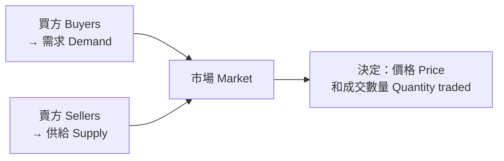

# 07 需求、供給與市場均衡 (Demand, Supply and Market Equilibrium)

> **對應課程**：Week 4 – Demand & Supply；Week 5 – Market Equilibrium & Resource Allocation
> **本課資料來源**：
> - ✅ 官方 *MUF0061 Definitions and Index*：本課所有標 **✅ 官方定義** 的英文定義（市場、需求、供給、需求定律、供給定律、需求曲線、供給曲線、非價格因素、替代品、互補品、市場均衡、過剩、短缺、價格機制、資源分配等），請照背
> - ✅ `Market_Equilibrium_eBook.epub`（市場、市場均衡、過剩、短缺、價格機制、四種移位的圖和步驟）——第 1、5–9 節
> - ✅ `Chapter_1.3.docx`（ceteris paribus 的兩個例題）
> - ⚠️ 需求 (Demand) 和供給 (Supply) 兩個模組你**沒有上傳**（Market Equilibrium eBook 寫著 *"Refer back to your learning about the law of supply and the law of demand"*）。第 2–4 節和第 10 節（資源分配）的**定義已經換成官方原文**；**解釋和例子**仍是**標準教科書內容**（參考 OpenStax《Principles of Economics 2e》3.1、3.2 節：<https://openstax.org/books/principles-economics-2e/pages/3-1-demand-supply-and-equilibrium-in-markets-for-goods-and-services>、<https://openstax.org/books/principles-economics-2e/pages/3-2-shifts-in-demand-and-supply-for-goods-and-services>）。
>
> **建議時間**：100–120 分鐘

## 本課學完，你要會：

- [ ] 用英文寫出 **市場 (market)**、**需求 (demand)**、**供給 (supply)**、**市場均衡 (market equilibrium)**、**價格機制 (price mechanism)** 的 ✅ 官方定義
- [ ] 說出 **需求定律 (law of demand)** 和 **供給定律 (law of supply)**
- [ ] 分清楚 **擴張/收縮 (expansion/contraction)**（沿著曲線移動）和 **增加/減少 (increase/decrease)**（整條曲線移動）
- [ ] 說出影響需求和供給的 **非價格因素 (non-price determinants)**
- [ ] 算出 **過剩 (surplus)** 和 **短缺 (shortage)** 的數量
- [ ] 畫出四種移位情況的圖，並**一步一步**寫出價格機制的過程
- [ ] 解釋價格機制怎麼**分配資源 (resource allocation)**

---

## 1. 市場是什麼？(What is a market?)

### 白話解釋
**市場 = 買方和賣方互動、決定「價格」和「成交數量」的地方或制度。** 不一定是一個實體的地方。

### 生活例子
- 實體市場：深圳華強北的電子市場、菜市場
- 網路市場：淘寶、美團外賣
- 看不見的市場：勞動市場（公司「買」勞動、工人「賣」勞動）

### 官方英文定義（請背下來）
> **✅ 官方定義**　**Market**: "A system in which interaction between buyers and sellers determines the prices and quantities traded of goods and services."

`Market_Equilibrium_eBook` 的說法（補充；第一句和官方差不多，第二、三句很好用）：
> A **market** is a system in which the interaction between buyers and sellers determines the prices and quantities traded of a product. One side of this market is related to buyers, and their **demand** for a product. The other side of the market relates to sellers, and their **supply** of a product.



---

## 2. 需求 (Demand)　（定義：✅ 官方；解釋和例子：⚠️ 標準教科書）

### 白話解釋
**需求 = 在各種價格下，消費者「願意而且有能力」買多少。**

> **✅ 官方定義**　**Demand**: "Buyers’ willingness and ability to buy a product."

- 「願意」和「有能力（付得起）」**兩個都要**。你很想要一台跑車，但買不起 → 不算需求。
- **需求量 (quantity demanded)** = 在**某一個價格**下想買的數量（一個數字）。
- **需求 (demand)** = **所有價格**和需求量之間的關係（整張表、整條線）。

### 需求定律 (The law of demand)
> **✅ 官方定義**　**Law of demand**: "The principle that there is an inverse relationship between the price of a product and the quantity that buyers are willing and able to buy."

白話：*inverse relationship* = **反向**關係。其他條件不變 (ceteris paribus)，價格上漲 → 需求量減少；價格下跌 → 需求量增加。

為什麼？
- 價格上漲 → 消費者改買比較便宜的**替代品 (substitutes)**。
- 價格上漲 → 同樣的錢能買的東西變少，**買得起的量變少**。
（Market Equilibrium eBook 也這樣說：*"As prices rise, consumers are less willing and able to buy (this is the law of demand)"*。）

### 例子：校門口奶茶店的需求表 (demand schedule)（我設計的數字）

| 價格 (¥/杯) | 20 | 17 | 14 | 11 | 8 |
|---|---|---|---|---|---|
| 需求量 (杯/天) | 10 | 30 | 50 | 70 | 90 |

> **✅ 官方定義**　**Demand curve**: "A curve depicting the relationship between price and quantity demanded of a product."

把表畫成**需求曲線 (demand curve)**——**向右下方傾斜**：

```text
Price (yuan per cup)
   ^
   |
 20|   \\
   |     \\\\\
 17|          \\\
   |             \\\\\
 14|                  \\\
   |                     \\\\\
 11|                          \\\
   |                             \\\\\
  8|                                  \\D
   |
   |
   |
   +------------------------------------------> Quantity demanded (cups per day)
       10      30      50      70      90
```

> 📌 畫圖規則：**價格 (Price) 放縱軸 (y)**、**數量 (Quantity) 放橫軸 (x)**。

---

## 3. 供給 (Supply)　（定義：✅ 官方；解釋和例子：⚠️ 標準教科書）

### 白話解釋
**供給 = 在各種價格下，生產者「願意而且有能力」賣多少。**

> **✅ 官方定義**　**Supply**: "Sellers’ willingness and ability to sell a product."

### 供給定律 (The law of supply)
> **✅ 官方定義**　**Law of supply**: "The principle that there is a direct relationship between the price of a product and the quantity that sellers are willing and able to sell."

白話：*direct relationship* = **正向**（同方向）關係。其他條件不變，價格上漲 → 供給量增加；價格下跌 → 供給量減少。

為什麼？價格越高 → 賣出去**利潤越多** → 企業願意多生產，也有能力負擔多生產的成本。
（eBook：*"As the price is able to increase, firms are willing and able to sell more (this is the law of supply)"*；*"we assume firms are motivated by earning profit"*。）

### 例子：同一家奶茶店的供給表 (supply schedule)（我設計的數字）

| 價格 (¥/杯) | 8 | 11 | 14 | 17 | 20 |
|---|---|---|---|---|---|
| 供給量 (杯/天) | 10 | 30 | 50 | 70 | 90 |

> **✅ 官方定義**　**Supply curve**: "A curve depicting the relationship between price and quantity supplied of a product."

**供給曲線 (supply curve)**——**向右上方傾斜**：

```text
Price (yuan per cup)
   ^
   |
 20|                                  //S
   |                             /////
 17|                          ///
   |                     /////
 14|                  ///
   |             /////
 11|          ///
   |     /////
  8|   //
   |
   |
   |
   +------------------------------------------> Quantity supplied (cups per day)
       10      30      50      70      90
```

---

## 4. 最重要的分辨：沿著曲線移動 vs 整條曲線移動　（定義：✅ 官方；分類和例子：⚠️ 標準教科書）

這是需求供給**最常考、最常錯**的地方。

| | 原因 | 圖上的變化 | 需求的說法 | 供給的說法 |
|---|---|---|---|---|
| **沿著曲線移動** (movement along) | **這個產品自己的價格**改變 | 在**同一條**曲線上移動 | 價格↓ → **需求擴張 (expansion / extension of demand)**；價格↑ → **需求收縮 (contraction of demand)** | 價格↑ → **供給擴張 (expansion of supply)**；價格↓ → **供給收縮 (contraction of supply)** |
| **整條曲線移動** (shift) | **價格以外**的因素改變（非價格因素） | 整條曲線**左移或右移** | **需求增加 (increase in demand)** = 右移；**需求減少 (decrease in demand)** = 左移 | **供給增加 (increase in supply)** = 右移；**供給減少 (decrease in supply)** = 左移 |

> 💡 你的 Market Equilibrium eBook 就是用這套說法：*"as prices are decreased, supply will **contract** and demand will **expand**"*（價格變化 → 擴張/收縮），而 *"a change in a non-price determinant leads to an **increase in demand**"*（非價格因素 → 增加/減少）。**寫答案時一定要用對詞。**

### 4.1 影響需求的非價格因素 (Non-price determinants of demand)

> **✅ 官方定義**　**Non-price determinant of demand**: "Factors that result in a shift of a demand curve, whereby quantity demanded changes at each different possible price level."

白話：價格以外、會讓需求曲線**整條移動**的因素——移動之後，**每一個價格**下的需求量都變了。

| 因素 | 例子 | 需求怎麼變 |
|---|---|---|
| **收入 (income)** | 大家收入增加 | 一般商品 (normal goods)：需求**增加**；劣等品 (inferior goods，例如最便宜的泡麵)：需求可能**減少** |
| **替代品的價格 (price of substitutes)** | 咖啡漲價 | 奶茶（咖啡的替代品）需求**增加** |
| **互補品的價格 (price of complements)** | 印表機漲價 | 墨水匣（互補品）需求**減少** |
| **喜好 (tastes and preferences)** | 某款飲料在網上爆紅、廣告 | 需求**增加** |
| **人口/買家數量 (population)** | 開學了，學生變多 | 校門口的奶茶需求**增加** |
| **對未來價格的預期 (expectations)** | 大家預期下個月會漲價 | **現在**的需求**增加** |

表裡的替代品和互補品，官方定義是：
> **✅ 官方定義**　**Substitute product**: "A product that can satisfy the same needs and wants of a customer as another similar product."
>
> **✅ 官方定義**　**Complementary product**: "A product that is consumed with, or connected to, another product so that demand for one generates demand for the other."

白話：替代品＝可以**互相取代**的產品（咖啡和奶茶）；互補品＝**一起用**的產品，買了一個就會想買另一個（印表機和墨水匣）。

### 4.2 影響供給的非價格因素 (Non-price determinants of supply)

> **✅ 官方定義**　**Non-price determinant of supply**: "Factors that result in a shift of a supply curve, whereby quantity supplied changes at each different possible price level."

| 因素 | 例子 | 供給怎麼變 |
|---|---|---|
| **生產成本 (costs of production)** | 工資、原料（茶葉、牛奶）、店租上漲 | 供給**減少** |
| **技術 (technology)** | 自動化封口機、更好的機器 | 供給**增加** |
| **賣家數量 (number of sellers)** | 更多奶茶店開業 | 供給**增加** |
| **天氣/自然條件 (weather)** | 乾旱、颱風（對農產品影響最大） | 供給**減少** |
| **政府的稅和補貼 (taxes and subsidies)** | 對企業課稅 / 給補貼 | 課稅 → 供給**減少**；補貼 → 供給**增加**（Week 7，見 `09_消費稅與補貼.md`） |
| **其他產品的價格 (prices of other products the firm could make)** | 農夫可以種玉米或黃豆；黃豆漲價 | 玉米的供給**減少**（資源轉去種黃豆——這就是 PPF 和機會成本的想法！） |

---

## 5. 市場均衡 (Market equilibrium)　✅ 課程 eBook

### 白話解釋
**市場均衡 = 「想買的量」剛好等於「想賣的量」的那個狀態。** 這時沒有人搶不到、也沒有東西賣不掉，價格**沒有理由再變**。

### 官方英文定義（請背下來）
> **✅ 官方定義**　**Market equilibrium**: "A condition whereby the quantity demanded and quantity supplied in a market are equal."

`Market_Equilibrium_eBook` 的補充：*The price at which this occurs is known as the **'equilibrium price'**.*（均衡時的價格叫做**均衡價格**。）

### eBook 的例子：Product X 的市場

| 價格 | 需求量 (QD) | 供給量 (QS) | 結果 |
|---|---|---|---|
| $12 | 50 | 110 | **過剩 (surplus)** 110 − 50 = **60** |
| $10 | 80 | 80 | **均衡 (equilibrium)** |
| $8 | 110 | 50 | **短缺 (shortage)** 110 − 50 = **60** |

```text
Price
   ^
   |
   |   \\                                 //Supply
   |     \\                             //
   |       \\\                       ///
   |          \\\                 ///
$12|             \<------------->/ surplus = 110 - 50 = 60
   |               \\\       ///
   |                  \\   //
$10| ...................\E\
   |                  // : \\
   |               ///   :   \\\
 $8|             /<------------->\ shortage = 110 - 50 = 60
   |          ///        :        \\\
   |       ///           :           \\\
   |     //              :              \\
   |   //                :                \\Demand
   |                     :
   +----------------------------------------------> Quantity
                 50      80     110
```

（E = 市場均衡：均衡價格 **$10**、均衡數量 **80**。）

> 📌 **計算規則**
> **過剩 (surplus) = 供給量 − 需求量**（價格高於均衡價格時）
> **短缺 (shortage) = 需求量 − 供給量**（價格低於均衡價格時）

用奶茶店的表也可以算：¥14 時需求量 = 供給量 = 50 → **均衡價格 ¥14、均衡數量 50 杯**。¥17 時：供給 70、需求 30 → 過剩 40 杯。¥11 時：需求 70、供給 30 → 短缺 40 杯。

---

## 6. 價格太高會怎樣？→ 過剩 (Surplus)　✅ 課程 eBook

> **✅ 官方定義**　**Surplus**: "A condition in which the quantity supplied exceeds the quantity demanded in a market."

eBook 的例子：
> If price was set at $12, the quantity supplied would be 110. The quantity demanded would be only 50. This means that there would be a **surplus** of 60 units of Product X. Firms would find that they would have a lot of leftover stock!

**一步一步**：
1. 價格 $12 太高 → 需求量 50、供給量 110 → **過剩 60 單位**，企業有很多賣不掉的存貨。
2. 過剩是一個**訊號**：告訴企業「價格太高了」。
3. 企業**降價**（打折）想把存貨賣掉。
4. 價格下降時：**供給收縮 (supply contracts)**、**需求擴張 (demand expands)**。
5. 一直到 **$10**，需求量 = 供給量 = 80 → 回到**市場均衡**。

---

## 7. 價格太低會怎樣？→ 短缺 (Shortage)　✅ 課程 eBook

> **✅ 官方定義**　**Shortage**: "A condition in which the quantity demanded exceeds the quantity supplied in a market."

eBook 的例子：
> What would happen if the price for Product X was $8? … 110 units of Product X would be demanded at a price of $8. But only 50 units would be supplied … At a price of $8, there would be a **shortage** of 60 units of Product X.

**一步一步**：
1. 價格 $8 太低 → 需求量 110、供給量 50 → **短缺 60 單位**，消費者搶著買。
2. 企業追求利潤，看到大家搶著買 → **漲價**。
3. 價格上升時：企業願意多賣 → **供給擴張**（供給定律）；消費者買得少 → **需求收縮**（需求定律）。
4. 一直到 **$10**，需求量 = 供給量 → **市場均衡**。

eBook 的重點句：
> When there is a change in demand or supply (shift of a curve), this creates **disequilibrium** (shortage or surplus) at the original equilibrium price. The shortage or surplus will cause the price to change.

---

## 8. 價格機制 (The price mechanism)　✅ 課程 eBook

### 官方英文定義（請背下來）
> **✅ 官方定義**　**Price mechanism**: "A system whereby the forces of demand and supply determine the price in a market."

`Market_Equilibrium_eBook` 的說法（補充，說明怎麼一步一步描述價格機制）：
> The **price mechanism** is the system or process whereby changes in demand and supply determine the price in the market. We can describe the way in which the price mechanism operates by identifying the changes that take place in a market, step by step, that lead to an ultimate change in equilibrium price and quantity.

### eBook 的五步驟範例（需求增加）
> 1. A change in a non-price determinant leads to an **increase in demand**.
> 2. The increase in demand leads to a **shortage** in the market.
> 3. The shortage in the market leads to **upward pressure on the price**.
> 4. Suppliers respond by **expanding supply** due to higher price they can now sell for.
> 5. The end result is a **higher equilibrium price and larger equilibrium quantity**.

> 📝 **這五步就是答題模板！** 任何「用價格機制解釋……」的題目，都照這個順序寫：**原因 → 曲線移動 → 在原價格出現短缺/過剩 → 價格壓力 → 另一條曲線擴張/收縮 → 新的均衡價格和數量**。

---

## 9. 四種移位情況（eBook 圖 1–4）　✅ 課程 eBook

> 圖中 **0** = 原來的均衡（EqP0、EqQ0），**1** = 新的均衡（EqP1、EqQ1）。

### 圖 1：需求增加 (Increase in demand)

```text
Price
   ^
   |
   |   \\          \\   D0 -> D1                //S0
   |     \\          \\                       //
   |       \\          \\                  ///
   |         \\          \\             ///
   |           \\          \\         //
   |             \\          \\    ///
 P1| ..............\\..........\1//
   |                 \\       //:\\
   |                   \\\ ///  :  \\\
 P0| ..................../0\--------->\\ shortage
   |                  /// : \\  :       \\
   |               ///    :   \\:         \\
   |             //       :     \\          \\
   |          ///         :     : \\          \\
   |       ///            :     :   \\          \\
   |     //               :     :     \\          \\
   |   //                 :     :       \\D0        \\D1
   |                      :     :
   +------------------------------------------------------------> Quantity
                          Q0    Q1
```

1. A change in a non-price determinant causes an increase in demand.（非價格因素改變 → 需求增加）
2. An increase in demand is shown by a **rightward shift** of the demand curve.（需求曲線**右移** D0 → D1）
3. The increase in demand causes a **shortage** to occur at the original equilibrium price (EqP0).（在原價格 P0 出現**短缺**）
4. The shortage leads to **upward pressure** on the price.（價格**上升壓力**）
5. Price rises and **supply expands** until the shortage is eliminated and the new equilibrium price is reached.（價格上升、**供給擴張**，直到短缺消失）
6. The final result is a **higher** equilibrium price (EqP1) and a **larger** equilibrium quantity (EqQ1).（**價格↑、數量↑**）

**生活例子**：夏天熱浪來了 → 冰淇淋需求增加 → 價格上升、成交量增加。

### 圖 2：需求減少 (Decrease in demand)

```text
Price
   ^
   |
   |   \\          \\   D1 <- D0                //S0
   |     \\          \\                       //
   |       \\          \\                  ///
   |         \\          \\             ///
   |           \\          \\         //
   |             \\          \\    ///
 P0| ..............\\<---------\0// surplus
   |                 \\       //:\\
   |                   \\\ ///  :  \\\
 P1| ..................../1\    :     \\
   |                  /// : \\  :       \\
   |               ///    :   \\:         \\
   |             //       :     \\          \\
   |          ///         :     : \\          \\
   |       ///            :     :   \\          \\
   |     //               :     :     \\          \\
   |   //                 :     :       \\D1        \\D0
   |                      :     :
   +------------------------------------------------------------> Quantity
                          Q1    Q0
```

1. A change in a non-price determinant causes a decrease in demand.
2. A decrease in demand is shown by a **leftward shift** of the demand curve.（D0 → D1 **左移**）
3. The decrease in demand causes a **surplus** at the original equilibrium price (EqP0).
4. The surplus leads to **downward pressure** on the price.
5. Price falls and **supply contracts** until the surplus is eliminated and the new equilibrium price is reached.
6. The final result is a **lower** equilibrium price (EqP1) and a **smaller** equilibrium quantity (EqQ1).（**價格↓、數量↓**）

**生活例子**：新聞報導含糖飲料有害健康 → 喜好改變 → 含糖飲料需求減少 → 價格下降、成交量減少。

### 圖 3：供給增加 (Increase in supply)

```text
Price
   ^
   |
   |   \\               S0 -> S1        //S0        //S1
   |     \\                           //          //
   |       \\\                      //          //
   |          \\\                 //          //
   |             \\             //          //
   |               \\\        //          //
   |                  \\\   //          //
 P0| ....................\0<--------->// surplus
   |                   ///:\\\     ///
   |                 //   :   \\ //
 P1| ..............//.....:..../1\\
   |             //       :  // :  \\\
   |           //         ://   :     \\
   |         //          //     :       \\\
   |       //          // :     :          \\\
   |     //          //   :     :             \\
   |   //          //     :     :               \\D0
   |                      :     :
   +------------------------------------------------------------> Quantity
                          Q0    Q1
```

1. A change in a non-price determinant causes an increase in supply.
2. An increase in supply is shown by a **rightward shift** of the supply curve.（S0 → S1 **右移**）
3. The increase in supply causes a **surplus** at the original equilibrium price (EqP0).
4. The surplus leads to **downward pressure** on the price.
5. Price falls and **demand expands** until the surplus is eliminated and the new equilibrium price is reached.
6. The final result is a **lower** equilibrium price (EqP1) and a **larger** equilibrium quantity (EqQ1).（**價格↓、數量↑**）

**生活例子**：新技術讓電池生產成本下降 → 電動車供給增加 → 價格下降、銷量增加。

### 圖 4：供給減少 (Decrease in supply)

```text
Price
   ^
   |
   |   \\               S1 <- S0        //S1        //S0
   |     \\                           //          //
   |       \\\                      //          //
   |          \\\                 //          //
   |             \\             //          //
   |               \\\        //          //
   |                  \\\   //          //
 P1| ....................\1/          //
   |                   ///:\\\     ///
   |                 //   :   \\ //
 P0| ..............//<--------->0\\shortage
   |             //       :  // :  \\\
   |           //         ://   :     \\
   |         //          //     :       \\\
   |       //          // :     :          \\\
   |     //          //   :     :             \\
   |   //          //     :     :               \\D0
   |                      :     :
   +------------------------------------------------------------> Quantity
                          Q1    Q0
```

1. A change in a non-price determinant causes a decrease in supply.
2. A decrease in supply is shown by a **leftward shift** of the supply curve.（S0 → S1 **左移**）
3. The decrease in supply causes a **shortage** at the original equilibrium price (EqP0).
4. The shortage leads to **upward pressure** on the price.
5. Price rises and **demand contracts** until the shortage is eliminated and the new equilibrium price is reached.
6. The final result is a **higher** equilibrium price (EqP1) and a **smaller** equilibrium quantity (EqQ1).（**價格↑、數量↓**）

**真實例子**：2006 年颶風 Larry 摧毀了澳洲昆士蘭大部分的香蕉作物 → 香蕉供給大減 → 香蕉價格大幅上漲。這正好回答 `Chapter_1.3` 的 ceteris paribus 例題：
> *What will happen to the price of bananas if there is a decrease in market supply, ceteris paribus?* → 價格**上升**（均衡數量下降）。

### 四種情況一張表（**背這張表**）

| 變化 | 曲線怎麼移 | 原價格出現 | 價格 | 數量 | 另一條曲線 |
|---|---|---|---|---|---|
| 需求增加 | D 右移 | 短缺 | ↑ | ↑ | 供給擴張 |
| 需求減少 | D 左移 | 過剩 | ↓ | ↓ | 供給收縮 |
| 供給增加 | S 右移 | 過剩 | ↓ | ↑ | 需求擴張 |
| 供給減少 | S 左移 | 短缺 | ↑ | ↓ | 需求收縮 |

**`Chapter_1.3` 的另一題 ceteris paribus 例題**：
> *Ceteris paribus, what will happen to the quantity demanded of Product A when there is a price decrease in a substitute Product B?*

一步一步：B 變便宜 → 有些人改買 B → **A 的需求減少**（A 的需求曲線**左移**）→ 在 A 的每一個價格下，A 的需求量都變少 → A 的市場出現過剩 → A 的均衡價格和均衡數量都**下降**。

---

## 10. 資源分配：價格機制怎麼分配資源 (Resource allocation in a market economy)　（定義：✅ 官方；步驟和例子：⚠️ 標準教科書）

（對應 Week 5 的 *Resource Allocation in a Market Economy* 影片與測驗。）

### 白話解釋
在市場經濟裡，**沒有人下命令**告訴工人和工廠要生產什麼（`06b` 課）。是**價格**在指揮：哪裡的價格和利潤上升，資源（土地、勞動、資本、企業家精神）就流向哪裡。

> **✅ 官方定義**　**Resource allocation**: "The assignment of scarce resources towards production of goods and services."

### 一步一步（以「消費者更喜歡電動車、不那麼喜歡燃油車」為例）
1. 消費者喜好改變 → **電動車需求增加**、燃油車需求減少。
2. 電動車市場出現**短缺** → 價格上升 → 電動車企業**利潤增加**；燃油車市場出現**過剩** → 價格下降 → 利潤減少。
3. 利潤是**誘因**：企業把更多**資本**（工廠、機器）、**勞動**（工程師、工人）投入電動車；新企業進入電動車產業。
4. 燃油車產業的資源**減少**（工廠轉型、工人轉行）。
5. 結果：社會的資源**重新分配**到消費者更想要的產品上——在 PPF 上，經濟體**沿著 PPF 往「電動車多」的那一邊移動**。

### 資源分配主題的另外三個官方名詞（Week 5–6）
上面的電動車例子，正好可以說明這三個名詞：

> **✅ 官方定義**　**Consumer sovereignty**: "The idea that consumers, through their demand for products, control what is produced in an economy."

白話：**消費者主權**——消費者用「買不買」決定經濟生產什麼（第 1–2 步：消費者想要電動車，市場就多生產電動車）。

> **✅ 官方定義**　**Derived demand**: "A type of demand whereby the demand for a resource is dependent on the demand for the products for which that resources can produce."

白話：**引申需求（衍生需求）**——對**資源**的需求，是從對**產品**的需求「衍生」出來的（第 3 步：電動車的需求增加，企業才需要更多電池工程師、工人和工廠）。

> **✅ 官方定義**　**Allocative efficiency**: "The condition in which scarce resources are allocated towards the production of goods and services that best satisfy consumer needs and wants."

白話：**配置效率**——資源被用來生產消費者**最想要**的組合（第 5 步的結果）。Week 13 的「效率」會再用到這個詞。

### 價格的三個功能（教科書常見的分法）

| 功能 | 白話 | 例子 |
|---|---|---|
| **信號 (signalling)** | 價格變化告訴大家「哪裡缺、哪裡多」 | 電動車漲價 → 告訴企業「市場想要更多電動車」 |
| **誘因 (incentive)** | 價格上升帶來更多利潤，是企業多生產的**誘因**；對消費者來說，高價是少買的**反誘因 (disincentive)**（價格下降時剛好相反） | 利潤高 → 企業願意投入更多資源 |
| **配給 (rationing)** | 東西不夠時，價格上升，讓「最願意、最有能力付錢」的人買到 | 演唱會門票很少 → 價格高，只有最想去的人會買 |

### 價格機制怎麼回答三個基本經濟問題（連到 `01`、`06b` 課）
- **生產什麼？** 消費者的需求推高哪些產品的價格和利潤，企業就生產那些。
- **如何生產？** 為了利潤和競爭，企業選擇**成本最低**的生產方法。
- **為誰生產？** 願意而且**有能力付錢**的人。

> ⚠️ 價格機制不一定總是分配得很好。例如工廠污染空氣，但價格沒有反映這個成本——這叫**市場失靈 (market failure)**，Week 8 會學（見 `10_外部性與市場失靈.md`）。
>
> **✅ 官方定義**　**Market failure**: "A situation in which a market fails to operate efficiently, resulting in a misallocation of resources."

---

## 常見錯誤

1. ❌「價格上漲，所以需求減少（需求曲線左移）」。✅ **自己的價格**改變只會**沿著曲線移動**：應該說「需求**收縮** (contraction of demand)」或「需求**量**減少」。
2. ❌「需求增加，所以供給也增加」。✅ 需求增加後，是**供給擴張**（沿著供給曲線移動），供給曲線**沒有**移動。
3. ❌ 供給增加畫成曲線**往上**移。✅ 供給增加 = 供給曲線往**右**（往下看起來也像，但要說「rightward shift」）。
4. ❌ 把過剩和短缺搞反。✅ 價格**太高** → 賣不完 → **過剩**；價格**太低** → 不夠賣 → **短缺**。
5. ❌ 畫圖不標 P0、Q0、P1、Q1，或軸放反。✅ **縱軸 Price、橫軸 Quantity**，舊的線標 D0/S0、新的標 D1/S1，用箭頭表示移動方向，並從均衡點畫虛線到兩軸。
6. ❌ 解釋價格機制只寫結果（「價格上升」）。✅ 要寫**完整過程**：短缺/過剩 → 價格壓力 → 擴張/收縮 → 新均衡。
7. ❌ 一題同時考慮兩個變化。✅ 照 ceteris paribus，**只分析題目說的那一個變化**。

---

## 自我檢查

**Q1.** Define market equilibrium.（用英文）

**Q2.** 用 Product X 的數字：如果價格是 $8，市場會出現什麼？數量是多少？接下來價格會怎麼變？

**Q3.** 判斷每一個是「沿著需求曲線移動」還是「需求曲線移動」（以及哪個方向）——以**奶茶**市場為例：
(a) 奶茶從 ¥15 降到 ¥12 (b) 咖啡（替代品）大幅降價 (c) 學校附近新開了一所大學，學生變多 (d) 新聞說奶茶的糖分有害健康

**Q4.** 用價格機制的步驟，解釋「牛奶價格大漲」對奶茶市場的影響（價格和數量）。

**Q5.** 用一段話解釋：在市場經濟中，價格怎麼把資源分配到消費者最想要的產品上？

<details>
<summary>👉 點我看答案</summary>

**A1.** **✅ 官方定義**　**Market equilibrium**: "A condition whereby the quantity demanded and quantity supplied in a market are equal."
（可以再補一句 eBook 的：*The price at which this occurs is known as the equilibrium price.*）

**A2.** 需求量 110、供給量 50 → **短缺 (shortage) 60 單位**。短缺使價格**上升**；價格上升時供給**擴張**、需求**收縮**，直到 **$10** 時需求量 = 供給量 = 80，達到市場均衡。

**A3.** (a) **沿著曲線移動**：需求**擴張** (expansion)（自己的價格下降）(b) **需求減少**，曲線**左移**（替代品變便宜）(c) **需求增加**，曲線**右移**（買家變多）(d) **需求減少**，曲線**左移**（喜好改變）

**A4.** 牛奶是奶茶的原料 → **生產成本上升** → 奶茶的**供給減少**（供給曲線左移）→ 在原價格出現**短缺** → 價格面臨**上升壓力** → 價格上升、**需求收縮**，直到短缺消失 → 新均衡：**價格較高、數量較少**。

**A5.** 先寫定義——**✅ 官方定義**　**Resource allocation**: "The assignment of scarce resources towards production of goods and services."
參考答案：當消費者更想要某個產品時，它的需求增加，在原價格出現短缺，價格上升。較高的價格是一個**信號**，也提高了生產它的**利潤**，成為企業的**誘因**，於是企業把更多土地、勞動、資本投入生產這個產品，新企業也會加入；而需求下降的產品價格和利潤下降，資源就離開那些產業。這樣，價格機制在沒有政府命令的情況下，把稀缺的資源分配到消費者最重視的用途上。

</details>

---

⬅️ 上一課：[06c 誘因與行為經濟學](06c_誘因與行為經濟學.md)　|　回到 ➡️ [README 學習地圖](README.md)
