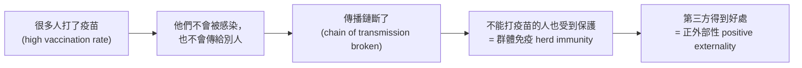

# 10 外部性與市場失靈 (Externalities and Market Failure)

> **對應課程**：**Week 8 – Externalities** · Study Area 2 (Markets in Action) → **A3 Group Essay**（小組論文屬於 Markets in Action，這一課是重要的分析工具）、**A5 Topic Activities**（Herd Immunity Questions、Revision Quiz: Externalities）
>
> **本課資料來源**：
> - 解釋、例子和圖以**標準教科書內容**為基礎，主要參考 OpenStax《Principles of Economics 3e》：[12.1 The Economics of Pollution](https://openstax.org/books/principles-economics-3e/pages/12-1-the-economics-of-pollution)、[12.2 Command-and-Control Regulation](https://openstax.org/books/principles-economics-3e/pages/12-2-command-and-control-regulation)、[12.3 Market-Oriented Environmental Tools](https://openstax.org/books/principles-economics-3e/pages/12-3-market-oriented-environmental-tools)、[13.1 Investments in Innovation](https://openstax.org/books/principles-economics-3e/pages/13-1-investments-in-innovation)、[13.3 Public Goods](https://openstax.org/books/principles-economics-3e/pages/13-3-public-goods)。
> - 標 **✅ 官方定義** 的英文定義，一字不改引自 *MUF0061 Introduction to Microeconomics Definitions and Index*（Study Area 2，Topic 13–14）。標 **📘 教科書定義** 的是標準教科書的用字。
> - 真實例子都附上連結。表格和圖裡的數字是**為了練習而設計的**。
>
> **週次說明**：官方的建議時間表 (Timeline) 把 Externalities 放在 Week 7、Excise Taxes and Subsidies 放在 Week 8；你的 Moodle（深圳校區）是 Week 7 稅與補貼、Week 8 外部性。**以 Moodle 為準。** 第 10 節（政府的對策）會用到 [`09_消費稅與補貼.md`](09_消費稅與補貼.md) 的稅和補貼圖，不熟的話可以先複習那一課。
>
> **建議時間**：120–150 分鐘

## 本課學完，你要會：

- [ ] 用英文寫出 **market failure**、**negative externalities**、**positive externalities** 的官方定義
- [ ] 判斷一個例子是**正**還是**負**外部性，發生在**生產**還是**消費**
- [ ] 解釋**私人**和**社會**的成本與收益：**MSC = MPC + 外部成本**、**MSB = MPB + 外部收益**（正的生產外部性和負的消費外部性要用「減」，見 4.2 的表）
- [ ] 畫出四種外部性的圖，標出**市場均衡 (Qm)**、**社會最適 (Q\*)** 和**福利損失三角形**
- [ ] 說明資源**過度分配 (over-allocation)** 和**分配不足 (under-allocation)**
- [ ] 用**疫苗和群體免疫 (herd immunity)** 解釋正外部性
- [ ] 說明並**評價**政府的五種對策：矯正稅、補貼、法規管制、可交易許可證、教育宣傳
- [ ] 說明**公共財 (public goods)** 和**搭便車者 (free rider)** 的問題

---

## 0. 先複習：市場什麼時候「分配得好」？

在 [`07`](07_需求供給與市場均衡.md) 課，我們學到價格機制會把資源分配到消費者想要的地方。這一課要問：**它什麼時候會出錯？**

先學一個新詞：**邊際 (marginal) = 「多一個」**。

| 曲線 | 它的高度代表什麼 | 新名字 |
|---|---|---|
| 需求曲線 D | 買方**願意為多一個付多少錢**＝多一個帶給買方的好處 | **邊際收益 (marginal benefit)** |
| 供給曲線 S | 賣方**多生產一個要花多少成本** | **邊際成本 (marginal cost)** |

**例子**：`07` 課的奶茶店，均衡在 ¥14、每天 50 杯。第 50 杯對買的人值 ¥14，做這一杯也剛好花 ¥14。如果再多做第 51 杯，成本會高於它帶來的好處——不划算。所以在均衡點，**「最後一單位的好處 = 最後一單位的成本」**，資源沒有浪費。這就叫**配置效率 (allocative efficiency)**。

> **✅ 官方定義 — Allocative efficiency**
> The condition in which scarce resources are allocated towards the production of goods and services that best satisfy consumer needs and wants.

⚠️ 但是有一個**前提**：所有的成本和收益都要由**買方和賣方自己**承擔和享受。如果有**別人**（第三方）承受了成本或得到了好處，市場就「看不到」這些東西，結果就會出錯。這就是這一課的主角。

---

## 1. 市場失靈 (Market failure)

### 白話解釋
**市場失靈 = 市場自己運作的結果，對整個社會來說不是最好的**——某樣東西生產得**太多**或**太少**，資源被用錯了地方。

⚠️「失靈」**不是**市場倒閉、沒人交易。市場照樣在買賣，只是**數量不對**。

### 生活例子
宿舍樓下有一個燒烤攤，生意很好。燒烤攤老闆只算自己的成本（肉、炭、租金），**不用付**樓上同學被油煙和噪音影響的「成本」（睡不好、衣服有煙味、要關窗）。結果：從整個社會來看，燒烤攤賣出的烤串**太多了**。

### 英文定義
> **✅ 官方定義 — Market failure**
> A situation in which a market fails to operate efficiently, resulting in a misallocation of resources.

| 關鍵字 | 意思 |
|---|---|
| fails to operate **efficiently** | 沒有達到配置效率（不是「沒有運作」） |
| **misallocation of resources** | 資源分配不當：分給這個產品的資源**太多**或**太少** |

### 市場失靈的常見原因（📘 標準教科書內容）

| 原因 | 白話 | 在哪裡學 |
|---|---|---|
| **外部性 (externalities)** | 交易影響到第三方 | 本課第 2–10 節 |
| **公共財 (public goods)** | 不付錢也能用，所以沒人願意付錢，市場不提供 | 本課第 11 節 |
| **市場力量 (market power)**，例如壟斷 | 一家公司控制價格，產量太少 | Week 12–13（[`14_`](14_完全競爭與壟斷.md)、[`15_`](15_效率_壟斷性競爭與寡頭壟斷.md)） |
| 資訊不對稱 (asymmetric information)（補充） | 一方知道得比另一方多，例如賣二手手機的人比買的人更清楚手機有沒有問題 | 補充知識 |

---

## 2. 外部性是什麼？(Externalities)

### 白話解釋
**外部性 = 一個交易影響到了「第三方」(third party)，而這個影響沒有反映在價格裡。**

- **第三方** = **不是買方、也不是賣方**的人（鄰居、路人、社會大眾）。
- 第三方**沒有付錢**（得到好處時），也**沒有被補償**（受到傷害時）。
- 對第三方**有害** → **負外部性 (negative externality)**；對第三方**有利** → **正外部性 (positive externality)**。

### 生活例子
你網購了一台很大聲的藍牙音響。買方是你，賣方是網店。晚上 12 點你在宿舍大聲放歌，**室友**睡不著——室友就是**第三方**，他沒有參與這筆交易，卻承受了成本，也沒有人補償他。→ **負外部性**。

### 英文定義
> **📘 教科書定義 — Externality**（OpenStax 3e，第 12 章 Key Terms）
> "a market exchange that affects a third party who is outside or 'external' to the exchange"（也叫 **spillover**，外溢效果）

> **✅ 官方定義 — Negative externalities**
> Negative effects that are experienced by third parties as a result of the production and/or consumption of a product.

> **✅ 官方定義 — Positive externalities**
> Positive effects that are experienced by third parties as a result of the production and/or consumption of a product.

| 關鍵字 | 意思 |
|---|---|
| **third parties** | 第三方：交易以外的人。**一定要寫**，這是外部性的核心 |
| **production and/or consumption** | 外部性可能在**生產**時出現，也可能在**消費**時出現 |
| negative / positive **effects** | 有害的／有利的影響 |

> ⚠️ **自己承受的不算外部性！** 吸菸的人自己的肺受傷，是**他自己**的成本（私人成本）；**旁邊的人吸到二手菸**才是外部性。

---

## 3. 四種外部性 (Four types of externalities)

用兩個問題來分類：
1. **對第三方是好還是壞？** → 正 (positive) 或 負 (negative)
2. **這個影響是在「生產」的過程中產生，還是在「使用/消費」的時候產生？** → 生產 (production) 或 消費 (consumption)

| | **負外部性 (negative)** | **正外部性 (positive)** |
|---|---|---|
| **生產 (production)** | 工廠把廢水排進河裡，下游漁民受害；燃煤發電排放廢氣；工地半夜施工的噪音；樓下燒烤攤的油煙 | 養蜂場的蜜蜂幫附近果園授粉；企業的研發成果被其他公司學去；公司培訓員工，員工跳槽後新公司也受益 |
| **消費 (consumption)** | 吸菸（二手菸）；開車（塞車、廢氣）；半夜在宿舍大聲放音樂；在圖書館講電話 | **打疫苗**（別人也比較不會被傳染）；受教育（社會更有生產力、更安全）；在自家陽台種花，路人也覺得漂亮 |

**同一個產品可以有兩種外部性**：以汽車為例——
- 汽車**工廠生產**汽車時排放廢氣 → **負的生產外部性**
- 你**開車**時造成塞車和廢氣 → **負的消費外部性**

### 小練習（答案就在下面）
宿舍樓下燒烤攤的油煙 → 負・生產｜同學打流感疫苗 → 正・消費｜在圖書館講電話 → 負・消費｜科技公司的新發明被其他公司學去改良 → 正・生產

---

## 4. 私人 vs 社會：成本和收益 (Private vs social costs and benefits)

### 4.1 白話解釋

| 名詞 | 意思 | 例子（成本：T 恤染布工廠；收益：疫苗） |
|---|---|---|
| **私人成本 (private cost)** | 生產者（或消費者）**自己付**的成本 | 工廠付的工資、布料、染料、電費 |
| **外部成本 (external cost)** | **第三方**承受的成本 | 下游漁民少賺的錢、居民淨水的花費 |
| **社會成本 (social cost)** | **私人成本 + 外部成本** | 整個社會為這件 T 恤付出的全部成本 |
| **私人收益 (private benefit)** | 買的人**自己**得到的好處 | 打疫苗的人自己不容易生病 |
| **外部收益 (external benefit)** | **第三方**得到的好處 | 身邊的人比較不會被傳染 |
| **社會收益 (social benefit)** | **私人收益 + 外部收益** | 整個社會從這一針疫苗得到的全部好處 |

> **📘 教科書定義 — Social benefits**（OpenStax 3e，第 13 章 Key Terms）："the sum of private benefits and external benefits"
> **📘 教科書定義 — Social costs**（意思，OpenStax 3e 第 12 章）：social costs include both the **private costs** paid by firms **and** the **external costs** borne by third parties, such as the cost of pollution.

### 4.2 「邊際」版本和縮寫（畫圖一定會用）

| 縮寫 | 英文全名 | 中文 | 意思 | 在圖上 |
|---|---|---|---|---|
| **MPC** | marginal private cost | 邊際私人成本 | 多生產 1 單位，生產者**自己**付的成本 | **供給曲線 S = MPC** |
| **MSC** | marginal social cost | 邊際社會成本 | MPC + 邊際外部成本 | 有生產外部性時，和 S 分開的另一條線 |
| **MPB** | marginal private benefit | 邊際私人收益 | 多買 1 單位，買方**自己**得到的好處 | **需求曲線 D = MPB** |
| **MSB** | marginal social benefit | 邊際社會收益 | MPB + 邊際外部收益 | 有消費外部性時，和 D 分開的另一條線 |
| MEC / MEB | marginal external cost / benefit | 邊際外部成本／收益 | 多 1 單位時，第三方承受的成本／得到的好處 | 兩條線之間的**垂直距離** |

> 🔑 **兩條公式**
> **MSC = MPC + 外部成本**　　**MSB = MPB + 外部收益**
> （外部成本或收益是 0 → 兩條線**重疊**，例如 MSC = MPC。）

⚠️ **上面的公式是最常見的兩種情況。四種外部性要這樣用**（第 5–8 節的四個例子都照這張表算）：

| 外部性 | 公式 | 哪一條線和市場的線分開？ |
|---|---|---|
| 負的**生產**外部性（T 恤工廠污染河流） | **MSC = MPC + 外部成本** | MSC 在供給 (MPC) **上方** |
| 正的**生產**外部性（蜜蜂幫果園授粉） | **MSC = MPC − 外部收益** | MSC 在供給 (MPC) **下方** |
| 正的**消費**外部性（打疫苗） | **MSB = MPB + 外部收益** | MSB 在需求 (MPB) **上方** |
| 負的**消費**外部性（吸菸、二手菸） | **MSB = MPB − 外部成本** | MSB 在需求 (MPB) **下方** |

> 💡 口訣：**生產**的外部性動「成本線」(MSC)，**消費**的外部性動「收益線」(MSB)。**負的**讓社會成本變高、社會收益變低；**正的**剛好相反。

### 4.3 兩條最重要的規則

> 🔑 **市場**只看自己的成本和收益 → 產量在 **MPB = MPC**（需求和供給的交點）→ **市場數量 Qm (market quantity)**
> 🔑 **社會**的最佳產量 → **MSB = MSC** → **社會最適數量 Q\* (socially optimal quantity)**，這時達到**配置效率**

- 沒有外部性：MPB = MSB、MPC = MSC → **Qm = Q\***，市場有效率。
- 有外部性：**Qm ≠ Q\*** → **市場失靈**：
  - **Qm > Q\***：生產或消費**太多** → **資源過度分配 (over-allocation of resources)** ← 負外部性
  - **Qm < Q\***：生產或消費**太少** → **資源分配不足 (under-allocation of resources)** ← 正外部性

---

## 5. 負的生產外部性 (Negative production externality)：T 恤染布工廠

### 白話解釋
一家 T 恤工廠把染布的廢水排進河裡。下游的漁民捕不到魚，附近居民要花錢買淨水器——這些是**外部成本**，工廠**不用付**。工廠只看自己的成本 (MPC)，覺得生產很便宜，於是**生產太多**。

### 一步一步的例題
假設每生產 1 件 T 恤，河流污染造成的外部成本是 **¥30**（數量單位：千件／週）。

| 數量 Q（千件） | MPB = MSB（¥） | MPC（¥） | 外部成本（¥） | MSC = MPC + 30（¥） | 這一件對社會划算嗎？ |
|---|---|---|---|---|---|
| 10 | 90 | 30 | 30 | 60 | MSB 90 > MSC 60 ✅ 划算 |
| 20 | 80 | 40 | 30 | 70 | 80 > 70 ✅ 划算 |
| **25** | **75** | 45 | 30 | **75** | **MSB = MSC → 社會最適 Q\*** |
| 30 | 70 | 50 | 30 | 80 | 70 < 80 ❌ 每件社會虧 ¥10 |
| 35 | 65 | 55 | 30 | 85 | 65 < 85 ❌ 每件社會虧 ¥20 |
| **40** | **60** | **60** | 30 | 90 | **MPB = MPC → 市場均衡 Qm**；但每件社會虧 ¥30 |
| 50 | 50 | 70 | 30 | 100 | 市場也不會做到這裡（MPB < MPC） |

（這裡沒有消費外部性，所以 MPB = MSB。）

**第 1 步：找市場均衡**——MPB = MPC 在 Q = 40：**Qm = 40 千件，Pm = ¥60**。
**第 2 步：找社會最適**——MSB = MSC 在 Q = 25：**Q\* = 25 千件，P\* = ¥75**。
**第 3 步：比較**——Qm (40) > Q\* (25)，市場**多生產了 15 千件 = 15,000 件** → 太多勞動、布料、機器時間被用來做 T 恤 → **資源過度分配 (over-allocation of resources)**。
**第 4 步：為什麼多出來的那些不划算？**——從第 25 千件到第 40 千件，每一件的 **MSC 都大於 MSB**：社會付出的比得到的多。例如第 30 千件，社會得到 ¥70 的好處，卻付出 ¥80 的成本，虧 ¥10。
**第 5 步（進階）：算福利損失**——把每一件的虧損加起來，就是圖上 Q\* 到 Qm 之間的三角形：
> 福利損失 (welfare loss) = ½ × 底 × 高 = ½ × (40 − 25) × (90 − 60) = ½ × 15 × 30 = **225**（千元）= **每週 ¥225,000**

### 圖

```text
        Negative production externality: the market for T-shirts
      Price, cost, benefit (yuan)
        ^
        |
        |                                //MSC
        |                              //
        |\\                         ///
        |  \\\                    //
        |     \\               ///
        |       \\\          //##              //S = MPC
        |          \\     ///####            //
        |            \\\//#######         ///
  P*=75 |............///\\#######       //
        |          //  :  \\#####    ///
        |        //    :    \\\##  //
  Pm=60 |.....///......:.......\///
        |   //         :      //:\\\
        |///           :   ///  :   \\
        |              : //     :     \\\
        |             ///       :        \\
        |           // :        :          \\\
        |        ///   :        :             \\
        |      //      :        :               \D = MPB = MSB
        |   ///        :        :
        | //           :        :
        |/             :        :
        |              :        :
        |              :        :
        |              :        :
        |              :        :
        +-------------------------------------------------------------> Quantity of T-shirts (thousand)
      0              Q*=25    Qm=40
        MSC = MPC + external cost (30)
        ### = welfare loss (between Q* and Qm, MSC above MSB)
```

### 怎麼畫、怎麼標（照順序）
1. **標題**：*Negative production externality: the market for T-shirts*
2. **軸**：縱軸 *Price, cost, benefit (¥)*；橫軸 *Quantity of T-shirts*。
3. 先畫市場：**D = MPB = MSB**（向右下）、**S = MPC**（向右上）。交點就是市場均衡，畫虛線到兩軸，標 **Pm、Qm**。
4. 畫 **MSC**：在 MPC 的**上方**，和 MPC 平行，兩線的垂直距離 = **外部成本**。
5. MSC 和 D (= MSB) 的交點是社會最適，畫虛線，標 **P\*、Q\***。
6. **塗福利損失三角形**：在 **Q\* 和 Qm 之間**、**MSC（上）和 MSB（下）之間**。三角形的**尖端在社會最適點**，**底邊是 Qm 那條垂直線**。
7. 在圖下寫說明，並**引用圖上的標籤**。

### 英文說明的寫法（模板）
> *The market equilibrium is at Qm, where MPB = MPC. However, the firm does not pay the external cost of pollution, so MSC lies above MPC. The socially optimal output is Q\*, where MSB = MSC. Since Qm is greater than Q\*, there is an over-allocation of resources to T-shirt production, and the shaded triangle shows the welfare loss to society.*

---

## 6. 負的消費外部性 (Negative consumption externality)：吸菸與二手菸

### 白話解釋
吸菸者買菸時只想到自己的享受（MPB），**沒有算到**旁邊的人吸二手菸的健康損害。對社會來說，每包菸的真正好處 (MSB) 要**扣掉**這個外部成本，所以 **MSB 在 MPB 的下方**。

### 例題（數量單位：千包／月；外部成本每包 ¥30）
- 市場：MPB = MPC → **Qm = 40 千包，Pm = ¥60**
- 社會：MSB = MSC → MSB = MPB − 30，**Q\* = 25 千包，P\* = ¥45**
- Qm > Q\* → **消費太多**，資源**過度分配**到香菸上
- 福利損失 = ½ × (40 − 25) × (60 − 30) = ½ × 15 × 30 = **225（千元）**

```text
        Negative consumption externality: the market for cigarettes
      Price, cost, benefit (yuan)
        ^
        |
        |
        |
        |\\
        |  \\\
        |     \\
        |       \\\                            //S = MPC = MSC
        |          \\                        //
        |            \\\                  ///
        |               \\              //
        |\                \\         ///
        | \\\               \\\    //
  Pm=60 |....\\................\///
        |      \\\            //#\\\
        |         \\       ///###   \\
        |           \\\  //######     \\\
  P*=45 |.............///########        \\
        |           // : \\\#####          \\\
        |        ///   :    \\###             \\
        |      //      :      \\\               \D = MPB
        |   ///        :        :\\
        | //           :        :  \\\
        |/             :        :     \\
        |              :        :       \\\
        |              :        :          \\
        |              :        :            \\
        |              :        :              \\MSB
        +-------------------------------------------------------------> Quantity of cigarettes (thousand packs)
      0              Q*=25    Qm=40
        MSB = MPB - external cost (30)
        ### = welfare loss (between Q* and Qm, MSC above MSB)
```

**標法重點**：這次**供給那條線不用動**（生產時沒有外部性），所以標成 **S = MPC = MSC**；**需求**這邊分成兩條：**D = MPB**（較高）和 **MSB**（較低）。福利損失三角形在 Q\* 和 Qm 之間、**MSC（上）和 MSB（下）**之間。

---

## 7. 正的生產外部性 (Positive production externality)：養蜂場與果園

### 白話解釋
養蜂場生產蜂蜜，它的蜜蜂也飛去幫附近果園的果樹**授粉**，果農的收成變好了（第三方受益），但果農沒有付錢給養蜂場。對社會來說，生產蜂蜜的真正成本要**扣掉**這個好處，所以 **MSC 在 MPC 的下方**。養蜂場只看自己的成本，就會**養得太少**。

其他例子：企業做研發 (R&D)，新技術被其他公司學去。OpenStax 13.1 提到，研究發現**發明者自己通常只拿到創新總好處的大約三分之一到二分之一**，其他都「外溢」給了社會——所以企業做的研發會比社會需要的少。

### 例題（數量單位：千公斤；外部收益每公斤 ¥30）
- 市場：MPB = MPC → **Qm = 30，Pm = ¥70**
- 社會：MSB = MSC（MSC = MPC − 30）→ **Q\* = 45，P\* = ¥55**
- Qm < Q\* → **生產太少**，資源**分配不足 (under-allocation)**
- 福利損失 = ½ × (45 − 30) × (70 − 40) = ½ × 15 × 30 = **225（千元）**

```text
        Positive production externality: the market for honey
      Price, cost, benefit (yuan)
        ^
        |
        |                                      /S = MPC
        |                                    //
        |\\                                //
        |  \\\                          ///
        |     \\                      //
        |       \\\                ///
        |          \\            //
        |            \\\      ///               /MSC
        |               \\  //                //
  Pm=70 |................///               ///
        |              // :#\\\          //
        |           ///   :####\\     ///
        |         //      :######\\\//
  P*=55 |......///........:######///\\
        |    //           :####//  :  \\\
        | ///             :#///    :     \\
        |/                //       :       \\\
        |               //:        :          \\
        |            ///  :        :            \D = MPB = MSB
        |          //     :        :
        |       ///       :        :
        |     //          :        :
        |  ///            :        :
        |//               :        :
        |                 :        :
        |                 :        :
        +-------------------------------------------------------------> Quantity of honey (thousand kg)
      0                 Qm=30    Q*=45
        MSC = MPC - external benefit (30)
        ### = welfare loss (between Qm and Q*, MSB above MSC)
```

**標法重點**：需求不用動，標成 **D = MPB = MSB**；供給分成兩條：**S = MPC**（較高）和 **MSC**（較低）。福利損失三角形在 **Qm 和 Q\* 之間**、**MSB（上）和 MSC（下）**之間——是社會「該得到卻沒得到」的好處。

---

## 8. 正的消費外部性 (Positive consumption externality)：疫苗與群體免疫 ⭐

這是課程特別強調的例子（Week 8 的 *Herd Immunity Questions*）。

### 白話解釋
你打流感疫苗：
- **私人收益**：你自己比較不會得流感、不用請病假。
- **外部收益**：你不生病，就**不會把病毒傳給**室友、同學、家人——他們沒有付錢，卻得到保護。

所以疫苗的**社會收益 > 私人收益**，**MSB 在 MPB 的上方**。

### 群體免疫 (herd immunity)
當**夠多的人**有免疫力時，病毒很難找到下一個可以感染的人，傳播鏈就斷了。這時連**不能打疫苗的人**（剛出生的嬰兒、免疫力很弱的病人、對疫苗嚴重過敏的人）也間接受到保護。

> **📘 世界衛生組織 (WHO) 的說法**：herd immunity（也叫 population immunity）是 "the indirect protection from an infectious disease"——當一個群體透過疫苗或之前的感染而有免疫力時，所產生的**間接保護**。
> WHO 舉例：**麻疹 (measles)** 大約要 **95%** 的人接種，才能達到群體免疫；**小兒麻痺 (polio)** 大約 **80%**。（來源：[WHO – Herd immunity, lockdowns and COVID-19](https://www.who.int/news-room/questions-and-answers/item/herd-immunity-lockdowns-and-covid-19)）



### 為什麼市場會「打太少」？
1. 每個人只比較**自己的好處 (MPB)** 和**價格**，不會把「保護別人」算進去 → **Qm < Q\***。
2. **搭便車 (free rider)**：「身邊的人都打了，我不打也不太會被傳染。」——想享受別人的群體免疫，自己卻不付出。如果很多人都這樣想，接種率就會**低於群體免疫的門檻**，疾病又會爆發。

> **✅ 官方定義 — Free rider**
> A person who obtains benefits from a good or service without paying for it.

### 一步一步的例題：某區的流感疫苗（數量單位：千針／年；每針的外部收益 ¥30）

| 數量 Q（千針） | MPB（¥） | 外部收益（¥） | MSB = MPB + 30（¥） | MPC = MSC（¥） | 說明 |
|---|---|---|---|---|---|
| 15 | 65 | 30 | 95 | 35 | |
| **30** | **50** | 30 | 80 | **50** | **MPB = MPC → 市場均衡 Qm** |
| 40 | 40 | 30 | 70 | 60 | MSB 70 > MSC 60：社會還想要更多 |
| **45** | 35 | 30 | **65** | **65** | **MSB = MSC → 社會最適 Q\*** |
| 55 | 25 | 30 | 55 | 75 | 太多了（MSB < MSC） |

**第 1 步**：市場均衡——MPB = MPC → **Qm = 30 千針，Pm = ¥50**。
**第 2 步**：社會最適——MSB = MSC → **Q\* = 45 千針，P\* = ¥65**。
**第 3 步**：Qm (30) < Q\* (45) → 少打了 **15 千針 = 15,000 針** → **資源分配不足 (under-allocation of resources)**。
**第 4 步**：從第 30 到第 45 千針，每一針的 MSB 都大於 MSC：社會**本來可以得到**這些好處卻沒得到。
**第 5 步（進階）**：福利損失 = ½ × (45 − 30) × (80 − 50) = ½ × 15 × 30 = **225（千元）**。

```text
        Positive consumption externality: the market for flu vaccinations
      Price, cost, benefit (yuan)
        ^
        |\
        | \\
        |   \\\
        |      \\
        |        \\\
        |           \\
        |             \\\                      //S = MPC = MSC
        |                \\                  //
        |\\                \\\            ///
        |  \\\             ###\\        //
        |     \\           #####\\\  ///
  P*=65 |.......\\\........########//
        |          \\      #####///: \\\
        |            \\\   ###//   :    \\
        |               \\ ///     :      \\\
  Pm=50 |................//\\      :         \\
        |             /// :  \\    :           \\MSB
        |           //    :    \\\ :
        |        ///      :       \\
        |      //         :        :\\\
        |   ///           :        :   \\
        | //              :        :     \\\
        |/                :        :        \\
        |                 :        :          \\\
        |                 :        :             D = MPB
        |                 :        :
        |                 :        :
        +-------------------------------------------------------------> Quantity of flu vaccinations (thousand)
      0                 Qm=30    Q*=45
        MSB = MPB + external benefit (30)
        ### = welfare loss (between Qm and Q*, MSB above MSC)
```

**標法重點**：供給不用動，標成 **S = MPC = MSC**；需求分成兩條：**D = MPB**（較低）和 **MSB**（較高，兩線距離 = 外部收益）。福利損失三角形在 **Qm 和 Q\* 之間**、**MSB（上）和 MSC（下）**之間。

### 英文說明的寫法（模板）
> *Vaccination creates a positive consumption externality. When a person is vaccinated, third parties also benefit because the disease is less likely to spread to them (herd immunity). Individuals only consider their marginal private benefit (MPB), so the market quantity Qm, where MPB = MPC, is less than the socially optimal quantity Q\*, where MSB = MSC. There is an under-allocation of resources to vaccinations, shown by the welfare loss triangle between Qm and Q\*.*

### 真實世界：中國怎麼處理疫苗的正外部性？
中國的《疫苗管理法》（2019 年 12 月 1 日起施行）同時用了**補貼、法規**兩種方法：
- **第 6 條**：*"The government shall provide immunization program vaccines for the citizens free of charge."*（免疫規劃疫苗由政府**免費**提供）→ **補貼**（消費者價格降到 0）
- **第 48 條**：*"Where any child is admitted to a nursery or school, the nursery or school shall check the immunization certificate."*（入托、入學要查驗預防接種證）→ **法規**
- **第 49 條**：接種單位接種免疫規劃疫苗**不得收取任何費用**。

（來源：全國人大英文版法律全文 [第 1 頁](https://subsites.chinadaily.com.cn/npc/2019-06/29/c_674711.htm)、[第 2 頁](https://subsites.chinadaily.com.cn/npc/2019-06/29/c_674711_2.htm)）

---

## 9. 四種外部性一張表（**背這張表**）

| 類型 | 例子 | 哪兩條線分開？ | 第三條線在哪？ | Qm vs Q\* | 資源 | 福利損失三角形 |
|---|---|---|---|---|---|---|
| 負・生產 | 工廠污染 | MSC 和 MPC | MSC 在 MPC **上方** | Qm **>** Q\* | **過度分配** | Q\*→Qm，MSC 和 MSB (= D) 之間 |
| 負・消費 | 二手菸 | MSB 和 MPB | MSB 在 MPB **下方** | Qm **>** Q\* | **過度分配** | Q\*→Qm，MSC (= S) 和 MSB 之間 |
| 正・生產 | 養蜂授粉 | MSC 和 MPC | MSC 在 MPC **下方** | Qm **<** Q\* | **分配不足** | Qm→Q\*，MSB (= D) 和 MSC 之間 |
| 正・消費 | 疫苗 | MSB 和 MPB | MSB 在 MPB **上方** | Qm **<** Q\* | **分配不足** | Qm→Q\*，MSB 和 MSC (= S) 之間 |

> 🔑 **口訣**
> **生產 → 動成本線 (MSC)；消費 → 動收益線 (MSB)。**
> **負 → 太多 (over)；正 → 太少 (under)。**
> **福利損失三角形的尖端，永遠指向社會最適點 (Q\*)；底邊在 Qm。**

---

## 10. 政府怎麼辦？(Government responses)

> **✅ 官方定義 — Government intervention**
> Any action taken by the government to influence the market and other economic outcomes.

**目標**：讓數量從 Qm **移到 Q\***。做法是讓買方或賣方**「感受到」**他們沒有算進去的外部成本或收益——這叫**把外部性內部化 (internalise the externality)**。

| 對策 | 用在哪種外部性 | 怎麼運作 | 例子 |
|---|---|---|---|
| **矯正稅** (corrective tax / Pigouvian tax) | 負 | 每單位課稅 = 外部成本 → 成本上升 → 數量減少 | 菸稅、碳稅、污染費 |
| **補貼** (subsidy) | 正 | 每單位補貼 = 外部收益 → 價格下降 → 數量增加 | 免費疫苗、公共交通補貼 |
| **法規管制** (regulation) | 負（有時正） | 用法律禁止、限制、規定標準，違規罰款 | 公共場所禁菸、排放標準、入學查驗接種證 |
| **可交易許可證** (tradable permits / cap-and-trade) | 負（污染） | 政府定污染**總量**，發許可證，企業可以買賣 | 全國碳排放權交易市場 |
| **教育和宣傳** (education / advertising campaigns) | 正和負 | 改變人的資訊和喜好 → 需求移動 | 戒菸廣告、接種疫苗宣傳 |

> 💡 和 `06c` 課連起來：稅是一種**負誘因 (disincentive)**，補貼是一種**誘因 (incentive)**。

### 10.1 矯正稅 (Corrective tax)

**怎麼運作**：對每單位產品課一個**等於外部成本**的稅。對賣方來說，稅就像成本增加 → 供給曲線從 S0 = MPC **向上（向左）移**到 S1 = MPC + 稅。當稅 = 外部成本時，**S1 剛好和 MSC 重疊** → 新的均衡就在 **Q\***。這也叫**「污染者付費」(polluter pays)**。

**用第 5 節 T 恤工廠的數字**：每件課稅 ¥30（= 外部成本）

| | 課稅前 | 課稅後 |
|---|---|---|
| 數量 | Q0 = 40 千件 | Q1 = **25 千件 = Q\*** ✅ |
| 買方付的價格 | ¥60 | **¥75** |
| 賣方實際拿到（扣稅後） | ¥60 | ¥75 − ¥30 = **¥45** |
| 政府稅收 | 0 | ¥30 × 25 千件 = **¥750,000** |

```text
        Corrective tax on T-shirt producers (tax = external cost)
      Price, cost, benefit (yuan)
        ^
        |
        |                                //S1 = MPC + tax = MSC
        |                              //
        |\\                         ///
        |  \\\                    //
        |     \\               ///
        |       \\\          //                //S0 = MPC
        |          \\     ///                //
        |            \\\//                ///
  P1=75 |............///\\              //
        |          //  :  \\         ///
        |        //    :    \\\    //
  P0=60 |.....///......:.......\///
        |   //         :      //:\\\
        |///           :   ///  :   \\
        |              : //     :     \\\
     45 |.............///       :        \\
        |           // :        :          \\\
        |        ///   :        :             \\
        |      //      :        :               \D = MPB = MSB
        |   ///        :        :
        | //           :        :
        |/             :        :
        |              :        :
        |              :        :
        |              :        :
        |              :        :
        +-------------------------------------------------------------> Quantity of T-shirts (thousand)
      0            Q1=Q*=25   Q0=40
        tax = 30 per unit = external cost
        buyers pay 75, sellers keep 75 - 30 = 45
```

> **📘 教科書定義 — Pollution charge**（OpenStax 3e，第 12 章 Key Terms）："a tax imposed on the quantity of pollution that a firm emits"
> 課程裡的**消費稅 (excise tax)** 也常被用來做矯正稅。✅ 官方定義：*Excise tax — A compulsory financial contribution to the government, levied on sellers of a particular product.*（詳見 [`09_`](09_消費稅與補貼.md)）

**真實例子**：中國在 **2015 年 5 月**提高菸草消費稅：批發環節的從價稅率從 **5% 提高到 11%**，並加徵**每支 ¥0.005（每包 ¥0.1）**的從量稅。WHO 估計零售價會平均上漲 **7–10%**，對香菸消費量有「modest but measurable」（不大但可以量到）的減少作用。（來源：[WHO 2015](https://www.who.int/hongkongchina/news/detail/15-05-2015-who-releases-preliminary-assessment-of-china-s-tobacco-tax-increase)）

| 👍 優點 | 👎 缺點／限制 |
|---|---|
| 直接處理問題的根源：讓污染者或消費者付出外部成本 | **外部成本很難算準**：稅太高或太低，都到不了 Q\* |
| 政府得到**稅收**，可以用來補償受害者或支付醫療 | 如果**需求缺乏彈性**（例如香菸，見 [`08_`](08_需求價格彈性.md)），課稅後數量**只減少一點** |
| 企業有誘因找更乾淨的生產方法（少污染就少繳稅） | 可能是**累退的 (regressive)**：低收入者付的稅佔收入比例較高 |
| 讓市場自己決定怎麼減少，比一刀切的規定有彈性 | 可能引起走私、黑市，或企業搬到不課稅的地方 |

### 10.2 補貼 (Subsidy)

> **✅ 官方定義 — Subsidy**
> A payment provided by the government to a person or a firm, in order to encourage a particular behaviour.

**怎麼運作**：每單位補貼**等於外部收益**。補貼給生產者（例如診所）→ 成本下降 → 供給曲線從 S0 = MPC **向下（向右）移**到 S1 = MPC − 補貼 → 新均衡在 **Q\***。（也可以給消費者**消費券／代金券**，讓需求曲線右移，結果一樣。）

**用第 8 節疫苗的數字**：每針補貼 ¥30（= 外部收益）

| | 補貼前 | 補貼後 |
|---|---|---|
| 數量 | Q0 = 30 千針 | Q1 = **45 千針 = Q\*** ✅ |
| 消費者付的價格 | ¥50 | **¥35** |
| 生產者實際拿到（含補貼） | ¥50 | ¥35 + ¥30 = **¥65** |
| 政府花費 | 0 | ¥30 × 45 千針 = **¥1,350,000** |

```text
        Subsidy for flu vaccinations (subsidy = external benefit)
      Price, cost, benefit (yuan)
        ^
        |\
        | \\
        |   \\\
        |      \\
        |        \\\
        |           \\
        |             \\\                      //S0 = MPC
        |                \\                  //
        |\\                \\\            ///
        |  \\\                \\        //
        |     \\                \\\  ///
     65 |.......\\\................//
        |          \\           ///: \\\
        |            \\\      //   :    \\      /S1 = MPC - subsidy
        |               \\ ///     :      \\\ //
  P0=50 |................//\\      :       ///\
        |             /// :  \\    :     //    \\MSB
        |           //    :    \\\ :  ///
  P1=35 |........///......:.......\\//
        |      //         :      ///\\\
        |   ///           :    //  :   \\
        | //              : ///    :     \\\
        |/                //       :        \\
        |              ///:        :          \\\
        |            //   :        :             D = MPB
        |         ///     :        :
        |       //        :        :
        +-------------------------------------------------------------> Quantity of flu vaccinations (thousand)
      0                 Q0=30  Q1=Q*=45
        subsidy = 30 per vaccination = external benefit
        buyers pay 35, sellers receive 35 + 30 = 65
```

**真實例子**：
- 中國的免疫規劃疫苗**由政府免費提供**（見第 8 節）——這是「補貼到消費者價格 = 0」的極端例子。
- 深圳在 **2017 年底**把全市 **16,359 輛公車全部換成電動車**；光是 2017 年，政府就投入大約 **5 億美元**在電動公車和充電設施上，目的是減少空氣污染和噪音。這是用政府的錢**支持比較乾淨的替代品**。（來源：[Yale E360, 2018](https://e360.yale.edu/digest/a-chinese-megacity-bus-fleet-goes-fully-electric)）

| 👍 優點 | 👎 缺點／限制 |
|---|---|
| 增加有益產品的生產和消費，接近 Q\* | **要花政府的錢**——有**機會成本**：這筆錢不能用在醫院、學校 |
| 讓低收入的人也負擔得起（例如免費疫苗） | **外部收益很難算準**：補貼太多會造成浪費 |
| 比強制規定更容易被大家接受 | 有些人本來就會買，補貼給他們等於白花 |
| | 企業可能變得依賴補貼；補貼也可能被濫用 |

### 10.3 法規管制 (Regulation)

**怎麼運作**：政府用法律**直接規定**能做什麼、不能做什麼——**禁止**（公共場所禁菸）、**限制數量**（排放上限）、**規定標準或技術**（汽車排放標準），違規就**罰款**。

> **📘 教科書定義 — Command-and-control regulation**（OpenStax 3e，第 12 章 Key Terms）："laws that specify allowable quantities of pollution"（也可能規定企業必須用哪種污染控制技術）

**真實例子**：
- 深圳在 2019 年把**電子煙**也納入控菸規定，在公共場所（包括公車站台、公共機構的候車／等候區）禁止吸電子煙。（來源：[China Daily / Xinhua, 2019-06-27](https://global.chinadaily.com.cn/a/201906/27/WS5d148264a3103dbf1432aa82.html)）
- 《疫苗管理法》第 48 條：入托、入學要查驗預防接種證（第 8 節）。

| 👍 優點 | 👎 缺點／限制 |
|---|---|
| **簡單、直接、結果比較確定**（例如禁止就是禁止） | 要花錢**執行和監督**（檢查、罰款），執行不嚴就沒用 |
| 對**非常危險**的東西最適合（例如有毒物質直接禁止） | 企業只要**達標就停**，沒有誘因做得更好 |
| 民眾容易理解 | **一刀切**：不管每家企業減污成本高低都一樣要求，社會總成本比較高 |
| | 可能出現黑市（例如禁止後偷偷賣） |

### 10.4 可交易許可證 (Tradable permits / cap-and-trade)

**怎麼運作**（「總量管制與交易」）：
1. 政府先定一個**污染總量上限 (cap)**，例如全區每年 140 噸。
2. 把總量分成**許可證 (permits)**（1 張 = 可以排 1 噸），發給或拍賣給企業。
3. 企業可以**互相買賣**許可證 (trade)：減污**便宜**的企業多減一點，把多出來的許可證**賣掉**；減污**很貴**的企業**買**許可證。
4. 結果：**總污染量 = 上限**（很確定），而且減污是由**成本最低**的企業來做。

> **📘 教科書定義 — Marketable permit program**（OpenStax 3e，第 12 章 Key Terms）：a permit that allows a firm to emit a certain amount of pollution；有多餘許可證的企業可以把它賣給其他企業。

**一步一步的例題**：工廠 A 和 B 現在各排放 100 噸。政府定總量 **140 噸**，各發 **70 張**許可證 → 兩家原本**各要減 30 噸**。

| | 工廠 A | 工廠 B |
|---|---|---|
| 每減 1 噸的成本 | **¥100**（便宜） | **¥500**（很貴） |
| **不能交易**：各減 30 噸 | 30 × 100 = ¥3,000 | 30 × 500 = ¥15,000 |

不能交易時，社會總減污成本 = 3,000 + 15,000 = **¥18,000**。

**可以交易**：A 多減 30 噸（共減 60 噸，排 40 噸），把用不到的 **30 張許可證**以每張 **¥300** 賣給 B；B 不減（排 100 噸 = 自己的 70 張 + 買來的 30 張）。

| | 工廠 A | 工廠 B |
|---|---|---|
| 減污成本 | 60 × 100 = ¥6,000 | 0 |
| 買賣許可證 | 賣 30 張：**收入** ¥9,000 | 買 30 張：**支出** ¥9,000 |
| 淨成本 | 6,000 − 9,000 = **−¥3,000**（反而賺 ¥3,000） | **¥9,000**（比 ¥15,000 省了 ¥6,000） |

- 總排放 = 40 + 100 = **140 噸**——和沒交易時**一樣**符合上限 ✅
- 社會**真正花在減污上的成本** = 只有 A 的 **¥6,000**（買賣許可證的錢只是從 B 轉給 A）——比 ¥18,000 **少了 ¥12,000** ✅
- 兩家工廠都比沒交易時**更好** ✅

**真實例子**：中國的**全國碳排放權交易市場**在 **2021 年**開始運作，起初只涵蓋**電力業**；2025 年政府決定擴大到**鋼鐵、水泥、鋁冶煉**，大約再加入 1,500 家企業。（來源：[ICAP, 2025](https://icapcarbonaction.com/en/news/china-officially-expands-national-ets-cement-steel-and-aluminum-sectors)）

| 👍 優點 | 👎 缺點／限制 |
|---|---|
| **總污染量確定**（就是上限） | **上限很難定**：太寬鬆就沒效果 |
| 由減污成本最低的企業來減 → **社會總成本最低** | 免費發太多許可證 → 許可證很便宜 → 誘因變弱 |
| 企業有誘因**創新**（少排就能賣許可證賺錢） | 要**準確測量**每家企業的排放，行政成本高 |
| 政府拍賣許可證可以有收入 | 適合少數大型污染源（電廠、工廠），不適合數百萬輛汽車這種小污染源 |

### 10.5 教育和宣傳 (Education and advertising campaigns)

**怎麼運作**：提供資訊、改變大家的**喜好** → 需求曲線移動，讓 **MPB 更接近 MSB**。
- 負外部性：戒菸廣告、菸盒上的健康警告 → 香菸**需求減少**（D 左移）
- 正外部性：接種疫苗宣傳、提醒簡訊 → 疫苗**需求增加**（D 右移）

這和 `06c` 課的**行為推力**很像：

> **✅ 官方定義 — Behavioural nudge**（Study Area 1）
> Any attempt to influence a person's decision making using psychology and behavioural economics theories.

| 👍 優點 | 👎 缺點／限制 |
|---|---|
| 成本比較低 | **很慢**：要很久才看到效果 |
| 改變想法後效果**持久** | **效果不確定**、很難衡量，有些人根本不理 |
| 不強迫，保留選擇的自由 | 單獨使用通常不夠，常常要和其他對策一起用 |

### 10.6 怎麼「評價」(evaluate) 政府的對策？

評價題（*Evaluate…*、*Discuss…*、*To what extent…*）不能只寫優點。好的評價會說「**效果要看情況 (it depends on…)**」，然後給**判斷**。下面是常用的「要看什麼」：

| 評價時問自己 | 為什麼重要 |
|---|---|
| 外部成本／收益**量得準嗎**？ | 稅或補貼太大或太小，都到不了 Q\* |
| 需求的**價格彈性 (PED)** 多大？ | 需求缺乏彈性 → 課稅後數量只減少一點，但稅收多（[`08_`](08_需求價格彈性.md)、[`09_`](09_消費稅與補貼.md)） |
| 政府要花多少錢？**機會成本**是什麼？ | 補貼的錢本來可以用在別的地方（[`03_`](03_機會成本.md)） |
| **執行和監督**難不難？ | 法規和許可證都要有人檢查、測量 |
| **公平 (equity)** 嗎？ | 菸稅對低收入者的負擔比例比較大 |
| **短期還是長期**？ | 教育宣傳短期效果小，長期可能很大 |
| 有沒有**副作用**？ | 走私、黑市、企業搬走 |
| 會不會**政府失靈 (government failure)**？ | 介入的成本比好處還大，反而讓情況更糟 |

> 💡 現實中政府常常**同時用好幾種對策**——例如疫苗：免費（補貼）＋入學查驗（法規）＋宣傳（教育）。評價時可以說明它們怎麼**互相配合**。

---

## 11. 公共財與搭便車 (Public goods and the free-rider problem)

### 白話解釋
有些東西：
- **不付錢的人也沒辦法不讓他用** → **非排他性 (non-excludability)**
- **一個人用了，不會讓別人能用的變少** → **非敵對性 (non-rivalry)**

兩個特徵都有，就是**公共財 (public goods)**。因為不付錢也能用，**每個人都想等別人付錢**（搭便車），結果私人企業很難向大家收錢 → 市場**不提供或提供太少** → 市場失靈。

### 生活例子
**路燈**：晚上走在路燈下，沒有人能叫你「付錢才能被照到」（非排他）；你被照到，也不會讓旁邊的人少一點光（非敵對）。
對比**奶茶**：不付錢就拿不到（排他）；你喝了這杯，別人就不能喝同一杯（敵對）→ **私人財 (private good)**。

### 英文定義
> **✅ 官方定義 — Public goods**
> A good or service that one person can consume without reducing its availability for others, and from which no person can be excluded.

> **✅ 官方定義 — Non-excludability**
> A characteristic of a public good meaning that it is impossible to prevent those who don't pay from consuming the benefits of the good.

> **✅ 官方定義 — Non-rivalry**
> A characteristic of a public good meaning the use or consumption of the good does not limit the use or consumption of that good by others.

> **✅ 官方定義 — Free rider**
> A person who obtains benefits from a good or service without paying for it.

| | 排他？(excludable) | 敵對？(rival) | 例子 |
|---|---|---|---|
| **私人財 (private good)** | ✅ 是 | ✅ 是 | 奶茶、手機、地鐵票 |
| **公共財 (public good)** | ❌ 否 | ❌ 否 | 路燈、國防、燈塔、天氣預報、城市的煙火表演 |

### 一步一步的例題：宿舍走廊的燈
宿舍一層樓有 10 個同學，走廊需要裝一盞燈，成本 **¥500**。每個人覺得這盞燈值 **¥100**。
1. 總好處 = 10 × ¥100 = **¥1,000** > 成本 ¥500 → 對大家來說**應該裝**。
2. 但燈裝好後，**沒付錢的人也能用**（非排他）。每個人都想：「等別人出錢，我就能免費用。」→ **搭便車**。
3. 如果每個人都這樣想，就**沒有人出錢** → 燈**裝不起來** → 市場失靈。
4. **解決**：由宿舍管理處（在社會上就是**政府**）向每人收 ¥50（像**稅**一樣，每個人都要付），統一裝燈。每個人付 ¥50、得到 ¥100 的好處 → 大家都更好。

這就是為什麼**路燈、國防、公園**這類東西通常由**政府用稅收來提供**。

---

## 常見錯誤

1. ❌ 把**買方自己**受到的影響當成外部性（「吸菸傷害吸菸者的肺 = 負外部性」）。✅ 外部性一定是**第三方 (third parties)** 受到影響。
2. ❌ 生產和消費外部性分不清。✅ 先問：影響是在**生產過程**還是**使用時**產生？**生產 → 動 MSC；消費 → 動 MSB**。
3. ❌ 負的生產外部性把 MSC 畫在 MPC **下面**。✅ 負生產：MSC 在**上方**；正生產：MSC 在**下方**；負消費：MSB 在**下方**；正消費：MSB 在**上方**。
4. ❌ 福利損失三角形塗錯位置（例如塗在 0 到 Q\* 之間）。✅ 一定在 **Q\* 和 Qm 之間**、**MSB 和 MSC 之間**；尖端在社會最適點。
5. ❌ 說「市場失靈 = 市場倒閉、沒有交易」。✅ 市場照樣運作，只是**數量不對**，資源分配不當 (misallocation of resources)。
6. ❌ 搞混**外部成本**和**社會成本**。✅ **社會成本 = 私人成本 + 外部成本**。
7. ❌ 說「政府應該課很重的稅，讓污染變成零」。✅ 目標是 **Q\***，不是零——T 恤對社會還是有價值的，只是不要**太多**。
8. ❌ 曲線沒標清楚「哪兩條重疊」。✅ 要寫 **D = MPB = MSB** 或 **S = MPC = MSC**，讓老師看出你知道哪一邊沒有外部性。
9. ❌ 評價題只寫優點。✅ 優點、缺點都寫，再用「**it depends on…**」給判斷。
10. ❌ 以為正外部性是「對買方好」。✅ 正外部性是對**第三方**好；對買方好的叫**私人收益**。

---

## 自我檢查

**Q1.** Define *negative externalities* and *market failure*.（用英文）

**Q2.** 把下面每一個分類為「正／負」和「生產／消費」：
(a) 化工廠把廢料排進河裡　(b) 同學打了麻疹疫苗　(c) 鄰居半夜大聲唱卡拉 OK　(d) 果園旁邊的養蜂場　(e) 一家科技公司的研發成果被其他公司學去

**Q3.** 某市場的資料如下（單位：千單位、¥）：需求 MPB = MSB = 120 − Q；供給 MPC = 20 + Q；每單位的外部成本 = ¥20。
(a) 這是哪一種外部性？
(b) 算出市場數量 Qm 和社會最適數量 Q\*。
(c) 資源是過度分配還是分配不足？差多少？
(d)（進階）福利損失是多少？

**Q4.** 用文字描述（或自己畫）疫苗市場的外部性圖：要有哪幾條線？Qm 和 Q\* 在哪？福利損失三角形塗在哪？

**Q5.** 政府想減少含糖飲料的消費。比較「對含糖飲料課稅」和「在學校做健康教育」這兩個對策，各寫一個優點和一個缺點。

<details>
<summary>👉 點我看答案</summary>

**A1.**
- *Negative externalities are negative effects that are experienced by third parties as a result of the production and/or consumption of a product.*
- *Market failure is a situation in which a market fails to operate efficiently, resulting in a misallocation of resources.*

**A2.**
(a) **負・生產**（生產過程污染河流，下游的人受害）
(b) **正・消費**（打疫苗的人身邊的人也受到保護——群體免疫）
(c) **負・消費**（唱歌是「消費」娛樂，鄰居受到噪音影響）
(d) **正・生產**（養蜂場生產蜂蜜時，蜜蜂幫果園授粉）
(e) **正・生產**（研發是生產活動，其他公司受益）

**A3.**
(a) 外部成本出現在**生產**那一邊（MSC = MPC + 20）→ **負的生產外部性**。
(b) 市場：MPB = MPC → 120 − Q = 20 + Q → 2Q = 100 → **Qm = 50**（Pm = ¥70）。
　社會：MSB = MSC → 120 − Q = 40 + Q → 2Q = 80 → **Q\* = 40**（P\* = ¥80）。
(c) Qm > Q\* → **過度分配 (over-allocation)**，多生產了 50 − 40 = **10 千單位**。
(d) 在 Qm = 50：MSC = 40 + 50 = 90，MSB = 120 − 50 = 70，高 = 20。福利損失 = ½ × 10 × 20 = **100（千元）**。

**A4.**
- 軸：縱軸 *Price, cost, benefit*；橫軸 *Quantity of vaccinations*。
- 三條線：**S = MPC = MSC**（向右上）；**D = MPB**（向右下）；**MSB**（在 D 的**上方**，距離 = 外部收益）。
- **Qm**：D 和 S 的交點（MPB = MPC）；**Q\***：MSB 和 S 的交點（MSB = MSC）；**Q\* 在 Qm 的右邊**。
- 福利損失三角形：在 **Qm 和 Q\* 之間**、**MSB（上）和 MSC（下）之間**，尖端在 Q\*。
- 結論：疫苗**分配不足 (under-allocation)**。

**A5.**（參考答案，寫出合理的一點即可）
- **課稅**：👍 價格上升 → 消費量減少，政府還有稅收可以用在醫療或健康教育；👎 含糖飲料的需求如果缺乏彈性，數量只減少一點；而且對低收入者負擔比較重（累退）。
- **健康教育**：👍 成本低、改變喜好後效果持久，不限制選擇自由；👎 很慢、效果不確定，學生可能不理會。
- 判斷可以這樣寫：*It depends on how price elastic the demand is and how quickly the government wants results; using both policies together is likely to be more effective.*

</details>

---

## 這一課的重點

- **市場失靈** = 市場沒有效率、**資源分配不當**（太多或太少），不是市場倒閉。
- **外部性** = 交易影響到**第三方**；有**正／負**、**生產／消費**四種。
- **MSC = MPC + 外部成本；MSB = MPB + 外部收益。**（例外：正的生產外部性 MSC = MPC − 外部收益；負的消費外部性 MSB = MPB − 外部成本。）
- **市場**在 **MPB = MPC**（Qm）；**社會最適**在 **MSB = MSC**（Q\*）。
- **負外部性 → Qm > Q\* → 過度分配；正外部性 → Qm < Q\* → 分配不足。**福利損失三角形在 Q\* 和 Qm 之間，尖端指向 Q\*。
- **疫苗**是正的消費外部性：**群體免疫**保護了第三方；**搭便車**讓接種率偏低。
- 政府五種對策：**矯正稅、補貼、法規、可交易許可證、教育宣傳**——評價時要寫優缺點，並說「**it depends on…**」。
- **公共財**（非排他＋非敵對）會有**搭便車**問題，通常由政府用稅收提供。

---

⬅️ 上一課：[09 消費稅與補貼](09_消費稅與補貼.md)　|　下一步 ➡️ Week 9：[16 小組論文與技能應用任務準備](16_小組論文與技能應用任務準備.md)　|　Week 10：[11 經濟利潤與邊際報酬遞減](11_經濟利潤與邊際報酬遞減.md)　|　[README 學習地圖](README.md)
