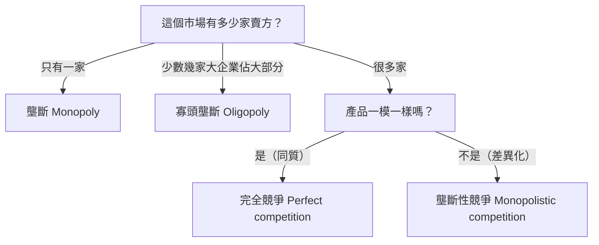

# 13 市場結構總覽 (Market Structures: An Overview)

> **對應課程**：**Week 11 – Marginal Cost/Average Cost & Market Structures**（市場結構的部分）· Study Area 3 (Decision Making by Firms) → **A4 SA3 任務**、**A5 Topic Activities**（Introduction to Market Structures 影片與測驗）。對應學習成果 4：*Describe the main characteristics of the four types of market structure and analyse the factors that affect the level of competition in each.*
>
> **本課資料來源**：
> - 解釋和例子以**標準教科書內容**為基礎，參考 OpenStax《Principles of Economics 3e》：[8.1 Perfect Competition and Why It Matters](https://openstax.org/books/principles-economics-3e/pages/8-1-perfect-competition-and-why-it-matters)、[9.1 How Monopolies Form: Barriers to Entry](https://openstax.org/books/principles-economics-3e/pages/9-1-how-monopolies-form-barriers-to-entry)、[10.1 Monopolistic Competition](https://openstax.org/books/principles-economics-3e/pages/10-1-monopolistic-competition)、[10.2 Oligopoly](https://openstax.org/books/principles-economics-3e/pages/10-2-oligopoly)。
> - 標 **✅ 官方定義** 的英文定義，一字不改引自 *MUF0061 Introduction to Microeconomics Definitions and Index*（Study Area 3，Topic 18–22）。標 **📘 教科書定義** 的是標準教科書的用字。
> - 真實例子都附上連結。
>
> **建議時間**：60–80 分鐘

## 本課學完，你要會：

- [ ] 用英文寫出 **market structure** 和四種市場結構的官方定義
- [ ] 分辨**同質產品 (homogeneous product)** 和**差異化產品 (differentiated product)**
- [ ] 用**一張表**比較四種市場結構：企業數量、產品、進入障礙、定價能力、例子
- [ ] 說出**進入障礙 (barriers to entry)** 的種類並舉例
- [ ] 判斷一個真實市場最接近哪一種結構，並說明理由

---

## 1. 什麼是市場結構？(Market structure)

### 白話解釋
**市場結構 = 用幾個特徵把市場分類。** 最重要的三個特徵：
1. **有多少家企業**在賣？（很多？幾家？一家？）
2. **產品有多像**？（一模一樣？有點不同？獨一無二？）
3. **新企業進來、舊企業離開容不容易**？

這三個特徵決定了第四件事：**企業能不能自己決定價格**。

### 生活例子
- 在菜市場買白菜：很多攤販、白菜都差不多、誰都可以來擺攤 → 每個攤販**沒辦法**自己抬高價格。
- 在深圳用電：電網只有一家公司經營 → 你**沒得選**。

> **✅ 官方定義 — Market structure**
> A classification system for markets, based on characteristics such as number of firms, degree of similarity of products and ease of entry into and exit from the market.

---

## 2. 兩種產品：同質 vs 差異化

| | **同質產品 (homogeneous product)** | **差異化產品 (differentiated product)** |
|---|---|---|
| 白話 | 不管跟誰買，**都一模一樣** | **很像**，但每家有**自己的特色** |
| 例子 | 同一等級的白米、菜市場的白菜、同一種規格的螺絲 | 不同品牌的奶茶、餐廳、髮廊、手機 |
| 消費者在意什麼？ | **只看價格** | 價格之外，還看**品牌、口味、品質、地點、服務、設計** |

> **✅ 官方定義 — Homogeneous product**
> A product that is identical to competing products from other suppliers.

> **✅ 官方定義 — Differentiated product**
> A product that is similar to competing products from other suppliers, but that contains distinguishing features or benefits.

---

## 3. 四種市場結構

### 3.1 完全競爭 (Perfect competition)

**白話**：**非常多**的小企業，賣**一模一樣**的產品，**自由進出**。每一家都太小，影響不了市場價格，只能**接受**市場價格——叫**價格接受者 (price taker)**。

**例子**：菜市場裡的蔬菜攤、種小麥或稻米的農夫（很接近完全競爭）。現實中**很少有百分之百**的完全競爭，但農產品市場很接近。

> **✅ 官方定義 — Perfect competition**
> A market structure that is easy to enter and exit, with many small firms selling homogenous products.
>（原文拼作 *homogenous*，意思和 *homogeneous* 一樣。）

> **✅ 官方定義 — Price taker**
> A firm who must accept the prevailing market price due to an inability to influence the market price on its own.

### 3.2 壟斷性競爭 (Monopolistic competition)

**白話**：**很多**小企業，賣**相似但有差異**的產品，**容易進出**。因為產品有特色，每一家對**自己的價格**有一點點控制力；但替代品很多，漲太多客人就跑了。企業常用**廣告、裝潢、新口味**來吸引客人（**非價格競爭 non-price competition**，[`15`](15_效率_壟斷性競爭與寡頭壟斷.md)）。

**例子**：學校附近的**奶茶店**、餐廳、髮廊、手機殼攤、服裝店。

> **✅ 官方定義 — Monopolistic competition**
> A market structure that is easy to enter and exit, with many small firms selling similar but differentiated products.

⚠️ 名字裡有「壟斷」，但它**不是**壟斷！它是「很多家競爭，但每家的產品有點獨特」。

### 3.3 寡頭壟斷 (Oligopoly)

**白話**：**少數幾家大企業**佔了市場的大部分，**進入障礙高**。最大的特點是**互相依賴 (mutual interdependence)**：一家降價、推新產品，其他幾家**一定會受影響、會回應**，所以每家做決定前都要**猜對手會怎麼做**（賽局理論，[`15`](15_效率_壟斷性競爭與寡頭壟斷.md)）。

**例子**：中國的**行動通訊**（中國移動、中國電信、中國聯通、中國廣電）、**外賣平台**、**智慧型手機**、**航空公司**、**石油公司**。

> **✅ 官方定義 — Oligopoly**
> A market structure with high barriers to entry, where a few large sellers have the majority of the market share and are mutually interdependent

> **✅ 官方定義 — Mutual interdependence**
> A condition whereby the actions of one firm will have an effect on the other firm/s.

### 3.4 壟斷 (Monopoly)

**白話**：**只有一家**企業，賣**沒有相近替代品**的產品，**進入障礙非常高**。它就是整個市場，所以可以**自己定價**——叫**價格制定者 (price maker)**。但它還是受**需求曲線**限制：價格越高，賣得越少（[`14`](14_完全競爭與壟斷.md)）。

**例子**：
- **電網**：中國只有兩家國有電網公司——國家電網和南方電網；南方電網負責廣東、廣西、雲南、貴州、海南五省區，**深圳供電局**是它的子公司。在深圳，你家的電只能經過這一家的電網送來。（來源：[Wikipedia – China Southern Power Grid](https://en.wikipedia.org/wiki/China_Southern_Power_Grid)）
- **香菸**：中國菸草 (China Tobacco) 在中國享有**法定壟斷 (legal monopoly)**，佔全國香菸銷售約 **96%**。（來源：[Wikipedia – China Tobacco](https://en.wikipedia.org/wiki/China_Tobacco)）
- **自來水**、受**專利**保護的新藥。

> **✅ 官方定義 — Monopoly**
> A market structure with very high barriers to entry, containing only one firm selling a unique product.

> **✅ 官方定義 — Price maker**
> A firm who has some control over the price of its product, due to being able to differentiate their product from competitors.

---

## 4. 四種市場結構一張表（**背這張表**）

| 特徵 | **完全競爭** (perfect competition) | **壟斷性競爭** (monopolistic competition) | **寡頭壟斷** (oligopoly) | **壟斷** (monopoly) |
|---|---|---|---|---|
| **企業數量** | 非常多、都很小 | 很多、都比較小 | **少數幾家大企業**佔大部分市場 | **一家** |
| **產品** | **同質**（一模一樣） | **差異化**（相似但有特色） | 同質或差異化都有可能 | **獨特**（沒有相近替代品） |
| **進入障礙** | **沒有**（自由進出） | **很低**（容易進出） | **高** | **非常高** |
| **定價能力** | **價格接受者**（沒有） | **一點點**（價格制定者，但受替代品限制） | **相當大**，但要考慮對手的反應 | **很大**（價格制定者），受需求曲線限制 |
| **企業面對的需求曲線** | **水平線** | 向右下傾斜，**比較平**（有彈性） | 向右下傾斜 | 向右下傾斜（= 整個市場的需求） |
| **非價格競爭**（廣告、品牌） | 沒有（產品都一樣，不用打廣告） | **很多** | **很多** | 有一些 |
| **長期利潤** | 只有**正常利潤** | 只有**正常利潤**（容易進入） | 可能有**超額利潤** | 可能有**超額利潤** |
| **例子** | 菜市場的蔬菜、農產品 | 奶茶店、餐廳、髮廊 | 手機、行動通訊、航空公司、外賣平台 | 電網、自來水、中國菸草 |

**從左到右**：企業越來越少、障礙越來越高、定價能力越來越大、競爭越來越少。

```text
 more competition                                         less competition
 <-------------------------------------------------------------------------->
 Perfect            Monopolistic           Oligopoly              Monopoly
 competition        competition
 many small firms   many small firms       a few large firms      one firm
 identical product  differentiated         identical or diff.     unique product
 no barriers        low barriers           high barriers          very high barriers
 price taker        some price control     interdependent         price maker
```

---

## 5. 進入障礙 (Barriers to entry)

### 白話解釋
**進入障礙 = 讓新企業很難（或不可能）進入市場的因素。** 障礙越高，現有企業越不怕新對手，越能**長期保持超額利潤**。

> **✅ 官方定義 — Barriers to entry**
> Factors that prevent a firm from entering a market as a seller.

### 進入障礙的種類（📘 標準教科書內容，OpenStax 9.1）

| 種類 | 白話 | 例子 |
|---|---|---|
| **規模經濟／自然壟斷** (economies of scale / natural monopoly) | 要生產非常多，平均成本才會低；一家大企業供應整個市場最便宜，新企業規模小、成本高，競爭不過 | 電網、自來水管線、地鐵（[`12`](12_成本曲線與規模經濟.md) 第 11 節） |
| **法律障礙** (legal barriers)：執照、政府特許、專利、版權 | 法律規定只有某家或少數幾家可以經營；**專利**讓發明者在一段時間內獨家生產 | 中國菸草的法定壟斷；電信營運需要政府執照；新藥的專利 |
| **控制關鍵資源** (control of essential resources) | 某家企業擁有生產一定需要的原料或資源 | 擁有唯一的礦場、唯一的水源 |
| **很高的開業成本** (high start-up costs) | 一開始就要投入很大一筆錢 | 建晶片廠、成立航空公司、建行動通訊網路 |
| **品牌忠誠和廣告** (brand loyalty and advertising) | 消費者習慣某個品牌，新品牌要花很多廣告費才能吸引客人 | 可口可樂、知名手機品牌 |
| **網路效應** (network effects) | 用的人越多，產品對每個人越有用，新產品很難搶客人 | 大家都用微信，所以很難換到別的通訊軟體 |
| **不正當的競爭手段** (anti-competitive behaviour) | 現有企業故意大幅降價把新對手趕走（掠奪性定價），或和供應商簽獨家合約 | 很多國家的競爭法禁止這些做法 |

---

## 6. 怎麼判斷一個市場是哪一種？



### 一步一步的例題

| 市場 | 第 1 問：幾家？ | 第 2 問：產品？ | 進入障礙 | 結論 |
|---|---|---|---|---|
| 菜市場的白菜 | 很多攤販 | 一模一樣 | 幾乎沒有 | **完全競爭**（很接近） |
| 學校附近的奶茶店 | 很多家 | 相似但有差異（口味、品牌） | 低（開一家店不難） | **壟斷性競爭** |
| 中國的行動通訊 | 幾家大企業 | 相似（都是通話和上網） | 高（要執照、要建網路） | **寡頭壟斷** |
| 深圳的電網 | 一家 | 沒有替代品 | 非常高（自然壟斷＋政府安排） | **壟斷** |
| 城市裡的髮廊 | 很多家 | 有差異（技術、服務、地點） | 低 | **壟斷性競爭** |
| 智慧型手機 | 幾個大品牌佔大部分 | 差異化 | 高（研發、品牌、規模） | **寡頭壟斷** |

---

## 7. 企業面對的需求曲線（預告 [`14`](14_完全競爭與壟斷.md)、[`15`](15_效率_壟斷性競爭與寡頭壟斷.md)）

```text
      (a) Perfect competition             (b) Monopolistic comp.              (c) Monopoly
    Price                               Price                               Price
      ^                                   ^                                   ^
      |                                   |                                   |
      |                                   |                                   |\\
      |                                   |                                   |  \\
      |                D                  |--------                           |    \\\
    P |---------------------              |        ---------D                 |       \\\
      |                                   |                 ----              |          \\
      |                                   |                                   |            \\\
      |                                   |                                   |               \\\
      |                                   |                                   |                  \D
      |                                   |                                   |                    \
      +-----------------------> Q         +-----------------------> Q         +-----------------------> Q
    0                                   0                                   0
      horizontal:                         fairly flat (elastic):              the market demand:
      firm = price taker                  many close substitutes              steeper (fewer substitutes)
```

- **(a) 完全競爭**：企業可以用市場價格 P **賣任何數量**，但只要比 P 貴一點，就沒人買 → **水平的需求曲線**（[`08`](08_需求價格彈性.md)：完全有彈性）。
- **(b) 壟斷性競爭**：漲價會流失**一部分**客人（有忠實客人，但替代品很多）→ 向右下傾斜、**比較平**。
- **(c) 壟斷**：企業就是整個市場，它的需求曲線就是**市場需求曲線** → 向右下傾斜。

---

## 8. 什麼因素影響競爭程度？（學習成果 4）

| 因素 | 競爭**較多**的情況 | 競爭**較少**的情況 |
|---|---|---|
| 企業的**數量和大小** | 很多家、都很小 | 幾家大企業或一家（看**市場佔有率**和**集中度比率**，[`15`](15_效率_壟斷性競爭與寡頭壟斷.md)） |
| **產品差異化** | 產品一樣，只能比價格 | 產品有特色，客人有品牌忠誠 |
| **進入和退出障礙** | 容易進出 | 障礙高（第 5 節） |
| **資訊** | 消費者很容易比價（例如網購平台） | 消費者不清楚其他選擇 |
| **政府政策** | 開放執照、執行競爭法 | 只發給少數執照、法定壟斷 |

競爭越多，通常**價格越低、選擇越多、企業越有動力提高效率**；競爭越少，企業越可能**賺超額利潤**（效率的比較在 [`15`](15_效率_壟斷性競爭與寡頭壟斷.md)）。

---

## 常見錯誤

1. ❌「壟斷性競爭 = 一種壟斷」。✅ 它有**很多**企業，只是每家產品有點不同。
2. ❌「大公司 = 壟斷」。✅ 壟斷是市場上**只有一家**賣方；很大的公司也可能在**寡頭**或競爭市場裡。
3. ❌「寡頭 = 市場上總共只有幾家企業」。✅ 重點是**少數幾家大企業佔了大部分**的市場（可能還有很多小企業），而且它們**互相依賴**。
4. ❌ 用超市、百貨公司當完全競爭的例子。✅ 完全競爭要**同質產品、很多小企業、自由進出**——菜市場的蔬菜、農產品比較接近。
5. ❌「差異化產品 = 完全不同的產品」。✅ 差異化產品**很相似**（都是奶茶），只是有**特色**。
6. ❌「價格制定者可以定任何價格、還賣得一樣多」。✅ 價格越高，需求量越少——還是受**需求曲線**限制。
7. ❌ 只寫「有進入障礙」。✅ 要寫出**哪一種**障礙，並舉例（規模經濟、執照、專利、高開業成本……）。

---

## 自我檢查

**Q1.** Define *market structure* and *oligopoly*.（用英文）

**Q2.** 把下面的市場分類到四種市場結構，並說明理由：
(a) 某個小鎮上唯一的自來水公司　(b) 深圳的火鍋餐廳　(c) 國際航空公司　(d) 菜市場的雞蛋　(e) 外賣平台

**Q3.** 下面每一個是哪一種**進入障礙**？
(a) 一家藥廠的新藥有 20 年的專利　(b) 建一個新的行動通訊網路要花幾百億元　(c) 大家都在用同一個社交平台，朋友都在上面　(d) 自來水管線由一家公司鋪設最便宜

**Q4.** 為什麼完全競爭的企業是**價格接受者**？如果它把價格定得比市場價格高，會發生什麼？

**Q5.** 比較壟斷性競爭和完全競爭：兩者有什麼**相同**和**不同**？

<details>
<summary>👉 點我看答案</summary>

**A1.**
- *Market structure: A classification system for markets, based on characteristics such as number of firms, degree of similarity of products and ease of entry into and exit from the market.*
- *Oligopoly: A market structure with high barriers to entry, where a few large sellers have the majority of the market share and are mutually interdependent.*

**A2.**
(a) **壟斷**：只有一家，沒有替代品，自然壟斷（鋪水管的規模經濟）。
(b) **壟斷性競爭**：很多家，產品有差異（口味、裝潢、服務），容易開新店。
(c) **寡頭壟斷**：少數大航空公司佔大部分市場；開航空公司的成本很高、要政府許可；一家降價，其他家會跟著反應。
(d) **完全競爭**（很接近）：很多攤販，雞蛋差不多一樣，容易進出。
(e) **寡頭壟斷**：少數平台佔了大部分市場；有網路效應，新平台很難進入；平台之間互相依賴（補貼大戰）。

**A3.** (a) **法律障礙（專利）**　(b) **很高的開業成本**　(c) **網路效應**　(d) **規模經濟／自然壟斷**

**A4.** 因為完全競爭的企業**非常小**，而且賣**一模一樣**的產品。它把價格定得比市場價格高，消費者會**全部**去別家買一樣的東西，它就**賣不出去**。它也沒有理由降價，因為用市場價格就能賣掉所有它想賣的數量。所以它只能**接受**市場價格。

**A5.**
- **相同**：都有**很多**企業、**容易進出**、**長期只有正常利潤**。
- **不同**：完全競爭賣**同質**產品（企業是價格接受者、沒有廣告）；壟斷性競爭賣**差異化**產品（每家有一點定價能力、有很多**非價格競爭**）。

</details>

---

## 這一課的重點

- **市場結構**按三個特徵分類：**企業數量、產品相似程度、進出的難易**。
- **完全競爭**：很多小企業、同質產品、自由進出 → **價格接受者**。
- **壟斷性競爭**：很多小企業、**差異化**產品、容易進出 → 一點定價能力、很多非價格競爭。
- **寡頭壟斷**：少數大企業佔大部分、進入障礙高、**互相依賴**。
- **壟斷**：一家企業、獨特產品、障礙非常高 → **價格制定者**（受需求曲線限制）。
- **進入障礙**：規模經濟（自然壟斷）、法律（執照、專利）、控制資源、高開業成本、品牌忠誠、網路效應、不正當競爭。

---

⬅️ 上一課：[12 成本曲線與規模經濟](12_成本曲線與規模經濟.md)　|　下一課 ➡️ [14 完全競爭與壟斷](14_完全競爭與壟斷.md)　|　[README 學習地圖](README.md)
