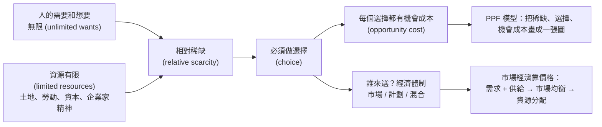

# MUFY 經濟學 學習地圖 (MUF0061 Introduction to Microeconomics Study Map)

> 給完全沒學過經濟學的你：這份指南從零開始，用生活例子、一步一步的計算和圖，教會你 MUF0061 的內容。
> 每個經濟學名詞第一次出現時，都會附上**英文** (English term)，因為你的作業和測驗是用英文。
> 📖 定義一律用官方 *MUF0061 Definitions and Index* 的英文原文，標示 **✅ 官方定義**——看到這個標記就照背。
> 🔒 每一項評量可以怎麼使用 AI 工具，規定寫在 **Moodle 上那一項任務的頁面**裡；這些筆記只用來學習，交出去的作業必須是你自己（和組員）寫的。

---

## 1. 這門課是什麼？（官方資料：Unit Guide、Timeline，加上你的 Moodle 課程頁）

**MUF0061 Introduction to Microeconomics**（Economics Unit 1），Monash College MUFY，2026 年第 2 學期，你在**深圳校區**上課。

**課程簡介**：個體經濟學——研究個人和企業如何做選擇，以及如何用**有限的資源**生產商品和服務，來滿足**無限的需要和想要**。

### 三個學習領域 (Study Areas)
| Study Area | 名稱 | 官方週數（Unit Guide） | 週次（官方建議時間表 Timeline） |
|---|---|---|---|
| 1 | The Economic Way of Thinking（經濟學的思考方式） | **3 weeks** | Week 1–3 |
| 2 | Markets in Action（市場的運作） | **6 weeks** | Week 4–9 |
| 3 | Decision Making by Firms（企業的決策） | **5 weeks** | Week 10–14 |

Unit Guide 補充：上課時間也會用來做**限時的評量**、評量前的**複習**和**小組合作**。

### 學習成果 (Unit learning outcomes)
1. Explain key economic concepts and the relationship between them.（解釋重要經濟概念和它們之間的關係）
2. Explain and illustrate the operation of the market system.（解釋並**用圖表示**市場制度如何運作）
3. Explain sources of market failure and reasons for government intervention in the market.（解釋市場失靈的原因和政府介入的理由）
4. Describe the main characteristics of the four types of market structure and analyse the factors that affect the level of competition in each.（描述四種市場結構並分析影響競爭程度的因素）
5. Evaluate perfect competition and monopoly in terms of efficiency.（從效率角度評價完全競爭和壟斷）

技能方面還包括：**畫圖和做表** (*construct diagrams and tables*)、**看懂和分析數字** (*interpret and analyse numerical data*)、**批判思考**、用多種來源研究並溝通經濟資訊。👉 也就是說：**畫圖、算數、寫解釋**三種能力都很重要。
Unit Guide 還列了**寫作能力**的要求（定義、描述、解釋、改寫、舉例、引用來源、限時寫簡答），白話整理在 [`考試技巧.md`](考試技巧.md) 第 8 節。

### 評量 (Assessments)——**沒有期末考**，總分 50% 以上才通過

| 評量 | 屬於哪個 Study Area | 比重 | 題型（Unit Guide） | 截止時間（你的 Moodle，**以這個為準**） | 準備用的檔案 |
|---|---|---|---|---|---|
| A1: MCQ Quiz | SA1 The Economic Way of Thinking | 10% | **20 題選擇題** (20 Multiple Choice Questions) | 2026/9/16（週三）晚上 9:55 | `01`–`06c` |
| A2: Skills and Application Task | SA2 Markets in Action | 25% | **選擇題 + 簡答題** (Multiple Choice Questions + Short Answer Questions) | — | Study Area 2 的內容（從 `07` 開始） |
| **A3: Group Essay** | **SA2 Markets in Action** | **25%** | 小組論文 | **2026/11/13（週五）晚上 8:59**（經 Turnitin 提交；Moodle 上有交件前的檢查清單） | `16_`；論文屬於 Study Area 2，相關內容在 `07`–`10` |
| **A4: Skills and Application Task** | **SA3 Decision Making by Firms** | **25%** | **選擇題 + 簡答題** (Multiple Choice Questions + Short Answer Questions) | **Week 14**（Revision Skills & Application Task SA3） | `11_`–`16_` |
| A5: Topic Activities | 全部 Study Areas | 15% | 每週測驗和活動、畫圖作業 (graph homework)、參與度 | 持續進行；**Week 13 Monopoly 畫圖作業 2026/11/27（週五）晚上 8:55** | 各週對應的檔案；畫圖看 `14_` 和 `考試技巧.md` 第 3 節 |

> 📅 **官方時間表只是「建議」**：Timeline 寫明它是 *suggested timeline*（建議時間表），主題和評量的時間 *may vary slightly according to local requirements*（可能依當地需要稍有不同）。官方建議的評量週是：MCQ Quiz **Week 4**、SAT SA2 **Week 7**、Group Essay **Week 10/11**、SAT SA3 **Week 14**；Topic Activities 在 Unit Guide 寫 *Ongoing*（持續進行），Timeline 把它列在 Week 14。
>
> **你真正的截止日期以 Moodle 為準**：Group Essay **2026/11/13（週五）晚上 8:59**、Week 13 Monopoly 畫圖作業 **2026/11/27（週五）晚上 8:55**、SA3 技能應用任務在 **Week 14**。

### 每週的學習節奏（課程建議的三步）
1. **Own time（課前）**：複習上週筆記、讀指定的 eBook、做 check-your-understanding、記下問題 ← **這份指南最適合在這一步用**
2. **Real-time（上課）**：參與、做筆記、發問
3. **Wrap up（課後）**：整理筆記、弄懂不清楚的地方、完成指定的閱讀和任務、逐步準備評量

---

## 2. 你現在在哪裡？接下來的計畫（今天是 2026/11/4，你的進度大約在 Week 8）

| 順序 | 時間 | 做什麼 | 讀哪個檔案 |
|---|---|---|---|
| ① | **現在** | Week 8 外部性與市場失靈：跟上這週的課 | [`10_外部性與市場失靈.md`](10_外部性與市場失靈.md) |
| ② | **11/13（週五）晚上 8:59 前** | **Group Essay**（屬於 Study Area 2：Markets in Action）：論文的結構、找資料、引用、和組員分工 | [`16_小組論文與技能應用任務準備.md`](16_小組論文與技能應用任務準備.md) |
| ③ | 論文交完之後 | **提前**預習 Week 10–13，比上課快一步 | [`11_`](11_經濟利潤與邊際報酬遞減.md) → [`12_`](12_成本曲線與規模經濟.md) → [`13_`](13_市場結構總覽.md) → [`14_`](14_完全競爭與壟斷.md) → [`15_`](15_效率_壟斷性競爭與寡頭壟斷.md) |
| ④ | **11/27（週五）晚上 8:55 前** | **Week 13 Monopoly 畫圖作業**。⚠️ 按你現在的進度，上課可能還沒教到壟斷 (Week 12)，所以一定要先自學 `14_` | [`14_完全競爭與壟斷.md`](14_完全競爭與壟斷.md) + [`考試技巧.md`](考試技巧.md) 第 3 節（畫圖檢查清單） |
| ⑤ | **Week 14** | **SA3 技能應用任務**（Study Area 3：企業的決策；選擇題 + 簡答題） | [`16_`](16_小組論文與技能應用任務準備.md) + [`練習題與答案_第6-14週.md`](練習題與答案_第6-14週.md) |
| 🔁 | 隨時 | **打好基礎**：Week 1–7 的觀念後面一直會用到——特別是**機會成本**（Week 10 經濟利潤會用到）和**需求、供給、均衡**（之後每個主題都會用到） | `01`–`07`、[`練習題與答案.md`](練習題與答案.md) |

---

## 3. Week 1–14 對照表：每週讀哪個檔案

| 週 | Moodle 上的週主題 | 檔案 |
|---|---|---|
| Week 1 | Introduction to Economics | [`01_經濟學是什麼.md`](01_經濟學是什麼.md)、[`02_生產要素.md`](02_生產要素.md)、[`03_機會成本.md`](03_機會成本.md)、[`04_經濟模型與其他條件不變.md`](04_經濟模型與其他條件不變.md) |
| Week 2 | PPF & Economic Systems | [`05_生產可能性曲線_基礎與計算.md`](05_生產可能性曲線_基礎與計算.md)、[`06_生產可能性曲線_形狀與移動.md`](06_生產可能性曲線_形狀與移動.md)、[`06b_經濟體制.md`](06b_經濟體制.md) |
| Week 3 | Behavioural Economics & Revision | [`06c_誘因與行為經濟學.md`](06c_誘因與行為經濟學.md)；複習 `01`–`06b` |
| Week 4 | Demand & Supply | [`07_需求供給與市場均衡.md`](07_需求供給與市場均衡.md) 第 1–4 節 |
| Week 5 | Market Equilibrium & Resource Allocation | [`07_需求供給與市場均衡.md`](07_需求供給與市場均衡.md) 第 5–10 節 |
| Week 6 | Price Elasticity of Demand (PED) | [`08_需求價格彈性.md`](08_需求價格彈性.md) |
| Week 7 | Revision for SA2 & Excise Taxes & Subsidies | [`09_消費稅與補貼.md`](09_消費稅與補貼.md) |
| Week 8 | Externalities | [`10_外部性與市場失靈.md`](10_外部性與市場失靈.md) |
| Week 9 | Group Essay Prep | [`16_小組論文與技能應用任務準備.md`](16_小組論文與技能應用任務準備.md) |
| Week 10 | Economic Profit & Law of Diminishing Returns | [`11_經濟利潤與邊際報酬遞減.md`](11_經濟利潤與邊際報酬遞減.md) |
| Week 11 | Marginal Cost/Average Cost & Market Structures | [`12_成本曲線與規模經濟.md`](12_成本曲線與規模經濟.md)、[`13_市場結構總覽.md`](13_市場結構總覽.md) |
| Week 12 | Perfect Competition (PC) & Monopoly | [`14_完全競爭與壟斷.md`](14_完全競爭與壟斷.md) |
| Week 13 | Efficiency, Monopolistic Competition & Oligopoly | [`15_效率_壟斷性競爭與寡頭壟斷.md`](15_效率_壟斷性競爭與寡頭壟斷.md) |
| Week 14 | Revision Skills & Application Task SA3 | [`16_小組論文與技能應用任務準備.md`](16_小組論文與技能應用任務準備.md) |

> 📌 週主題照你的 Moodle 課程頁。官方 Timeline（建議時間表）的排法有一點不同：它把 Resource Allocation 延續到 Week 6；把 Externalities 放在 Week 7、Excise Taxes and Subsidies 和 Group Essay preparation 放在 Week 8，Week 9 是 SAT SA2 的回饋；Moodle 則是 Week 7 稅與補貼、Week 8 外部性、Week 9 準備論文。上課順序以 Moodle 和老師的安排為準。

**全課程通用的檔案**

| 檔案 | 內容 |
|---|---|
| [`詞彙表.md`](詞彙表.md) | Week 1–5 中英名詞對照：**✅ 官方定義原文**（Study Area 1 全部，Study Area 2 到 Week 5）＋白話解釋 |
| [`詞彙表_第6-14週.md`](詞彙表_第6-14週.md) | Week 6–14 中英名詞對照 |
| [`練習題與答案.md`](練習題與答案.md) | Week 1–5 練習：選擇題、簡答題、計算/畫圖題（英文題目、中文詳解） |
| [`練習題與答案_第6-14週.md`](練習題與答案_第6-14週.md) | Week 6–14 練習 |
| [`考試技巧.md`](考試技巧.md) | 通用答題技巧：選擇題、定義、畫圖、計算、簡答結構、常見失分點、Unit Guide 的寫作能力要求 |

每一課的結構都一樣：**白話解釋 → 生活例子 → ✅ 官方英文定義（照背）→ 一步一步的例題 → 常見錯誤 → 自我檢查**（答案藏在可以點開的區塊裡，**先自己寫，再點開看**）。

---

## 4. 🙏 謝謝你上傳官方文件

你上傳的 *Definitions and Index*、*Unit Guide*、*Timeline* 三份官方文件都已經用上了：每一課的定義都換成了 **✅ 官方定義**原文，評量的題型和每個 Study Area 的週數也照 Unit Guide 更新了。

（可選）如果你手上有 **Week 6–14 的 eBook**，也可以上傳，讓 `08`–`16` 的例子和用字更貼近你的課程。

---

## 5. 資料來源：每份資料在哪裡用到？

| 資料（都來自你的 Moodle 課程） | 內容 | 對應本指南 |
|---|---|---|
| ✅ **官方** `MUF0061 Introduction to Microeconomics Definitions and Index.pdf` | 三個 Study Area 重要名詞的官方定義 | 每一課的 **✅ 官方定義**、[`詞彙表.md`](詞彙表.md) |
| ✅ **官方** `MUF0061 Introduction to Microeconomics Unit Guide.pdf` | 每個 Study Area 的週數、評量的題型和比重、學習成果、寫作能力要求 | 本頁第 1 節、[`考試技巧.md`](考試技巧.md) |
| ✅ **官方** `MUF0061 Introduction to Microeconomics Timeline.pdf` | 建議時間表 (suggested timeline)：每週主題和評量週 | 本頁第 1、3 節 |
| 你從 Moodle 複製的課程資訊 | 每週主題、評量名稱和比重、**真正的截止日期** | 本頁第 1–3 節 |
| `Why_Study_Economics.pptx` | 為什麼要學經濟學；經濟學能回答、能解決哪些問題 | `01` |
| `Lesson_1_Introduction_to_Economics.pptx`（課堂投影片） | 經濟學是什麼、個體 vs 總體、經濟問題、三個基本問題、四種生產要素與報酬 | `01`、`02` |
| `Chapter_1.1-1.2.docx` | 經濟學入門、相對稀缺、需要與想要、商品與服務、生產要素、個體/總體；機會成本與練習題 | `01`、`02`、`03` |
| `Introduction_to_Economics_eBook.epub` | 和 Chapter 1.1 幾乎相同 | `01`、`02` |
| `Lesson_2_Opportunity_cost_and_PPC.pdf`（課堂投影片） | 機會成本、PPC 的形狀、點的位置、曲線移動、練習題（其中一題標示 *AS 2022-11 #1*，看起來是引用劍橋 AS Level 經濟學考古題作練習） | `03`、`05`、`06` |
| `Chapter_1.3.docx` | 經濟模型、ceteris paribus、PPF、AustBus 與家具工廠、測驗、荒島 Rupert、PPF 移動與個體/總體活動 | `04`、`05`、`06` |
| `The_Law_of_Increasing_Opportunity_Costs.pptx` | 為什麼 PPF 是曲線：經濟體 Z、農夫與教授 | `06` |
| `Market_Equilibrium_eBook.epub` | 市場、市場均衡、過剩與短缺、價格機制、四種移位情況 | `07` |

Week 2 的經濟體制、Week 3 的誘因與行為經濟學、Week 4 的需求和供給，你**沒有上傳**對應的 eBook。這些地方的**定義已經換成 ✅ 官方定義**；只有**解釋和例子**還是**標準教科書內容**（OpenStax《Principles of Economics 2e》），課文中都有標示（`06b`、`06c` 和 `07` 第 2–4、10 節）。

**用詞提醒**：課堂投影片用 **PPC (Production Possibility Curve)**，課程模組和 eBook 用 **PPF (Production Possibilities Frontier)**——**同一個東西**。官方定義表也用 *Production Possibilities Frontier*，所以寫 PPF。

### ⚠️ 資料裡幾處「文字和圖對不上」的地方（課文中都以圖上的數字為準重新算過）

投影片偶爾會有小筆誤，這很正常。下面幾處建議上課時向老師確認一下：

| 位置 | 問題 | 本指南的處理 |
|---|---|---|
| `Lesson_2` PDF 第 5 頁（直線 PPF） | 方框文字說 B 從 60 增加到 90 要「放棄 90 單位 A」、「每多 1 單位 B 的機會成本是 30 單位 A」；但同一張圖上 A 是從 200 減到 160，也就是**放棄 40 單位 A、得到 30 單位 B** | 依圖計算：1 個 B ≈ **1.33 個 A**（40 ÷ 30）；1 個 A = **0.75 個 B**（30 ÷ 40）（`06` 課） |
| `Lesson_2` PDF 第 6 頁 | 寫「extra Xo – X1 consumer goods」：這裡的「–」很可能是「從 Xo 到 X1」的意思，不算錯；但如果當成減法來讀，X0 − X1 會是負數 | 自己用減法寫「多了多少」時，寫成 **X1 − X0**（大減小）（`05` 課） |
| `The_Law_of_Increasing_Opportunity_Costs` 第 3–4 頁 | 問題寫「first 20 university degrees」，但圖上每一段是 **20,000** 個學位 | 依圖理解成每段 20,000 個；答案 10、20、50 百萬農產品是對的（`06` 課） |
| `Chapter_1.3.docx` 圖 2（家具工廠） | 圖上的點沒有按比例畫；C 點的數字（1200 椅、320 桌）讓機會成本不是每一段都遞增 | 計算一律用**表格上的數字**，並說明這個小瑕疵（`05` 課） |

### 📌 官方定義和課本、投影片用字不同的地方（寫定義時用官方的）

| 名詞 | 課本／投影片／教科書的說法 | ✅ 官方定義表的說法 |
|---|---|---|
| Incentive | 教科書分成 *positive incentive* 和 *negative incentive* | **incentive** 是正面的好處；負面的叫 **disincentive**（`06c`） |
| Ceteris paribus | 課本：*all other things remain unchanged* | *all other things being equal*，意思一樣（`04`） |
| PPF | 課本說 PPF 是展示稀缺、選擇和機會成本的**模型**；投影片說 *two or more goods* | 一條**曲線**，畫出**兩種產品**的所有最大產量組合（`05`） |
| Opportunity cost | 課本：*…alternative lost when making a decision* | 原文多一個 **is**：*…alternative is lost when making a decision*（`03`） |
| Entrepreneurship | 投影片的說法強調**承擔風險** | 官方定義講的是組合資源、追求利潤的**創造力**，沒有提到 risk（`02`） |
| Planned economy | 教科書常叫 *command economy* | 官方名稱是 **planned economy**（`06b`） |
| Market、Market equilibrium、Price mechanism | eBook 的句子比較長（例如價格機制寫成 *the system or process whereby changes in demand and supply …*） | 官方的句子比較短，照官方背（`07`） |

---

## 6. 一張圖看懂 Week 1–5 的邏輯

**記住這條線：資源有限 + 慾望無限 → 稀缺 → 選擇 → 機會成本 → PPF；社會用不同的經濟體制做選擇，市場經濟靠價格機制來分配稀缺的資源。**

---

資料來源（依優先順序）：① 官方文件——*MUF0061 Definitions and Index*、*Unit Guide*、*Timeline*（你上傳的 PDF）；② 你從 Moodle 複製的課程資訊（真正的截止日期、週主題）；③ 你上傳的課堂投影片和課程模組／eBook；④ 標準教科書 OpenStax《Principles of Economics 2e》（只用在沒有課程資料的地方）。較早的版本曾參考合作學院的公開手冊（Sunway College *MUFY Student Guide 2023*：<https://sunwaycollege.edu.my/sites/default/files/documents/MUFY_Student_Guide_2023.pdf>；JIC *MUFY – Subject Units*：<https://jic.ac.id/subject-units-mufy>），現已改用官方資料。
