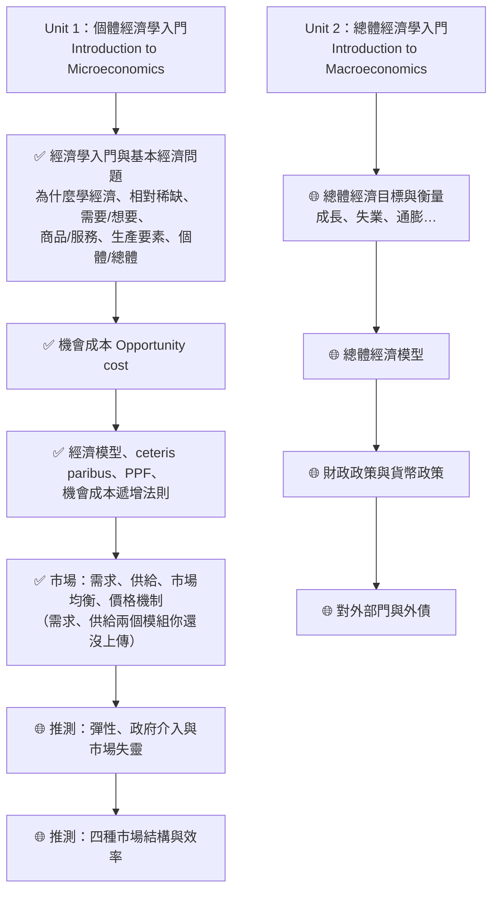
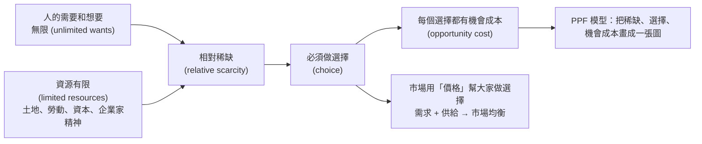

# MUFY 經濟學 學習地圖 (MUFY Economics Study Map)

> 給完全沒學過經濟學的你：這份指南從零開始，用生活例子、一步一步的計算和圖，把你上傳的課程內容教會你。
> 每個經濟學名詞第一次出現時，都會附上**英文** (English term)，因為你的考試是用英文。

---

## 0. 這份指南怎麼用？

1. 先讀這一頁，知道整門課長什麼樣子、你手上的資料在哪個位置。
2. 按照下面的「建議學習順序」讀 `01` → `07` 課。每一課都是同一個結構：
   - **白話解釋** → **生活例子** → **課程的英文正式定義** → **一步一步的例題** → **常見錯誤** → **自我檢查**（答案藏在可以點開的區塊裡）。
3. 讀完每一課，馬上做那一課的「自我檢查」。**先自己寫答案，再點開看**。
4. 全部讀完後，做 [`練習題與答案.md`](練習題與答案.md)，再看 [`考試技巧.md`](考試技巧.md)。
5. 遇到不懂的英文名詞，查 [`詞彙表.md`](詞彙表.md)。

---

## 1. MUFY 經濟學是什麼？

**MUFY** = Monash University Foundation Year（蒙納士大學預科），是進入 Monash University（蒙納士大學）本科之前的一年預備課程，由 Monash College 及其合作學院開設。你在深圳校區上課，所有資料都來自你自己的 Monash Moodle 課程頁。

在 MUFY 裡，**每一個科目都分成兩個單元 (Unit 1 和 Unit 2)**。根據合作學院公開的資料，經濟學 (Economics) 是這樣分的：

| 單元 | 課程代碼 | 名稱 | 內容一句話 |
|---|---|---|---|
| Economics Unit 1 | MUF0061 | Introduction to Microeconomics（個體經濟學入門） | 個人、家庭、公司怎麼做決定；市場怎麼運作 |
| Economics Unit 2 | MUF0062 | Introduction to Macroeconomics（總體經濟學入門） | 整個國家的經濟：成長、失業、通膨、政府政策、對外貿易 |

### 1.1 資訊來源：哪些已確認、哪些要再核對？

- ✅ **已確認（來自你的 Moodle 檔案）**：Unit 1 開頭的內容包括：為什麼要學經濟學、經濟學入門、相對稀缺、生產要素、個體 vs 總體經濟學、機會成本、經濟模型、其他條件不變 (ceteris paribus)、生產可能性曲線 (PPF)、機會成本遞增法則，以及**市場均衡 (market equilibrium)**。你的 `Chapter_1.3.docx` 還寫明 *"This task contributes towards your grade for participation in the unit"*，代表**課堂參與 (participation) 會計分**。
- 🌐 **來自合作學院的公開手冊（2023 年版）**：上面的課程代碼、下面的學習成果 (learning outcomes) 和評分比例，來自 Sunway College（馬來西亞的 MUFY 合作學院）的 *MUFY Student Guide 2023*，JIC 的 MUFY 單元介紹網頁內容也一致。MUFY 很可能是一套**標準化的課程**，各校區用同樣的單元，**但請一定用你自己 Moodle 上的 Unit Guide 確認**。我無法打開 Monash College 官網的課程頁（伺服器拒絕存取，HTTP 403），所以沒辦法用官網核對。
  - Sunway College, *MUFY Student Guide 2023*：<https://sunwaycollege.edu.my/sites/default/files/documents/MUFY_Student_Guide_2023.pdf>
  - JIC, *MUFY – Subject Units*：<https://jic.ac.id/subject-units-mufy>
  - Sunway College MUFY 課程頁：<https://sunwaycollege.edu.my/programmes/pre-university-foundation/monash-university-foundation-year>

### 1.2 Unit 1 的學習成果 (Learning outcomes)（🌐 合作學院手冊 2023）

Unit 1 結束時，你應該能夠（原文）：

- Explain key economic concepts and the relationship between them.（解釋重要經濟概念和它們之間的關係）
- Explain and illustrate the operation of the market system.（解釋並**用圖表示**市場制度如何運作）← 就是 `07` 課的需求、供給、市場均衡
- Explain sources of market failure and reasons for government intervention in the market.（解釋市場失靈的原因、政府為什麼要介入）
- Describe the main characteristics of the four types of market structure and analyse the factors that affect the level of competition in each.（描述四種市場結構的特徵）
- Evaluate perfect competition and monopoly in terms of efficiency.（從效率角度評價完全競爭和壟斷）

技能方面還包括：*Interpret and analyse numerical data*（看懂和分析數字資料）、*Construct diagrams and tables to represent economic data*（畫圖和做表）、*Think critically about economic issues*（批判思考）。
👉 這說明：**畫圖、算數、寫解釋**三種能力都會考。

### 1.3 評分方式（🌐 合作學院手冊 2023，只作參考）

| Unit 1 (MUF0061) 評分項目 | 比重 | Unit 2 (MUF0062) 評分項目 | 比重 |
|---|---|---|---|
| Skills and Application Task SA1（技能應用任務） | 10% | Skills and Application Task SA1 | 10% |
| Skills and Application Task SA2 | 15% | Group Research Presentation（小組研究報告） | 20% |
| Group Essay（小組論文） | 20% | Research Essay（研究論文） | 20% |
| Group Research Presentation（小組研究報告） | 15% | Skills and Application Task SA3 | 10% |
| Participation（課堂參與） | 10% | Participation | 10% |
| Examination（期末考試） | 30% | Examination | 30% |

同一份手冊還寫到：
- 平時作業 (coursework) 佔 70%，期末考 (final examination) 佔 30%。
- **Unit 1 和 Unit 2 都要各自達到 50% 才算通過整個科目**。例如 Unit 1 拿 40%、Unit 2 拿 70%，平均雖然超過 50%，**仍然不算通過經濟學**。
- 要先通過 Unit 1 才能讀 Unit 2，或兩個 Unit 同時讀。
- 等第：HD (High Distinction) 80–100、D (Distinction) 70–79、C (Credit) 60–69 …

### 1.4 ✅ 請你在 Moodle 上核對這幾件事（很簡單的清單）

打開你的 Moodle 課程頁（`learning.monash.edu/course/view.php?id=48787`，需要登入），找 **Unit Guide（單元指南）**、**Assessment（評分）** 或 **Schedule（課程進度）** 之類的區塊，看看：

- [ ] **單元代碼**：是不是 MUF0061（Unit 1）？
- [ ] **每週主題表**：第 1 週、第 2 週…各教什麼？（這樣我們就知道 PPF 之後是什麼）
- [ ] **評分項目和比重**：有哪些作業/小測/報告/考試？各佔幾 %？什麼時候交？
- [ ] **考試形式**：選擇題？簡答題？要畫圖嗎？可以帶計算機嗎？

📸 **把這些頁面上傳或截圖給我**，我可以幫你把這份指南調整成完全對應你的課程（例如補上你們每週的主題、按評分比重決定複習重點）。

---

## 2. 你上傳的資料是什麼？在課程的哪裡？

| 你的檔案（都來自你的 Moodle 課程） | 內容 | 對應本指南 |
|---|---|---|
| `Why_Study_Economics.pptx`（Monash College 投影片） | 為什麼要學經濟學；經濟學能回答哪些問題、解決哪些問題 | `01` |
| `Lesson_1_Introduction_to_Economics.pptx`（課堂投影片） | 經濟學是什麼、個體 vs 總體、經濟問題（稀缺、選擇、資源分配）、三個基本問題、四種生產要素與報酬 | `01`、`02` |
| `Chapter_1.1-1.2.docx`（課程模組文字） | 1.1 經濟學入門、相對稀缺、需要與想要、商品與服務、四種生產要素、個體/總體經濟學；1.2 機會成本與練習題 | `01`、`02`、`03` |
| `Introduction_to_Economics_eBook.epub`（課程 eBook，內容和 1.1 幾乎相同） | 經濟學定義、相對稀缺、需要與想要、資源/商品/服務、個體與總體經濟學 | `01`、`02` |
| `Lesson_2_Opportunity_cost_and_PPC.pdf`（課堂投影片） | 機會成本、PPC 的形狀、點的位置、曲線移動、練習題（其中一題標示 *AS 2022-11 #1*，看起來是引用劍橋 AS Level 經濟學考古題作練習） | `03`、`05`、`06` |
| `Chapter_1.3.docx`（課程模組文字） | 經濟模型、假設、ceteris paribus、PPF、AustBus 與家具工廠例子、課堂測驗、小組活動（荒島 Rupert、PPF 外移、個體或總體？） | `04`、`05`、`06` |
| `The_Law_of_Increasing_Opportunity_Costs.pptx`（Monash College 投影片） | 為什麼 PPF 是曲線而不是直線：經濟體 Z（農產品 vs 大學學位）、農夫與教授的例子 | `06` |
| `Market_Equilibrium_eBook.epub`（課程 eBook） | 市場、市場均衡、過剩與短缺、價格機制、需求/供給增加或減少的四種情況 | `07` |

**用詞提醒：** 課堂投影片用 **PPC (Production Possibility Curve)**，課程模組和 eBook 用 **PPF (Production Possibilities Frontier)**。**兩個是同一個東西**，考試時兩種寫法都看得懂；建議跟著課程模組寫 PPF。

### 2.1 ⚠️ 資料裡幾處「文字和圖對不上」的地方（我幫你檢查過了）

老師做投影片時偶爾會有小筆誤，這很正常。下面這幾處，**我在課文中都以圖上的數字為準重新算過**，但建議你上課時向老師確認一下：

| 位置 | 問題 | 本指南的處理 |
|---|---|---|
| `Lesson_2` PDF 第 5 頁（直線 PPF） | 方框文字說 B 從 60 增加到 90 要「放棄 90 單位 A」、「每多 1 單位 B 的機會成本是 30 單位 A」；但圖上 A 是從 200 減到 160，也就是**放棄 40 單位 A、得到 30 單位 B** | 依圖計算：1 個 B 的機會成本 = 40 ÷ 30 ≈ **1.33 個 A**；1 個 A 的機會成本 = 30 ÷ 40 = **0.75 個 B**（見 `06` 課） |
| `Lesson_2` PDF 第 6 頁 | 寫「extra Xo – X1 consumer goods」，但 X1 比 Xo 大，這樣減會得到負數 | 多生產的數量應寫成 **X1 – X0**（見 `05` 課） |
| `The_Law_of_Increasing_Opportunity_Costs` 第 3–4 頁 | 問題寫「first 20 university degrees」，但圖上每一段是 **20,000** 個學位（0 → 20,000 → 40,000 → 60,000） | 依圖理解成每段 20,000 個學位；答案的 10、20、50 百萬農產品是對的（見 `06` 課） |
| `Chapter_1.3.docx` 圖 2（家具工廠） | 圖上點的位置沒有按比例畫；而且 C 點的數字（1200 椅子、320 桌子）讓機會成本不是每一段都遞增 | 計算一律用**表格上的數字**；並說明這個小瑕疵（見 `05` 課） |

---

## 3. 整門課的地圖

- ✅ = 你的檔案裡有，本指南 `01`–`07` 課詳細教。
- 🌐 = 根據合作學院手冊的學習成果推測，**順序和細節要用你的 Moodle 核對**。在 [`後續主題預覽.md`](後續主題預覽.md) 有簡短預覽。
- 線索：`Market_Equilibrium_eBook` 寫著 *"Refer back to your learning about the law of supply and the law of demand"*，而且它的練習叫 *"CHECK YOUR UNDERSTANDING 3"*——表示在市場均衡之前，課程還有**需求 (demand)** 和**供給 (supply)** 兩個模組。你沒有上傳那兩個模組，所以 `07` 課裡「需求定律、供給定律、非價格因素」的部分是我用**標準教科書內容**補上的（課文中有標示），請和你的 Moodle 對照。

---

## 4. 本指南的檔案

| 檔案 | 內容 | 預計時間 |
|---|---|---|
| [`01_經濟學是什麼.md`](01_經濟學是什麼.md) | 為什麼學經濟學、經濟學的定義、相對稀缺、需要 vs 想要、商品 vs 服務、選擇與取捨、三個基本經濟問題、個體 vs 總體經濟學 | 70–90 分鐘 |
| [`02_生產要素.md`](02_生產要素.md) | 土地、勞動、資本、企業家精神；各自的報酬（租金、工資、利息、利潤）；資本財 vs 消費財 | 45–60 分鐘 |
| [`03_機會成本.md`](03_機會成本.md) | 機會成本的定義、三步驟找法、所有課本例題的完整解答、計算公式 | 60–80 分鐘 |
| [`04_經濟模型與其他條件不變.md`](04_經濟模型與其他條件不變.md) | 什麼是模型、為什麼要假設、ceteris paribus | 30–40 分鐘 |
| [`05_生產可能性曲線_基礎與計算.md`](05_生產可能性曲線_基礎與計算.md) | PPF 的定義、假設、畫法、曲線上/內/外的點、從 PPF 計算機會成本 | 80–100 分鐘 |
| [`06_生產可能性曲線_形狀與移動.md`](06_生產可能性曲線_形狀與移動.md) | 直線 vs 向外凸、機會成本遞增法則（農夫與教授）、PPF 外移/內移/單邊移動、資本財 vs 消費財、個體還是總體 | 90–110 分鐘 |
| [`07_需求供給與市場均衡.md`](07_需求供給與市場均衡.md) | 市場、需求定律、供給定律、移動 vs 移位、均衡、過剩、短缺、價格機制、四種移位情況 | 100–120 分鐘 |
| [`詞彙表.md`](詞彙表.md) | 中英對照名詞表，每個名詞一句白話解釋 | 隨時查 |
| [`練習題與答案.md`](練習題與答案.md) | 選擇題、簡答題、計算/畫圖題（英文題目、中文詳解） | 3 小時 |
| [`考試技巧.md`](考試技巧.md) | 怎麼寫定義、怎麼畫圖、簡答題結構、常見失分點 | 30 分鐘 |
| [`後續主題預覽.md`](後續主題預覽.md) | 彈性、政府介入、市場失靈、市場結構、總體經濟（依網路資料推測） | 30 分鐘 |

---

## 5. 建議學習順序與計畫（約三週版）

> 每天 1–1.5 小時。考試很近的話可以壓縮，但**不要跳過自我檢查和練習題**。

| 天 | 做什麼 | 完成標準 |
|---|---|---|
| 第 1 天 | 讀 `01` 第 1–4 節（為什麼學、經濟學、相對稀缺、需要/想要） | 能用英文背出 *Economics* 和 *Relative scarcity* 的定義 |
| 第 2 天 | 讀 `01` 第 5–8 節（商品/服務、取捨、三個基本問題、個體/總體），做 `01` 自我檢查 | 能把 10 個例子分成 micro 或 macro |
| 第 3 天 | 讀 `02`，做自我檢查 | 能說出四種生產要素 + 各自的報酬，並舉例 |
| 第 4 天 | 讀 `03` 前半（定義、三步驟、個人例子） | 能用「三步驟」說明任何一個機會成本例子 |
| 第 5 天 | 讀 `03` 後半（課本練習題、公司例子、計算公式），做自我檢查 | 能算出「1 個 X 的機會成本 = 幾個 Y」 |
| 第 6 天 | 讀 `04`，做自我檢查；複習 `01`–`03` 的定義 | 能解釋 ceteris paribus 並舉例 |
| 第 7 天 | **休息或複習**：把所有英文定義寫一遍 | 不看書寫出 8 個定義 |
| 第 8 天 | 讀 `05` 第 1–4 節（PPF 定義、假設、畫法） | 能從表格自己畫出 PPF，軸和標題都標好 |
| 第 9 天 | 讀 `05` 第 5–8 節（點的位置、算機會成本），做自我檢查 | 家具工廠表格每一段的機會成本都會算 |
| 第 10 天 | 讀 `06` 第 1–3 節（直線 vs 凸出、機會成本遞增法則） | 能用「農夫與教授」解釋為什麼 PPF 向外凸 |
| 第 11 天 | 讀 `06` 第 4–8 節（PPF 移動、資本財 vs 消費財、個體/總體），做自我檢查 | 能畫出外移、內移、單邊移動三種圖 |
| 第 12 天 | 讀 `07` 第 1–4 節（市場、需求、供給、移動 vs 移位） | 能分清 *increase in demand* 和 *expansion of demand* |
| 第 13 天 | 讀 `07` 第 5–8 節（均衡、過剩、短缺、價格機制） | 能用 Product X 的數字說出 $12 和 $8 時發生什麼 |
| 第 14 天 | 讀 `07` 第 9–10 節（四種移位情況），做自我檢查 | 四張圖都能自己畫、每一步都會寫 |
| 第 15 天 | 做 `練習題與答案.md` 的 A、B 部分 | 正確率 ≥ 80%；錯的題目回去讀對應課 |
| 第 16 天 | 做 `練習題與答案.md` 的 C 部分（計算與畫圖），讀 `考試技巧.md` | 畫圖題全部有標題、軸名、標籤 |
| 第 17 天 | 讀 `後續主題預覽.md`；把錯題再做一次 | 知道下一個主題是什麼 |

---

## 6. 一張圖看懂目前學過的邏輯

**記住這條線：資源有限 + 慾望無限 → 稀缺 → 選擇 → 機會成本 → PPF；而「市場」是社會做選擇的一種方法，靠價格來分配稀缺的東西。**
