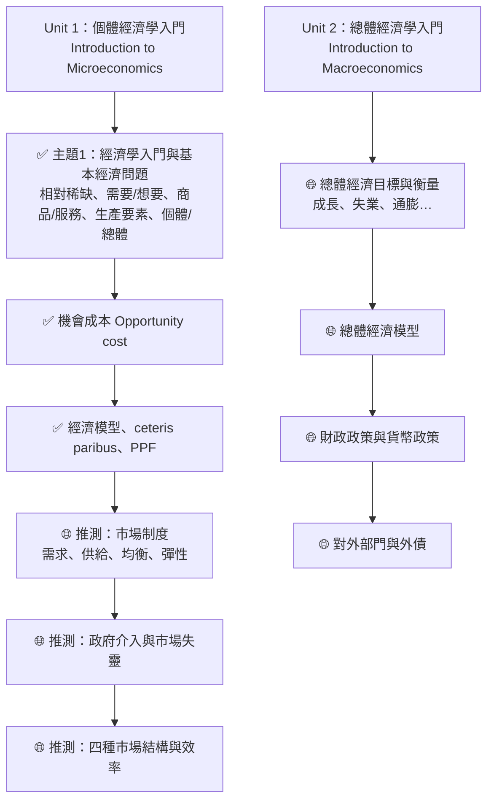
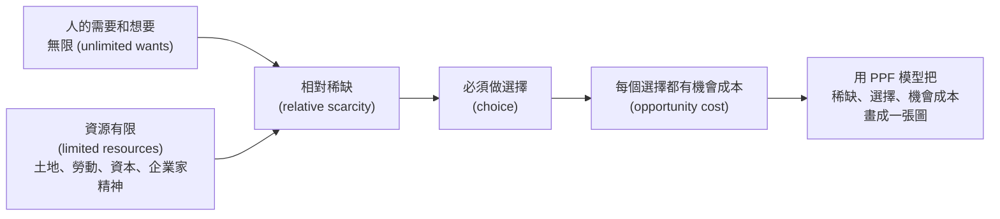

# MUFY 經濟學 學習地圖 (MUFY Economics Study Map)

> 給完全沒學過經濟學的你：這份指南會從零開始，用生活例子、一步一步的計算和圖，把你上傳的課程內容教會你。
> 每個經濟學名詞第一次出現時，都會附上**英文** (English term)，因為你的考試是用英文。

---

## 0. 這份指南怎麼用？

1. 先讀這一頁，知道整門課長什麼樣子、你手上的資料在哪個位置。
2. 按照下面的「建議學習順序」讀 `01` → `06` 課。每一課都是同一個結構：
   - **白話解釋** → **生活例子** → **課程的英文正式定義** → **一步一步的例題** → **常見錯誤** → **自我檢查**（答案藏在可以點開的區塊裡）。
3. 讀完每一課，馬上做那一課的「自我檢查」。**先自己寫答案，再點開看**。
4. 全部讀完後，做 [`練習題與答案.md`](練習題與答案.md)，再看 [`考試技巧.md`](考試技巧.md)。
5. 遇到不懂的英文名詞，查 [`詞彙表.md`](詞彙表.md)。

---

## 1. MUFY 經濟學是什麼？

**MUFY** = Monash University Foundation Year（蒙納士大學預科）。它是讀 Monash University（蒙納士大學）本科之前的一年預備課程，由 **Monash College** 開設（在馬來西亞等地也有合作學院開設，例如 Sunway College）。

在 MUFY 裡，**每一個科目都分成兩個單元 (Unit 1 和 Unit 2)**。經濟學 (Economics) 也是這樣：

| 單元 | 課程代碼 | 名稱 | 內容一句話 |
|---|---|---|---|
| Economics Unit 1 | MUF0061 | Introduction to Microeconomics（個體經濟學入門） | 個人、家庭、公司怎麼做決定；市場怎麼運作 |
| Economics Unit 2 | MUF0062 | Introduction to Macroeconomics（總體經濟學入門） | 整個國家的經濟：成長、失業、通膨、政府政策、對外貿易 |

**來源標示說明**（很重要，請注意分辨）：

- ✅ **已確認（來自你的檔案）**：Unit 1 一開始的內容 = 經濟學入門、相對稀缺、生產要素、個體 vs 總體經濟學、機會成本、經濟模型、其他條件不變 (ceteris paribus)、生產可能性曲線 (PPF)。你的 `Chapter_1.3.docx` 也寫明「What is a model?」這個活動 *"contributes towards your grade for participation in the unit"* —— 代表**課堂參與 (participation) 會計分**。
- 🌐 **來自網路（不是你學校官方頁面，可能和你的版本不同）**：課程代碼、學習成果 (learning outcomes)、評分比例，來自 Sunway College（馬來西亞的 MUFY 合作學院）2023 年的學生手冊，以及 jic.ac.id 轉載的 MUFY 單元介紹。Monash College 澳洲官網的課程頁面在我搜尋時拒絕存取 (HTTP 403)，所以**無法從官方頁面直接核對**。
  - Sunway College, *MUFY Student Guide 2023*：<https://sunwaycollege.edu.my/sites/default/files/documents/MUFY_Student_Guide_2023.pdf>
  - JIC, *MUFY – Subject Units*：<https://jic.ac.id/subject-units-mufy>
  - Sunway College MUFY 課程頁：<https://sunwaycollege.edu.my/programmes/pre-university-foundation/monash-university-foundation-year>

> ⚠️ **一定要做的事**：登入你學校的 Moodle / LMS，找到 **Unit Guide（單元指南）**，核對你自己那一期的評分項目和考試日期。下面的評分表只是「參考」。

### 1.1 Unit 1 的學習成果 (Learning outcomes)（🌐 來源：Sunway MUFY Student Guide 2023）

Unit 1 結束時，你應該能夠（原文）：

- Explain key economic concepts and the relationship between them.（解釋重要經濟概念和它們之間的關係）
- Explain and illustrate the operation of the market system.（解釋並**用圖表示**市場制度如何運作）
- Explain sources of market failure and reasons for government intervention in the market.（解釋市場失靈的原因、政府為什麼要介入）
- Describe the main characteristics of the four types of market structure and analyse the factors that affect the level of competition in each.（描述四種市場結構的特徵）
- Evaluate perfect competition and monopoly in terms of efficiency.（從效率角度評價完全競爭和壟斷）

技能方面還包括：*Interpret and analyse numerical data*（看懂和分析數字資料）、*Construct diagrams and tables to represent economic data*（畫圖和做表）、*Think critically about economic issues*（批判思考）。
👉 這說明：**畫圖、算數、寫解釋**三種能力都會考。

### 1.2 評分方式（🌐 參考：Sunway MUFY Student Guide 2023，可能與你的學校不同）

| Unit 1 (MUF0061) 評分項目 | 比重 | Unit 2 (MUF0062) 評分項目 | 比重 |
|---|---|---|---|
| Skills and Application Task SA1（技能應用小測/作業） | 10% | Skills and Application Task SA1 | 10% |
| Skills and Application Task SA2 | 15% | Group Research Presentation（小組研究報告） | 20% |
| Group Essay（小組論文） | 20% | Research Essay（研究論文） | 20% |
| Group Research Presentation（小組研究報告） | 15% | Skills and Application Task SA3 | 10% |
| Participation（課堂參與） | 10% | Participation | 10% |
| Examination（期末考試） | 30% | Examination | 30% |

同一份手冊還寫到：
- 平時作業 (coursework) 佔 70%，期末考 (final examination) 佔 30%。
- **Unit 1 和 Unit 2 都要各自達到 50% 才算通過整個科目**。例如 Unit 1 拿 40%、Unit 2 拿 70%，平均雖然超過 50%，**仍然不算通過經濟學**。
- 學生必須先通過 Unit 1 才能讀 Unit 2，或兩個 Unit 同時讀。
- 等第：HD (High Distinction) 80–100、D (Distinction) 70–79、C (Credit) 60–69 …（以你學校公布為準）

---

## 2. 你上傳的資料是什麼？在課程的哪裡？

| 你的檔案 | 來源判斷 | 內容 | 對應本指南 |
|---|---|---|---|
| `Chapter_1.1-1.2.docx` | Monash College 課程模組文字（檔案內有 lms.monashcollege.edu.au 的連結） | 1.1 經濟學入門、相對稀缺、需要與想要、商品與服務、四種生產要素、個體/總體經濟學；1.2 機會成本與練習題 | `01`、`02`、`03` |
| `Introduction_to_Economics_eBook.epub` | Monash College eBook（內容和 1.1 幾乎相同） | 經濟學定義、相對稀缺、需要與想要、資源/商品/服務、個體與總體經濟學 | `01`、`02` |
| `Chapter_1.3.docx` | Monash College 課程模組文字 | 經濟模型、假設、ceteris paribus、PPF、AustBus 與家具工廠例子、課堂測驗、小組活動（荒島 Rupert、PPF 外移、個體或總體？） | `04`、`05`、`06` |
| `Lesson_1_Introduction_to_Economics.pptx` | **新東方 (XDF) 補習班**投影片（每頁有新東方標誌），不是 Monash 官方 | 經濟學是什麼、個體 vs 總體、經濟問題（稀缺、選擇、資源分配）、三個基本問題、四種生產要素與報酬 | `01`、`02` |
| `Lesson_2_Opportunity_cost_and_PPC.pdf` | **新東方 (XDF) 補習班**投影片，其中引用了劍橋 AS Level 考題（標示 AS 2022-11 #1） | 機會成本、PPC 的形狀、點的位置、曲線移動、測驗題 | `03`、`05`、`06` |

**重要提醒：**
- 補習班投影片用 **PPC (Production Possibility Curve)**，Monash 課本用 **PPF (Production Possibilities Frontier)**。**兩個是同一個東西**。考 Monash 的試時，建議用課本的 PPF 寫法。
- 補習班投影片有一處文字和圖上數字對不上（在 `06` 課有說明），所以**以 Monash 的課本定義為準**。

---

## 3. 整門課的地圖

- ✅ = 你的檔案裡有，本指南 `01`–`06` 課詳細教。
- 🌐 = 根據網路上的學習成果推測，**順序和細節可能和你的學校不同**。在 [`後續主題預覽.md`](後續主題預覽.md) 有簡短預覽。
- 線索：你的 `Chapter_1.3.docx` 說 *"You will read more about ceteris paribus in the next module"*，而且舉例「香蕉供給減少時價格會怎樣」、「替代品 B 降價時 A 的需求量會怎樣」——這證明**下一個模組就是需求與供給 (demand and supply)**。

---

## 4. 本指南的檔案

| 檔案 | 內容 | 預計時間 |
|---|---|---|
| [`01_經濟學是什麼.md`](01_經濟學是什麼.md) | 經濟學的定義、相對稀缺、需要 vs 想要、商品 vs 服務、選擇與取捨、三個基本經濟問題、個體 vs 總體經濟學 | 60–80 分鐘 |
| [`02_生產要素.md`](02_生產要素.md) | 土地、勞動、資本、企業家精神；各自的報酬（租金、工資、利息、利潤）；資本財 vs 消費財 | 45–60 分鐘 |
| [`03_機會成本.md`](03_機會成本.md) | 機會成本的定義、三步驟找法、所有課本例題的完整解答、計算公式 | 60–80 分鐘 |
| [`04_經濟模型與其他條件不變.md`](04_經濟模型與其他條件不變.md) | 什麼是模型、為什麼要假設、ceteris paribus | 30–40 分鐘 |
| [`05_生產可能性曲線_基礎與計算.md`](05_生產可能性曲線_基礎與計算.md) | PPF 的定義、假設、畫法、曲線上/內/外的點、從 PPF 計算機會成本 | 80–100 分鐘 |
| [`06_生產可能性曲線_形狀與移動.md`](06_生產可能性曲線_形狀與移動.md) | 直線 vs 向外凸（固定 vs 遞增的機會成本）、PPF 外移/內移/單邊移動、資本財 vs 消費財、個體還是總體 | 80–100 分鐘 |
| [`詞彙表.md`](詞彙表.md) | 中英對照名詞表，每個名詞一句白話解釋 | 隨時查 |
| [`練習題與答案.md`](練習題與答案.md) | 選擇題、簡答題、計算/畫圖題（英文題目、中文詳解） | 2–3 小時 |
| [`考試技巧.md`](考試技巧.md) | 怎麼寫定義、怎麼畫圖、簡答題結構、常見失分點 | 30 分鐘 |
| [`後續主題預覽.md`](後續主題預覽.md) | 需求與供給、彈性、市場失靈、市場結構、總體經濟（網路資料推測） | 30 分鐘 |

---

## 5. 建議學習順序與計畫（兩週版）

> 每天 1–1.5 小時。如果考試很近，可以壓縮成 4–5 天，但**不要跳過自我檢查和練習題**。

| 天 | 做什麼 | 完成標準 |
|---|---|---|
| 第 1 天 | 讀 `01` 第 1–4 節（經濟學、相對稀缺、需要/想要、商品/服務） | 能用英文背出 *Economics* 和 *Relative scarcity* 的定義 |
| 第 2 天 | 讀 `01` 第 5–7 節（取捨、三個基本問題、個體/總體），做 `01` 自我檢查 | 能把 10 個例子分成 micro 或 macro |
| 第 3 天 | 讀 `02`，做自我檢查 | 能說出四種生產要素 + 各自的報酬，並舉例 |
| 第 4 天 | 讀 `03` 前半（定義、三步驟、個人例子） | 能用「三步驟」說明任何一個機會成本例子 |
| 第 5 天 | 讀 `03` 後半（課本練習題、公司例子、計算公式），做自我檢查 | 能算出「1 個 X 的機會成本 = 幾個 Y」 |
| 第 6 天 | 讀 `04`，做自我檢查；複習 `01`–`03` 的定義 | 能解釋 ceteris paribus 並舉例 |
| 第 7 天 | **休息或複習**：把所有英文定義寫一遍 | 不看書寫出 8 個定義 |
| 第 8 天 | 讀 `05` 第 1–4 節（PPF 定義、假設、畫法） | 能從表格自己畫出 PPF，軸和標題都標好 |
| 第 9 天 | 讀 `05` 第 5–7 節（點的位置、算機會成本），做自我檢查 | 家具工廠表格每一段的機會成本都會算 |
| 第 10 天 | 讀 `06` 第 1–3 節（直線 vs 凸出，固定 vs 遞增機會成本） | 能解釋「為什麼 PPF 通常向外凸」 |
| 第 11 天 | 讀 `06` 第 4–7 節（PPF 移動、資本財 vs 消費財、個體/總體），做自我檢查 | 能畫出外移、內移、單邊移動三種圖 |
| 第 12 天 | 做 `練習題與答案.md` 的 A、B 部分 | 正確率 ≥ 80%；錯的題目回去讀對應課 |
| 第 13 天 | 做 `練習題與答案.md` 的 C 部分（計算與畫圖），讀 `考試技巧.md` | 畫圖題全部有標題、軸名、標籤 |
| 第 14 天 | 讀 `後續主題預覽.md`；把錯題再做一次 | 知道下一個主題是什麼 |

---

## 6. 一張圖看懂第一章的邏輯

**記住這條線：資源有限 + 慾望無限 → 稀缺 → 選擇 → 機會成本 → PPF。** 第一章所有內容都在這條線上。
